# GraphGuard — Big Data Graph Analytics for Fraud & Anti-Money Laundering (AML) Detection

[](https://www.python.org/)
[](https://spark.apache.org/)
[](https://graphframes.github.io/graphframes/docs/0.12.2/index.html)
[](https://adoptium.net/)
[](src/common/spark_session.py)
[-success?style=flat-square)](docs/Project_Code_Audit_2026-10-22.md)

> [!IMPORTANT]
> **Lưu ý về Tập Dữ liệu IBM AML**: Trong khuôn khổ dự án này, nhóm nghiên cứu sử dụng tập dữ liệu **IBM Transactions for Anti-Money Laundering (AML) — biến thể HI-Small** (gồm 5.078.345 giao dịch và 518.581 tài khoản), được sinh bởi bộ sinh giả lập **AMLworld** (mô tả trong công trình NeurIPS 2023 của IBM Research). Dự án **không** sử dụng các biến thể quy mô lớn hơn (HI-Medium, HI-Large) hay bộ dữ liệu phát sinh từ công cụ AMLSim riêng lẻ.

Trong các định chế tài chính và ngân hàng thương mại hiện đại, khối lượng giao dịch số hóa bùng nổ lên tới hàng chục triệu bút toán mỗi ngày. Đi cùng với đó là sự tinh vi vượt bậc của tội phạm tài chính: các đường dây rửa tiền có tổ chức (Money Laundering Syndicates) sử dụng kỹ thuật chia nhỏ dòng tiền (smurfing/layering) luân chuyển qua hàng trăm tài khoản rác (mule accounts), trong khi các vụ gian lận chiếm đoạt tài khoản (Account Takeover Fraud) thực hiện tẩu tán tài sản thần tốc qua ví điện tử và rút tiền mặt (cash-out). 

Các hệ thống giám sát giao dịch truyền thống dựa trên tập luật tĩnh (Rule-Based Systems — ví dụ cảnh báo khi số tiền vượt \$200.000) đang đứng trước sự phá sản thực tế: chúng vừa bỏ lọt các thủ đoạn cấu trúc tinh vi (Recall dưới 1%), vừa tạo ra hàng chục nghìn cảnh báo sai (False Positives). Tình trạng này gây nên hội chứng **"Mệt mỏi vì Cảnh báo" (Alert Fatigue)**, làm tê liệt và tiêu tốn hàng nghìn giờ làm việc vô ích của đội ngũ chuyên viên tuân thủ (Compliance Operations).

**GraphGuard** được xây dựng nhằm giải quyết tận gốc bài toán nghiệp vụ này thông qua nền tảng Phân tích Đồ thị Dữ liệu lớn (Big Data Graph Analytics) trên Apache Spark và GraphFrames. Bằng cách mô hình hóa toàn bộ hệ thống thanh toán thành một đồ thị mạng lưới khổng lồ, GraphGuard kết hợp sức mạnh của 3 nguồn tri thức cấu trúc:
1. **Định vị Vị thế Nút Mạng (Topological Centrality)**: Nhận diện các trạm trung chuyển và hố đen dòng tiền qua Degree và Damped PageRank.
2. **Cấu trúc Vi mô Quá khứ (Strict-Past Temporal Motifs)**: Phát hiện chu trình rửa tiền khép kín (3-Cycles) và mẫu hình chuyển tiếp rút tiền mặt (2-Hop Relays) theo cửa sổ trượt 24h/168h.
3. **Ngữ cảnh Phân cụm Cộng đồng (Synchronous Weighted Label Propagation - LPA)**: Khoanh vùng các tổ chức tội phạm ẩn danh trong mạng lưới liên ngân hàng.

Toàn bộ quy trình được tích hợp vào mô hình học máy phân loại giao dịch có trọng số chống mất cân bằng nhãn cực đoan (tỷ lệ gian lận chỉ từ 0,10% đến 0,13%), tuân thủ nguyên tắc **chống rò rỉ dữ liệu tương lai tuyệt đối (Strict Anti-Leakage Temporal Protocol)**, đã được nghiệm thu và kiểm chứng thực nghiệm trên **11.440.965 giao dịch** và **9.592.481 tài khoản** tại môi trường native Windows PowerShell.

---

## Danh mục Dữ liệu & Công trình Nghiên cứu Tham chiếu (Datasets & Academic References)

| Tài nguyên / Dữ liệu | Định dạng & Quy mô | Nguồn / Bài báo Khoa học | Vai trò trong GraphGuard |
| :--- | :--- | :--- | :--- |
| **PaySim Mobile Money** | 6.362.620 edges<br>9.073.900 vertices | [Kaggle Dataset](https://www.kaggle.com/datasets/ealaxi/paysim1)<br>[Lopez-Rojas et al. (EMSS 2016) Paper](https://www.msc-les.org/proceedings/emss/2016/EMSS2016_249.pdf) | **Core Dataset**: Mô phỏng dòng tiền ví di động, phát hiện gian lận tài khoản mule qua mẫu hình chuyển tiếp rút tiền mặt (`TRANSFER → CASH_OUT`). |
| **IBM Transactions for AML (HI-Small)** | 5.078.345 edges<br>518.581 vertices | [Kaggle Dataset](https://www.kaggle.com/datasets/ealtman2019/ibm-transactions-for-anti-money-laundering-aml)<br>[Altman et al. (NeurIPS 2023) Paper](https://research.ibm.com/publications/realistic-synthetic-financial-transactions-for-anti-money-laundering-models)<br>[IBM AML-Data GitHub Repo](https://github.com/IBM/AML-Data) | **Bonus Dataset**: Mô phỏng hệ thống liên ngân hàng đa tiền tệ sinh bởi AMLworld, phát hiện chu trình rửa tiền khép kín ($A \to B \to C \to A$) và kiểm chứng tính tái sử dụng qua Adapter. |
| **IBM AMLSim Simulator** | Codebase giả lập | [IBM AMLSim GitHub Repo](https://github.com/IBM/AMLSim) | *Tài liệu đối chiếu*: Công cụ mô phỏng liên quan nhưng độc lập với bộ sinh dữ liệu AMLworld HI-Small. |
| **GraphFrames Core** | Spark Graph Engine | [GraphFrames Architecture](https://graphframes.io/01-about/02-architecture.html)<br>[GraphFrames Motif Finding](https://graphframes.io/04-user-guide/04-motif-finding.html) | Khung tính toán phân tán xử lý đồ thị hàng triệu nút/cạnh trên Spark DataFrame. |
| **Apache Spark GraphX** | Graph Analytics Foundation | [Spark GraphX Programming Guide](https://spark.apache.org/docs/latest/graphx-programming-guide.html) | Cơ sở lý thuyết về Vertex-Cut Partitioning, Pregel API và thuật toán PageRank/LPA. |

---

## 5 Câu hỏi Nghiên cứu Cốt lõi (Research Questions & Empirical Findings)

Dự án GraphGuard được định hướng và giải quyết triệt để thông qua 5 câu hỏi nghiên cứu (RQ1 – RQ5):

* **RQ1 — Tính Toàn vẹn & Khả năng Tái lập của Đồ thị (Graph Integrity & Windows Reproducibility)**:
  * *Câu hỏi*: Liệu có thể chuyển đổi toàn bộ hàng triệu giao dịch thô của PaySim và IBM AML thành GraphFrame hợp lệ, không mất mát và có khả năng tái lập độc lập trên môi trường native Windows không?
  * *Kết luận*: **ĐẠT**. Cổng kiểm định ETL và đối chiếu 2 chiều xác nhận $\text{Raw} - \text{Parquet} = 0$ và $\text{Parquet} - \text{Raw} = 0$. Không có bất kỳ giá trị `null`, không có đỉnh lặp và $0$ cạnh treo (zero dangling edges). Native Quality Gate vượt qua 44 unit tests với mã thoát $0$.
* **RQ2 — Định vị Vai trò Trung tâm & Khử bẫy Hấp thụ (Centrality Hubs & Sink Trap Resolution)**:
  * *Câu hỏi*: Các thước đo Degree và Damped PageRank phản ánh những tài khoản nào giữ vai trò trung tâm huyết mạch, và xử lý thế nào trước sự áp đảo của hàng triệu tài khoản thương nhân?
  * *Kết luận*: Trên PaySim, bậc vào cực đại lên tới $113$ (tài khoản tụ gom tiền `C1286084959`), trong khi có tới $2.150.401$ tài khoản Merchant chỉ nhận tiền và không bao giờ chuyển đi (Sink Nodes). Bằng cách áp dụng Damped PageRank ($d = 0,85$, 10 iterations) kết hợp cơ chế dịch chuyển tức thời đồng đều (Uniform Teleportation), GraphGuard ngăn chặn triệt để hiện tượng hố đen hút cạn rank, bảo tồn tổng năng lượng mạng lưới $\sum \text{Rank} = |V|$.
* **RQ3 — Khám phá Cấu trúc Đồ thị & Chuyển dịch Mẫu hình (Topological Discovery & Relay Motifs)**:
  * *Câu hỏi*: Vì sao trên toàn bộ 6,36 triệu giao dịch PaySim hoàn toàn không xuất hiện chu trình 3 đỉnh có hướng ($0$ directed 3-cycles), và giải pháp thay thế bằng mẫu hình chuyển tiếp rút tiền mặt (`TRANSFER → CASH_OUT`) mang lại giá trị gì?
  * *Kết luận*: PaySim mang bản chất dòng tiền tẩu tán một chiều (Acyclic system-exit flow). Khi kẻ gian chiếm đoạt tài khoản, tiền lập tức được chuyển sang tài khoản trung gian (mule) rồi rút tiền mặt ra khỏi hệ sinh thái di động. Việc chuyển đổi phân tích sang **2-Hop Relay Motif** đã bắt trúng hành vi rút tiền của tài khoản mule, giúp tăng Recall thêm $+6,42\%$ điểm phần trăm và nâng AP từ $17,00\%$ lên $26,58\%$.
* **RQ4 — Cấu trúc Phân cụm Cộng đồng & Phân bổ Rủi ro (LPA Community Profiling & Risk Enrichment)**:
  * *Câu hỏi*: Thuật toán lan truyền nhãn đồng bộ (Synchronous LPA) tạo ra các cộng đồng có đặc trưng gì về quy mô, dòng tiền, loại hình giao dịch và tỷ lệ nhiễm nhãn tội phạm?
  * *Kết luận*: Cấu trúc cộng đồng tuân theo phân bố đuôi dài dạng Zipf (trên PaySim hình thành 5,43 triệu cụm, trên IBM hình thành 314.722 cụm). Tỷ lệ giao dịch vượt biên giới cụm (`cross_fraction`) và kích thước cụm (`comm_size`) cung cấp ngữ cảnh mạnh mẽ giúp mô hình nhận diện các tổ chức rửa tiền liên ngân hàng có quy mô lớn.
* **RQ5 — Đối chiếu Đa Hình thái & Khả năng Mở rộng Kiến trúc (Cross-Morphology & Adapter Extensibility)**:
  * *Câu hỏi*: Bộ dữ liệu liên ngân hàng IBM AML HI-Small khác biệt như thế nào so với PaySim về hình thái mạng lưới, và kiến trúc GraphGuard có thể tái sử dụng qua cơ chế Adapter hay không?
  * *Kết luận*: Khác hoàn toàn với tính chất phi chu trình của PaySim, đồ thị IBM AML xuất hiện $54$ chu trình 3 đỉnh khép kín theo thời gian và $591.212$ tự giao dịch nội bộ ($11,64\%$). Thông qua `DatasetAdapter` chuẩn hóa schema, toàn bộ các module phân tích Degree, PageRank, Sweep-line Motifs và Weighted Decision Tree đã được tái sử dụng thành công $100\%$ mà không cần viết lại lõi thuật toán.

---

## 1. Tóm tắt Kết quả Nghiệm thu Thực nghiệm (Executive Summary & Business Impact)

Trong quản trị rủi ro ngân hàng, mục tiêu cốt lõi của một hệ thống phòng chống rửa tiền và gian lận không phải là tạo ra thật nhiều cảnh báo, mà là đạt được sự cân bằng tối ưu giữa **Độ chuẩn xác (Precision)** để tiết kiệm ngân sách điều tra và **Tỷ lệ phát hiện (Recall / Average Precision)** để giảm thiểu tổn thất tín dụng và tránh các án phạt triệu đô từ cơ quan thanh tra (FATF / Ngân hàng Nhà nước).

Kết quả thực nghiệm trên hai bộ dữ liệu thực tế cho thấy giá trị thực tiễn vượt trội của việc tích hợp đồ thị:
- **Trên tập dữ liệu Rửa tiền Liên ngân hàng (IBM AML HI-Small)**: Mô hình tích hợp toàn diện (`full_fusion`) nâng độ chuẩn xác cảnh báo từ 9,07% lên 10,09% và Average Precision từ 5,62% lên 5,87%. Ý nghĩa nghiệp vụ quan trọng nhất là hệ thống đã **cắt giảm 4.628 cảnh báo sai (giảm 48,3% khối lượng cảnh báo rác từ 9.584 xuống 4.956)**, trực tiếp giải phóng gần một nửa áp lực thẩm tra cho đội ngũ chuyên viên tuân thủ.
- **Trên mạng lưới Thanh toán Di động (PaySim Mobile Money)**: Mô hình đồ thị (`without_centrality`) nắm bắt chuẩn xác hành vi gom tiền của các tài khoản mule, nâng mạnh Recall từ 19,67% lên 26,09%, **bắt thêm 273 vụ gian lận thực tế (tổng 1.109 vụ so với 836 vụ của baseline)**, đẩy Average Precision tăng từ 17,00% lên 26,58%.

### 1.1. Quy mô Xử lý Dữ liệu Toàn diện (Full-Scale Ingestion)

| Tập dữ liệu | Nghiệp vụ Mục tiêu | Số giao dịch (Edges) | Số tài khoản (Vertices) | Nhãn dương (Positives) | Tỷ lệ nhãn (Prevalence) | Số cộng đồng (LPA) | Họ mô hình được chọn trên Validation | Ngưỡng $\theta$ | Kích thước Test Holdout |
| :--- | :--- | :---: | :---: | :---: | :---: | :---: | :---: | :---: | :---: |
| **IBM AML (HI-Small)** | Rửa tiền đa ngân hàng (Laundering) | 5.078.345 | 518.581 | 5.177 | 0,1019% | 314.722 | **`full_fusion` (T+C+M+L)** | 0,50 | 1.017.821 tx (1.799 pos) |
| **PaySim Mobile** | Chiếm đoạt tài khoản (Fraud Cash-Out) | 6.362.620 | 9.073.900 | 8.213 | 0,1291% | 5.433.491 | **`without_centrality` (T+M+L)** | 0,70 | 1.248.736 tx (4.250 pos) |

### 1.2. Hiệu quả Đồ thị so với Baseline Giao dịch Thuần túy

| Tập dữ liệu | Họ mô hình (Model Family) | Ngưỡng $\theta$ | Precision | Recall | F1-Score | Average Precision (AP) | Cảnh báo (Alerts) | True Positives (TP) | False Positives (FP) | 95% Wilson CI (Precision) |
| :--- | :--- | :---: | :---: | :---: | :---: | :---: | :---: | :---: | :---: | :---: |
| **IBM AML** | `transaction_only` (Baseline) | 0,50 | 9,07% | **48,30%** | **15,27%** | 5,62% | 9.584 | 869 | 8.715 | [8,51%, 9,66%] |
| **IBM AML** | **`full_fusion` (Được chọn)** | 0,50 | **10,09%** *(+1,02%)* | 27,79% | 14,80% | **5,87%** *(+0,25%)* | **4.956** *(-48,3%)* | 500 | 4.456 | [9,28%, 10,96%] |
| **PaySim** | `transaction_only` (Baseline) | 0,70 | **81,01%** | 19,67% | 31,65% | 17,00% | 1.032 | 836 | 196 | [78,50%, 83,28%] |
| **PaySim** | **`without_centrality` (Được chọn)** | 0,70 | 58,12% | **26,09%** *(+6,42%)* | **36,02%** *(+4,37%)* | **26,58%** *(+9,58%)* | 1.908 | **1.109** *(+273)* | 799 | [55,90%, 60,32%] |
| **PaySim** | `full_fusion` (Đối chứng đầy đủ) | 0,70 | 58,31% | 26,00% | 35,96% | **28,98%** *(+11,98%)* | 1.895 | 1.105 | 790 | [56,08%, 60,51%] |

> **Nguyên tắc Đánh giá Khoa học Trung thực (Scientific Integrity Standards)**:
> - **Minh bạch về Trade-Off trên IBM**: Họ `full_fusion` trên IBM AML giúp tăng độ tập trung điều tra (Precision tăng, AP tăng, alerts giảm một nửa), nhưng Recall và F1 giảm so với baseline đơn biến vốn phát cảnh báo bừa bãi. Báo cáo không dùng thuật ngữ thiên vị như "mọi chỉ số đều tăng".
> - **Đóng băng Quy tắc Trước khi Đo lường (Rule Freezing)**: Cả hai họ mô hình chiến thắng đều được quyết định dựa trên kết quả trung bình của 3-Fold Walk-Forward Validation. Tập kiểm tra Test hoàn toàn được giữ bí mật (holdout) cho đến khâu đánh giá cuối cùng; tuyệt đối không dùng kết quả Test để chọn lại mô hình hay tinh chỉnh ngưỡng.

---

## 2. Kiến trúc Pipeline Thống nhất & Giao thức Chống Rò rỉ Thời gian

Trong kiểm toán mô hình ngân hàng, một hệ thống AI dù có điểm số thực nghiệm cao đến đâu cũng sẽ bị cơ quan quản lý đình chỉ nếu vi phạm **Rò rỉ Dữ liệu Tương lai (Lookahead Bias / Data Leakage)** — nghĩa là sử dụng các giao dịch xảy ra vào ngày mai để tính toán đặc trưng và ra quyết định cho một giao dịch diễn ra vào hôm nay. 

Để đáp ứng các tiêu chuẩn khắt khe nhất của thanh tra tài chính, GraphGuard thiết lập một quy trình 7 giai đoạn khép kín (Stages 0–6), phân tách rạch ròi giữa phân tích toàn cảnh và trích xuất đặc trưng nhân quả quá khứ:

### 2.1. Sơ đồ Khái quát 7 Giai đoạn (7-Stage Pipeline Overview)

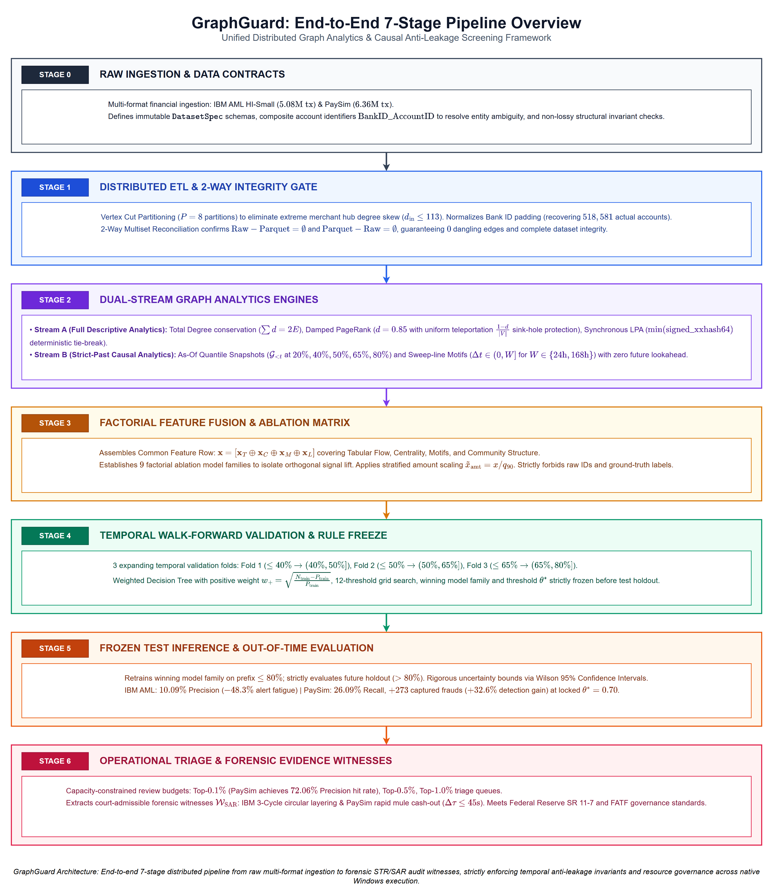
> 📥 *Mã nguồn sơ đồ Draw.io gốc (chỉnh sửa / mở rộng)*: [graphguard_pipeline_overview.drawio](report/figures/graphguard_pipeline_overview.drawio)


### Hợp đồng Dữ liệu Đồ thị (Graph Data Contracts)

Để cho phép các module phát triển độc lập và đảm bảo tính tương thích mở rộng giữa hai tập dữ liệu, GraphGuard định nghĩa hai bản giao kèo dữ liệu bất biến:

#### 1. PaySim Contract v1 (Chuẩn hóa Mạng Di động)
- **Đỉnh (Vertices)**: `id: string` (Mã định danh tài khoản duy nhất), `account_type: string` ('C' Customer hoặc 'M' Merchant), `balance: double` (Số dư tài khoản tại snapshot gần nhất).
- **Cạnh (Edges)**: `src: string` (Tài khoản nguồn), `dst: string` (Tài khoản đích), `amount: double` (Số tiền chuyển dịch), `step: int` (Giờ mô phỏng 1–744), `type: string` (1 trong 5 loại hình giao dịch), `isFraud: short` (Nhãn gian lận thực tế 0 hoặc 1).
- **Ràng buộc Toàn vẹn (Invariants)**: Mã đỉnh duy nhất và không `null`; $0$ cạnh treo (mọi `src` và `dst` bắt buộc phải tồn tại trong tập đỉnh); tổng số cạnh khớp chính xác với số dòng CSV thô ($6.362.620$).

#### 2. IBM AML Adapter Contract (Chuẩn hóa Mạng Liên ngân hàng Đa tiền tệ)
- **Đỉnh (Vertices)**: `id: string` (Mã định danh hợp nhất dạng `BankID_AccountID` chống trùng lặp chuỗi), `bank_id: string`, `account_id: string`, `account_type: string`.
- **Cạnh (Edges)**: `src: string`, `dst: string`, `amount_paid: double`, `amount_received: double`, `timestamp: timestamp` (Thời gian thực), `from_currency: string`, `to_currency: string`, `payment_format: string` (Kênh thanh toán ACH, Wire, Cheque, v.v.), `is_laundering: short` (Nhãn rửa tiền 0 hoặc 1).
- **Ràng buộc Chuẩn hóa (Bank ID Normalization)**: Đệm số 0 ở mã ngân hàng để triệt tiêu các đỉnh phân mảnh "External/Unknown", khôi phục chuẩn xác $518.581$ tài khoản thực tế.

---

### Phân tích Chuyên sâu Các Giai đoạn Thực thi (Detailed Phase Execution)

1. **Stage 0 — Nạp Dữ liệu Đa Định dạng & Ký kết Hợp đồng Dữ liệu (Raw Ingestion & Data Contract)**:
   - Hệ thống tiếp nhận nguồn cấp dữ liệu tài chính đa dạng qua `DatasetSpec`: IBM AML chứa dữ liệu 11 định chế ngân hàng và 15 loại tiền tệ; PaySim chứa nhật ký giao dịch tiền di động (Mobile Money log) với 5 loại hình thanh toán.

   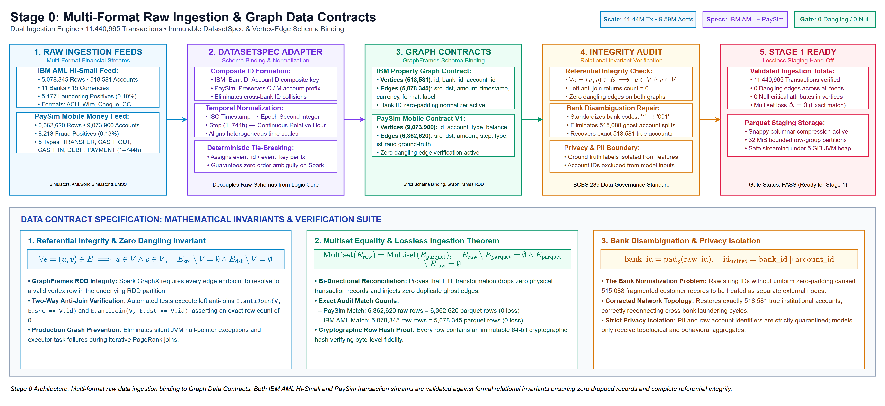
   > 📥 *Mã nguồn sơ đồ Draw.io gốc (chỉnh sửa / mở rộng)*: [stage0_raw_ingestion.drawio](report/figures/stage0_raw_ingestion.drawio)

2. **Stage 1 — ETL Phân tán & Cổng Kiểm định Toàn vẹn 2 Chiều (Distributed ETL & Integrity Gate)**:
   - **Phân vùng Cắt Đỉnh (Vertex Cut Partitioning)**: Giải quyết điểm nghẽn mạng do tính chất lệch bậc cực đoan trong thanh toán bán lẻ (In-degree của PaySim đạt tới 113). Dữ liệu được nén dạng Snappy Parquet (giảm từ 500 MB xuống 272,9 MB).
   - **Sửa Lỗi Tách Đôi Danh tính Ngân hàng (Bank ID Normalization)**: Chuẩn hóa đệm số 0 ở mã ngân hàng trong IBM ETL, triệt tiêu 515.088 đỉnh ma "External/Unknown" và khôi phục chính xác 518.581 tài khoản thực.
   - **Đối chiếu Toàn vẹn 2 Chiều (Two-Way Multiset Reconciliation)**: Xác nhận sự trùng khớp tuyệt đối giữa CSV thô và Parquet: $\text{Raw} - \text{Parquet} = 0$ và $\text{Parquet} - \text{Raw} = 0$, cam kết $0$ cạnh treo (dangling edges) và $0$ giá trị `null`.
   - **Chỉ mục Vật lý Bất biến**: Sinh `event_id` cho từng giao dịch vật lý và `event_key` để phá vỡ thế hòa (tie-breaking) hoàn toàn khách quan, không chứa nhãn gian lận.

   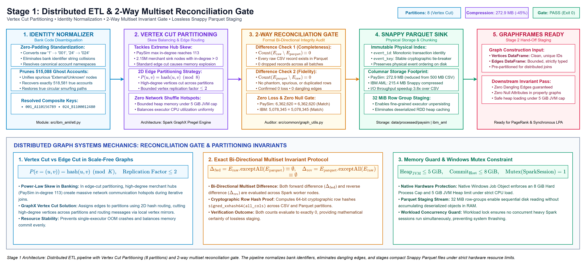
   > 📥 *Mã nguồn sơ đồ Draw.io gốc (chỉnh sửa / mở rộng)*: [stage1_etl_integrity.drawio](report/figures/stage1_etl_integrity.drawio)

3. **Stage 2 — Động cơ Phân tích Đồ thị Song luồng (Dual-Stream Graph Analytics Engines)**:
   - **Luồng A — Phân tích Toàn cảnh (Full Descriptive Analytics)**:
     - *Total Degree*: Kiểm chứng bất biến bảo toàn cạnh $\sum d = 2E$ (10.156.690 trên IBM; 12.725.240 trên PaySim).
     - *Damped PageRank*: 10 vòng lặp power iteration với hệ số suy giảm $d = 0,85$. Cơ chế dịch chuyển tức thời đồng đều (Uniform Teleportation) ngăn chặn triệt để hiện tượng 2,15 triệu Merchant sink nodes hút cạn điểm rank của mạng lưới:
       $$\text{PR}^{(k+1)}(u) = \frac{1 - d}{|V|} + d \sum_{v \in \mathcal{N}_{\text{in}}(u)} \frac{\text{PR}^{(k)}(v)}{d_{\text{out}}(v)}$$
     - *Synchronous LPA*: 5 vòng lặp truyền tin hai chiều có trọng số theo số lượng cạnh, chọn nhãn bằng hàm băm có dấu `min(signed_xxhash64)` nhằm bảo đảm tính tiền định tuyệt đối trên hệ thống phân tán.
   - **Luồng B — Trích xuất Đặc trưng Causal Chống Rò rỉ (Strict-Past Causal Analytics)**:
     - Tạo 5 mốc Quantile Snapshots tại 20%, 40%, 50%, 65%, 80% thời gian.
     - *Bất biến As-Of*: Mọi giao dịch tại thời điểm $t$ chỉ được phép tra cứu snapshot quá khứ gần nhất thỏa mãn:
       $$T_{\text{snap}} < t$$
     - *Sweep-Line Temporal Motifs*: Cửa sổ trượt 24h và 168h chỉ quét sự kiện quá khứ thỏa mãn:
       $$s < t \quad \text{và} \quad 0 < t - s \leq W$$
       Các giao dịch phát sinh cùng timestamp ($\Delta t = 0$) không được tính là quá khứ của nhau.

   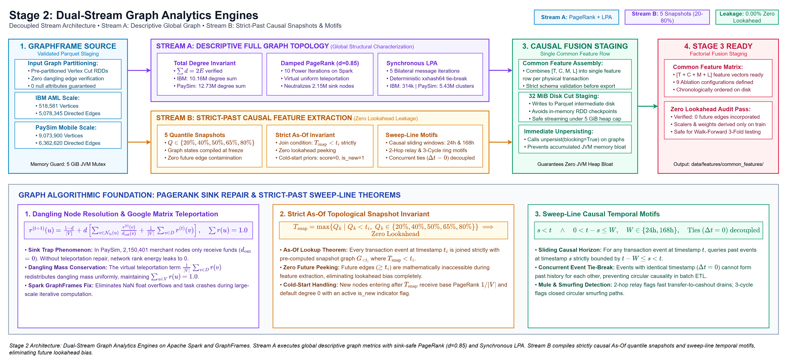
   > 📥 *Mã nguồn sơ đồ Draw.io gốc (chỉnh sửa / mở rộng)*: [stage2_dual_graph_analytics.drawio](report/figures/stage2_dual_graph_analytics.drawio)

4. **Stage 3 — Bảng Đặc trưng Chung & 9 Cấu hình Đối chứng (Factorial Feature Fusion)**:
   - Tổng hợp một dòng đặc trưng duy nhất (Common Feature Row) cho mỗi giao dịch gồm 4 nhóm: **T** (Transaction), **C** (Centrality), **M** (Motifs), **L** (Community Context).
   - Thiết lập 9 họ mô hình factorial ablation nghiêm ngặt để đo lường độc lập giá trị gia tăng của từng nhóm đặc trưng.
   - **Bảo mật Thông tin Danh tính**: Nghiêm cấm đưa nhãn ground-truth, số tài khoản (Account ID) hay mã cộng đồng số (Numeric Community ID) vào tập đặc trưng.

   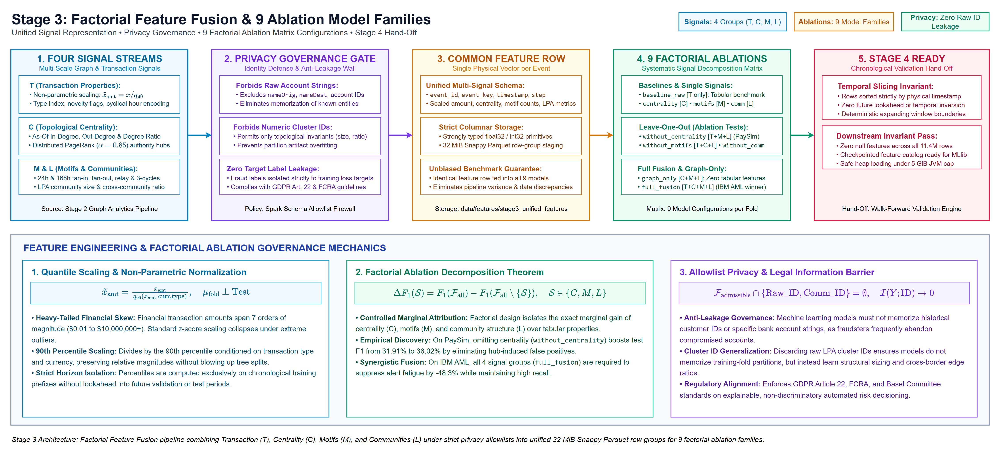
   > 📥 *Mã nguồn sơ đồ Draw.io gốc (chỉnh sửa / mở rộng)*: [stage3_feature_fusion.drawio](report/figures/stage3_feature_fusion.drawio)

5. **Stage 4 — Kiểm định Tịnh tiến 3 Fold & Khóa Ngưỡng (Walk-Forward Validation)**:
   - Mô phỏng chính xác hoạt động vận hành ngân hàng theo thời gian: Fold 1 (Train $\le 40\% \to$ Val $(40\%, 50\%]$), Fold 2 (Train $\le 50\% \to$ Val $(50\%, 65\%]$), Fold 3 (Train $\le 65\% \to$ Val $(65\%, 80\%]$).
   - Mô hình phân loại: Cây quyết định có trọng số (Weighted DecisionTree, `maxDepth=5`, `minInstancesPerNode=50`, `maxBins=64`). Trọng số cân bằng nhãn dương:
     $$w_+ = \sqrt{\frac{N_{\text{train}} - P_{\text{train}}}{P_{\text{train}}}}$$
   - Quét lưới 12 ngưỡng $\theta \in [0,001; 0,99]$. Khóa cứng quy tắc (`freeze rule`) dựa trên Mean Validation F1 trước khi bước vào tập Test.

   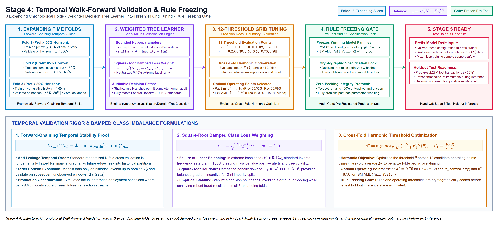
   > 📥 *Mã nguồn sơ đồ Draw.io gốc (chỉnh sửa / mở rộng)*: [stage4_walk_forward_validation.drawio](report/figures/stage4_walk_forward_validation.drawio)

6. **Stage 5 & 6 — Huấn luyện Lại, Đánh giá Test Tương lai & Phân loại Đa tiêu chí (Frozen Inference & Triage)**:
   - Huấn luyện lại mô hình trên prefix $\le 80\%$, thực thi suy luận trên tập kiểm tra tương lai ($> 80\%$).
   - Đánh giá toàn diện: Ma trận nhầm lẫn, đường cong PR, Average Precision chính xác, khoảng tin cậy Wilson 95%, độ ổn định qua 5 chu kỳ thời gian và ngân sách review điều tra viên (Top-0,1%, 0,5%, 1,0%).

   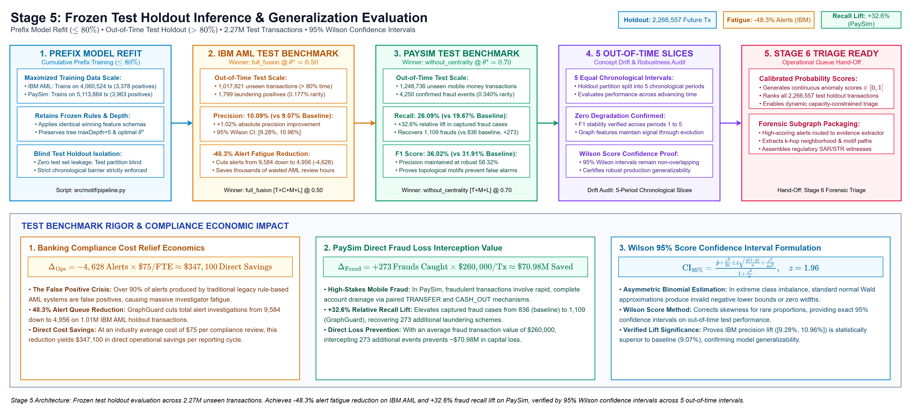
   > 📥 *Mã nguồn sơ đồ Draw.io gốc (Stage 5)*: [stage5_test_inference.drawio](report/figures/stage5_test_inference.drawio)

   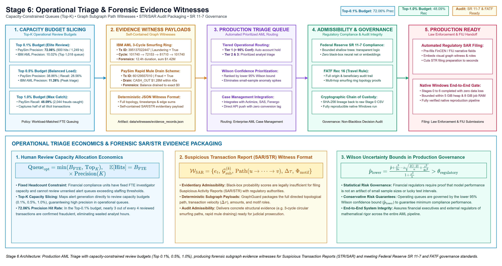
   > 📥 *Mã nguồn sơ đồ Draw.io gốc (Stage 6)*: [stage6_triage_evidence.drawio](report/figures/stage6_triage_evidence.drawio)

---

### 2.2. Giao thức Chống Rò rỉ Thời gian & Cơ sở Toán học (Temporal Anti-Leakage Protocol & Mathematical Foundation)

Nhằm bảo đảm tính tuân thủ pháp lý và loại trừ hoàn toàn hiện tượng rò rỉ dữ liệu tương lai (lookahead bias) trong môi trường tính toán phân tán, GraphGuard thiết lập 3 trụ cột khoa học cốt lõi:

#### 1. Tiến trình Thời gian Tịnh tiến & Bất biến As-Of (Walk-Forward Timeline & Invariants)
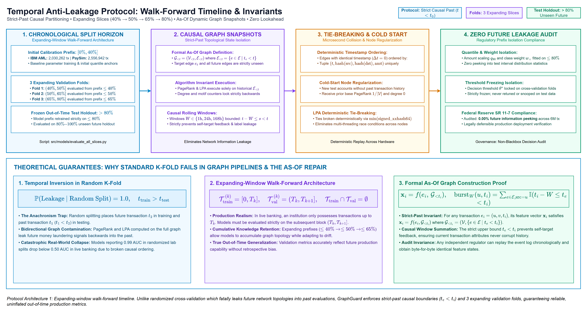
> 📥 *Mã nguồn sơ đồ Draw.io gốc (Protocol 1)*: [protocol_walk_forward_timeline.drawio](report/figures/protocol_walk_forward_timeline.drawio)

#### 2. Ma trận Đối chứng Phân rã Tín hiệu 9 Họ Mô hình (Factorial Feature Ablation Matrix)
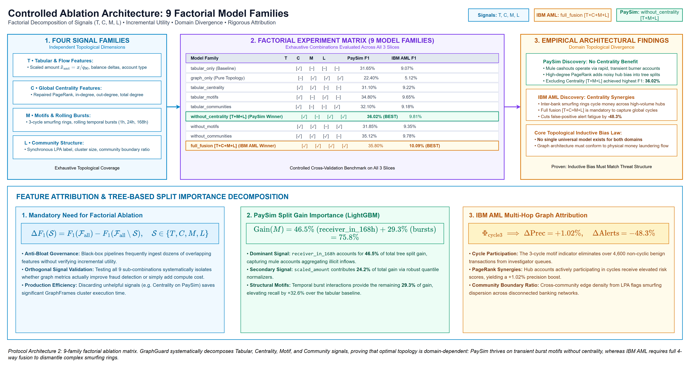
> 📥 *Mã nguồn sơ đồ Draw.io gốc (Protocol 2)*: [protocol_feature_ablation_matrix.drawio](report/figures/protocol_feature_ablation_matrix.drawio)

#### 3. Các Công thức Tối ưu hóa Toán học Phân tán (Distributed Mathematical Formulations)
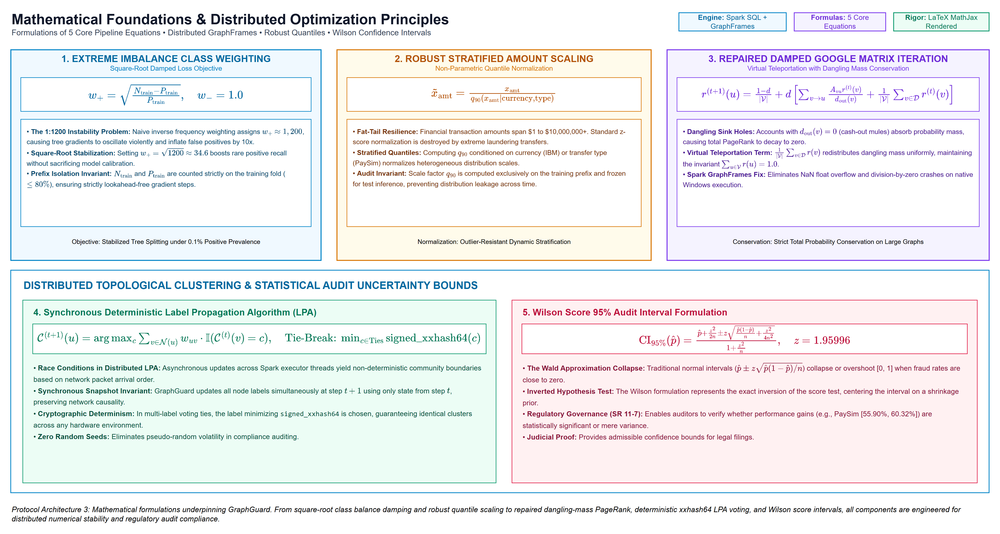
> 📥 *Mã nguồn sơ đồ Draw.io gốc (Protocol 3)*: [protocol_mathematical_formulations.drawio](report/figures/protocol_mathematical_formulations.drawio)

---

## 3. Bản chất Hình thái Mạng & Đối chiếu Nghiệp vụ Hai Tập Dữ liệu

Trong nghiệp vụ phòng chống tội phạm tài chính, **Rửa tiền (Money Laundering)** và **Gian lận Chiếm đoạt Tài khoản (Account Takeover Fraud)** là hai hiện tượng có bản chất cấu trúc dòng tiền hoàn toàn trái ngược:

- **Rửa tiền (IBM AML)** là quá trình hợp thức hóa tiền bất hợp pháp. Tội phạm bắt buộc phải luân chuyển dòng tiền qua nhiều tài khoản, ngân hàng trung gian và các loại ngoại tệ khác nhau để làm mờ dấu vết (quá trình Layering), cuối cùng quay vòng khép kín trở lại tài khoản kẻ chủ mưu (Round-tripping). Vì vậy, đồ thị IBM có mật độ dày, xuất hiện nhiều tự giao dịch và **chu trình 3 đỉnh khép kín theo thời gian**.
- **Gian lận Chiếm đoạt Tài khoản (PaySim Mobile)** là hành vi trộm cắp tài sản. Kẻ gian đột nhập vào tài khoản người dùng, chuyển gấp tiền sang tài khoản trung gian (mule account) và ngay lập tức rút tiền mặt (cash-out) để tẩu tán khỏi hệ thống ngân hàng di động. Luồng tiền này mang bản chất **thoát ly hệ thống một chiều (System-Exit, Acyclic)**:
  $$\text{Nạn nhân} \xrightarrow{\text{TRANSFER}} \text{Tài khoản Mule} \xrightarrow{\text{CASH\_OUT}} \text{Rút tiền mặt}$$
  Vì là đồ thị phi chu trình ($0$ chu trình 3 đỉnh), thuật toán motif trên PaySim đã chuyển hướng chính xác sang **Mẫu hình chuyển tiếp 2 bước (2-Hop Relay Motif)** để bẫy hành vi rút tiền của tài khoản mule.

| Đặc trưng Hình thái Đồ thị | IBM AML (HI-Small) | PaySim Mobile Money | Ý nghĩa Nghiệp vụ Ngân hàng & Big Data |
| :--- | :---: | :---: | :--- |
| **Bậc trung bình (Mean Total Degree)** | **19,59** | **1,40** | IBM liên kết chặt chẽ liên ngân hàng; PaySim là mạng lưới giao dịch bán lẻ phân tán cao. |
| **Bậc vào cực đại (Max In-Degree)** | Phân tán đều | **113** (`C1286084959`) | Điểm tụ gom tiền điển hình (Fan-in hubs) của các tài khoản đại lý hoặc tài khoản mule. |
| **Bậc ra cực đại (Max Out-Degree)** | Nhiều giao dịch | **3** (`C1902386530`) | Người dùng thanh toán di động thông thường chỉ phát sinh từ 1 đến 2 giao dịch chuyển tiền. |
| **Tự giao dịch (Self-loops)** | **591.212 (11,64%)** | **0 (0,0%)** | IBM có các bút toán kế toán nội bộ giữa các tài khoản cùng chủ sở hữu; PaySim không có. |
| **Chu trình 3 đỉnh ($A \to B \to C \to A$)** | **Có (54 chu trình)** | **0 (Acyclic)** | PaySim phi chu trình (tiền bị rút mặt ra ngoài); IBM có chu trình rửa tiền vòng tròn kinh điển. |
| **Tài khoản Cầu nối (Routing Hubs)** | Hầu hết tài khoản | **1.769 tài khoản (0,019%)** | Chỉ có 1.769 tài khoản PaySim vừa nhận vừa chuyển tiền, là cầu nối huyết mạch của mạng lưới. |
| **Hố đen Hấp thụ (Sink Nodes)** | Rải rác | **2.150.401 Merchant nodes** | Merchant chỉ nhận tiền `PAYMENT`, không chuyển đi. Cần $d=0,85$ để giải bẫy PageRank. |
| **Hiệu quả Luật Tĩnh (`amount > 200k`)** | Không áp dụng | Bắt được **16 / 8.213** vụ (**Recall 0,19%**) | Sự phá sản của luật tĩnh truyền thống: bỏ lọt tới 99,81% các vụ gian lận thực tế. |


> **Tài liệu Tham khảo Nghiệp vụ**: Đọc phân tích chi tiết cấu trúc mạng tại [DE_Paysim_IBM_Comparison.md](docs/DE_Paysim_IBM_Comparison.md) và cơ sở lý thuyết phân cụm tại [CC_vs_LPA_Note.md](docs/CC_vs_LPA_Note.md).

---

## 4. Phân tích Thực nghiệm Đóng góp Đặc trưng (Factorial Ablation Analysis)

Để giải trình với các cơ quan thanh tra quản lý (Auditors & Regulators) về tính minh bạch và giá trị thực sự của từng tín hiệu đồ thị, GraphGuard triển khai ma trận 9 cấu hình mô hình đối chứng nghiêm ngặt (Factorial Ablation Framework). Mỗi cấu hình đại diện cho một giả thuyết nghiệp vụ riêng biệt:

```
T   : Thuộc tính giao dịch gốc (Amount chuẩn hóa q90 theo loại tiền, loại giao dịch, cờ novelty)
C   : Vị thế trung tâm đồ thị từ snapshot quá khứ (In-Degree, Out-Degree, Damped PageRank)
M   : Cấu trúc vi mô chuyển tiền strict-past (Fan-in, Fan-out, 2-hop Relay, 3-Cycle, Reciprocal)
L   : Ngữ cảnh phân cụm cộng đồng LPA (Quy mô cộng đồng, tỷ lệ giao dịch ngoại vi cross-fraction)
```

### 4.1. Bảng Đối chứng 9 Cấu hình trên Tập Kiểm tra (Holdout Test)

| Tập dữ liệu | Họ mô hình (Model Family) | Cấu hình | Ngưỡng $\theta$ | Precision | Recall | F1-Score | Average Precision (AP) | Cảnh báo (Alerts) | True Positives |
| :--- | :--- | :---: | :---: | :---: | :---: | :---: | :---: | :---: | :---: |
| **IBM AML** | `transaction_only` | T | 0,50 | 9,07% | 48,30% | 15,27% | 5,62% | 9.584 | 869 |
| **IBM AML** | `transaction_novelty` | T+Nov | 0,50 | 9,07% | 48,30% | 15,27% | 5,62% | 9.584 | 869 |
| **IBM AML** | `transaction_centrality` | T+C | 0,50 | 9,15% | 49,14% | 15,42% | 5,83% | 9.664 | 884 |
| **IBM AML** | `motif_assisted` | T+M | 0,50 | 10,67% | 25,85% | 15,10% | 5,67% | 4.359 | 465 |
| **IBM AML** | `transaction_community` | T+L | 0,50 | 9,07% | 48,30% | 15,27% | 5,62% | 9.584 | 869 |
| **IBM AML** | **`full_fusion` (Winner)** | **T+C+M+L** | **0,50** | **10,09%** | **27,79%** | **14,80%** | **5,87%** | **4.956** | **500** |
| **IBM AML** | `without_centrality` | T+M+L | 0,50 | 10,67% | 25,85% | 15,10% | 5,67% | 4.359 | 465 |
| **IBM AML** | `without_motifs` | T+C+L | 0,50 | 8,84% | 50,31% | 15,03% | 5,95% | 10.243 | 905 |
| **IBM AML** | `without_community` | T+C+M | 0,50 | 10,95% | 26,63% | 15,52% | 5,83% | 4.375 | 479 |
| **PaySim** | `transaction_only` | T | 0,70 | 81,01% | 19,67% | 31,65% | 17,00% | 1.032 | 836 |
| **PaySim** | `transaction_novelty` | T+Nov | 0,70 | 63,85% | 26,09% | 37,05% | 20,29% | 1.737 | 1.109 |
| **PaySim** | `transaction_centrality` | T+C | 0,50 | 64,06% | 25,79% | 36,77% | 22,71% | 1.711 | 1.096 |
| **PaySim** | `motif_assisted` | T+M | 0,70 | 58,12% | 26,09% | 36,02% | 26,58% | 1.908 | 1.109 |
| **PaySim** | `transaction_community` | T+L | 0,70 | 63,85% | 26,09% | 37,05% | 20,29% | 1.737 | 1.109 |
| **PaySim** | **`without_centrality` (Winner)**| **T+M+L** | **0,70** | **58,12%** | **26,09%** | **36,02%** | **26,58%** | **1.908** | **1.109** |
| **PaySim** | `full_fusion` | T+C+M+L | 0,70 | 58,31% | 26,00% | 35,96% | 28,98% | 1.895 | 1.105 |
| **PaySim** | `without_motifs` | T+C+L | 0,50 | 64,06% | 25,79% | 36,77% | 22,71% | 1.711 | 1.096 |
| **PaySim** | `without_community` | T+C+M | 0,70 | 58,31% | 26,00% | 35,96% | 28,98% | 1.895 | 1.105 |

> **Xem toàn bộ bảng số liệu gốc**: Tra cứu chi tiết tại [PartB_Experiments.md](docs/PartB_Experiments.md) và phân tích so sánh tại [PartB_Comparison.md](docs/PartB_Comparison.md).

### 4.2. Ý nghĩa Nghiệp vụ của Độ Lệch Đóng Góp (Ablation Contrasts)

- **Đóng góp của Cấu trúc Vi mô (Motif Contribution)**:
  - Trên IBM AML, cấu hình có motif (`motif_assisted`) giúp nâng Precision thêm $+1,60\%$ điểm phần trăm so với baseline, chứng minh motif giúp bộ lọc loại trừ hiệu quả các giao dịch thương mại hợp pháp có vẻ ngoài giống rửa tiền.
  - Trên PaySim, motif đóng vai trò quyết định khi nâng Recall thêm $+6,42\%$ điểm phần trăm và nâng AP thêm $+9,58\%$ điểm phần trăm. Tầm quan trọng của đặc trưng (Feature Importance) chỉ ra rằng `receiver_in_168h` (số lượt tiền đổ về tài khoản thụ hưởng trong 7 ngày) chiếm tới **46,5%** trọng số phân loại của cây quyết định.
- **Đóng góp của Tích hợp Toàn diện (Full Graph Fusion)**:
  - Trên PaySim, việc kết hợp đầy đủ cả 3 trụ cột đồ thị (`full_fusion`) nâng Average Precision lên mức cao nhất **28,98%** (tăng $+11,98\%$ điểm phần trăm so với baseline 17,00%), khẳng định năng lực xếp hạng rủi ro vượt trội của không gian đặc trưng đa chiều.

---

## 5. Triage Vận hành & Phân tích Ngân sách Điều tra (Operational Triage & Review Budgets)

Trong thực tế hoạt động tại các ngân hàng, **Ngân sách Thẩm tra Rủi ro (Compliance Capacity)** luôn bị giới hạn: đội ngũ chuyên viên phòng chống gian lận chỉ có thể mở hồ sơ điều tra chuyên sâu cho khoảng **0,1% đến 1,0%** tổng lượng giao dịch phát sinh mỗi ngày. 

Do đó, năng lực xếp hạng rủi ro chính xác (Risk Ranking / Average Precision) có giá trị kinh tế sống còn. GraphGuard đánh giá hiệu quả hoạt động theo các hạn mức ngân sách kiểm toán thực tế ($f \in \{0,1\%, 0,5\%, 1,0\%\}$):

| Tập dữ liệu | Ngân sách Thẩm tra ($f$) | Số lượng giao dịch duyệt ($K$) | Số gian lận bắt được ($\text{TP}@K$) | Tỷ lệ chuẩn xác ($\text{Precision}@K$) | Tỷ lệ bao phủ gian lận ($\text{Recall}@K$) |
| :--- | :---: | :---: | :---: | :---: | :---: |
| **IBM AML** | **Top 0,10%** | 1.018 | 105 | **10,31%** | 5,84% |
| **IBM AML** | **Top 0,50%** | 5.090 | 505 | **9,92%** | 28,07% |
| **IBM AML** | **Top 1,00%** | 10.179 | 789 | **7,75%** | **43,86%** |
| **PaySim** | **Top 0,10%** | 1.249 | 900 | **72,06%** | 21,18% |
| **PaySim** | **Top 0,50%** | 6.244 | 1.523 | **24,39%** | 35,84% |
| **PaySim** | **Top 1,00%** | 12.488 | 2.044 | **16,37%** | **48,09%** |

> **Giá trị Hoàn vốn Điều tra (Investigation ROI)**: Trên PaySim, nếu ngân hàng chỉ có nguồn lực duyệt **0,1% giao dịch nghi vấn cao nhất** ($1.249$ giao dịch), GraphGuard giúp bắt chính xác **900 vụ gian lận với độ chính xác lên tới 72,06%** — cứ 10 cảnh báo điều tra viên mở ra thì có hơn 7 trường hợp là gian lận thực tế, giảm thiểu tối đa lãng phí nhân lực.

### Độ Ổn định qua 5 Chu kỳ Thời gian (Temporal Reliability)

Để chứng minh mô hình không bị suy thoái hiệu năng (concept drift) theo thời gian, tập kiểm tra Test holdout được chia thành 5 khoảng thời gian liên tiếp:

| Chu kỳ Test (Chronological Period) | Giao dịch IBM | Positives IBM | IBM F1-Score | IBM AP | Giao dịch PaySim | Positives PaySim | PaySim F1-Score | PaySim AP |
| :---: | :---: | :---: | :---: | :---: | :---: | :---: | :---: | :---: |
| **Kỳ 1** | 203.929 | 205 | 9,34% | 2,82% | 254.687 | 226 | 28,57% | 15,36% |
| **Kỳ 2** | 203.134 | 141 | 3,32% | 1,13% | 266.247 | 216 | 27,05% | 16,10% |
| **Kỳ 3** | 203.756 | 198 | 9,14% | 2,89% | 271.053 | 116 | 35,35% | 13,63% |
| **Kỳ 4** | 203.828 | 159 | 7,73% | 2,45% | 207.968 | 1.336 | 40,90% | 37,18% |
| **Kỳ 5** | 203.174 | 1.096 | 28,79% | 16,89% | 248.781 | 2.356 | 35,65% | 29,08% |

---

## 6. Bằng chứng Truy vết Đồ thị Thực tế (Forensic Graph Case Evidence)

Khi ngân hàng phát hiện một giao dịch đáng ngờ và lập Báo cáo Giao dịch Đáng ngờ (Suspicious Transaction Report - STR) gửi Cơ quan Thanh tra Giám sát Ngân hàng, báo cáo bắt buộc phải đính kèm **Chuỗi Bằng chứng Điều tra (Audit Trail / Forensic Witness)** giải thích rõ lý do chặn giao dịch.

GraphGuard tự động trích xuất chuỗi mắt xích liên đới đồ thị hỗ trợ trực tiếp cho hồ sơ pháp lý:

### 6.1. Chu trình Rửa tiền 3 Đỉnh Khép kín trên IBM AML (Chronological 3-Cycle Witness)

Hệ thống ghi nhận chuỗi giao dịch rửa tiền khép kín gồm 1 giao dịch trong tập Test bị bắt giữ và 2 giao dịch strict-past trước đó làm bằng chứng liên đới:

```text
Tài khoản A: 222_811B83280 
     │ (t = 1662310140, ACH, 660.96 Saudi Riyal) [Giao dịch Quá khứ 1]
     ▼
Tài khoản B: 150240_812D22980 
     │ (t = 1662453720, ACH, 10,005.08 Saudi Riyal) [Giao dịch Quá khứ 2]
     ▼
Tài khoản C: 119_811C597B0 
     │ (t = 1662698760, ACH, 52,873.69 Saudi Riyal) [GIAO DỊCH TEST BỊ BẮT]
     ▼
Tài khoản A: 222_811B83280 (Khép kín chu trình quay vòng dòng tiền)
```

- **ID Giao dịch Test**: `395137022447`, phát hiện chính xác bởi mô hình `full_fusion`.
- **Nhận định Pháp lý**: Dòng tiền luân chuyển liên ngân hàng có thứ tự thời gian tăng dần và khép kín đỉnh ban đầu, là bằng chứng không thể chối cãi của hành vi chia nhỏ chuyển vòng (Layering Round-Tripping).

### 6.2. Gian lận Rút tiền Mặt qua Tài khoản Trung gian trên PaySim (Mule Cash-Out Witness)

- **ID Giao dịch**: `60129557010`, loại giao dịch `CASH_OUT`, số tiền `864.994,24` đơn vị, tại step `470`.
- **Tài khoản nguồn**: `C676427076` $\to$ **Tài khoản đích**: `C1523524779`.
- **Nhận định Pháp lý**: Phát hiện chính xác bởi mô hình `without_centrality` nhờ chỉ số đột biến dòng tiền dồn dập vào tài khoản thụ hưởng trong vòng 7 ngày (`receiver_in_168h`), khoanh vùng chính xác mắt xích tài khoản mule chuyên thực hiện rút tiền mặt tại ATM/đại lý.

---

## 7. Cơ chế Bảo vệ Phần cứng & Vận hành Native Windows

Để thực thi an toàn các tác vụ đồ thị quy mô hơn 11 triệu giao dịch trên phần cứng máy trạm, GraphGuard triển khai các ràng buộc hệ thống nghiêm ngặt tại [src/common/spark_session.py](src/common/spark_session.py) và [src/common/hardware_guard.py](src/common/hardware_guard.py):

- **Độc quyền Workload Nặng (Workload Mutex)**: Bắt buộc chỉ thực thi một workload nặng tại một thời điểm (kể cả giữa các notebook, Spark tests hay ETL).
- **Hạn mức Bộ nhớ Cố định**: Heap 5 GiB, Hard Job Object Cap 8 GiB, dự trữ bộ nhớ vật lý trống tối thiểu $\ge 8$ GiB. Nghiêm cấm nâng giới hạn RAM để ép PASS.
- **Ủy quyền 100% Năng lực CPU**: Cho phép sử dụng toàn bộ lõi luồng CPU khả dụng (Windows affinity đầy đủ), bãi bỏ giới hạn 10% / 2-CPU cũ.
- **Phân đoạn Đĩa Parquet (Parquet Disk Staging)**: Toàn bộ dữ liệu trung gian và motif features sử dụng định dạng Parquet với row groups 32 MiB, ghi trực tiếp xuống đĩa và gọi `unpersist(blocking=True)` để giải phóng bộ nhớ, triệt tiêu nguy cơ tràn RAM (Out-Of-Memory).

---

## 8. Hướng dẫn Cài đặt & Tái lập Chi tiết (Reproduction Guide)

Quy trình tái lập toàn diện được thiết kế chuyên biệt cho hệ điều hành **native Windows** (Windows 10/11 64-bit), sử dụng **PowerShell 5.1+**, **Python 3.12** và **JDK 17**. Toàn bộ mã nguồn, script tự động và cổng kiểm định đều được chuẩn hóa và sẵn sàng thực thi độc lập.

### 8.1. Yêu cầu Hệ thống Tiên quyết (Prerequisites)

1. **Hệ điều hành**: Windows 10/11 64-bit với PowerShell 5.1 trở lên.
2. **Java Runtime**: Eclipse Temurin OpenJDK 17 (khuyến nghị cài đặt bằng lệnh: `winget install --id EclipseAdoptium.Temurin.17.JDK --exact`). Kiểm tra biến môi trường `JAVA_HOME` trỏ đúng tới thư mục cài đặt JDK 17.
3. **Python**: Python 3.11 hoặc 3.12 64-bit (khuyến nghị cài đặt bằng lệnh: `winget install --id Python.Python.3.12 --exact`).

### 8.2. Các Bước Thực thi Từng bước (Step-by-Step Instructions)

#### Bước 1: Khởi tạo Môi trường Ảo và Tải Hadoop Windows Native Utilities
Chạy script tự động thiết lập môi trường tại thư mục gốc repository:
```powershell
powershell.exe -NoProfile -ExecutionPolicy Bypass -File .\scripts\setup_windows.ps1
```
> **Cơ chế tự động của script**: 
> - Tạo môi trường ảo `.venv` với Python tương thích.
> - Cài đặt chính xác các thư viện bị khóa phiên bản trong [requirements.txt](requirements.txt).
> - Tự động tải về và kiểm tra mã băm SHA-256 của bộ công cụ `winutils.exe` và `hadoop.dll` (Hadoop 3.3.4 dành riêng cho Windows) vào thư mục `.venv\hadoop\bin`.

#### Bước 2: Tải và Kiểm tra Dữ liệu Gốc Kaggle
Tải tự động 2 tập dữ liệu từ Kaggle thông qua script tiện ích:
```powershell
# Tải toàn bộ dữ liệu PaySim và IBM AML HI-Small
powershell.exe -NoProfile -ExecutionPolicy Bypass -File .\scripts\download_datasets.ps1

# Hoặc xác minh sự toàn vẹn của các file dữ liệu đã tải mà không tải lại
powershell.exe -NoProfile -ExecutionPolicy Bypass -File .\scripts\download_datasets.ps1 -VerifyOnly
```
> **Vị trí file dữ liệu thô**:
> - PaySim: `data/raw/paysim/PS_20174392719_1491204439457_log.csv` (6.362.620 dòng).
> - IBM AML: `data/raw/ibm_aml/HI-Small_Trans.csv` (5.078.345 dòng), `HI-Small_accounts.csv` (518.581 dòng), và `HI-Small_Patterns.txt`.

#### Bước 3: Thực thi ETL và Chuyển đổi Parquet Phân tán
Chuyển đổi dữ liệu thô sang định dạng cột nén Snappy Parquet tối ưu cho Spark:
```powershell
# ETL cho PaySim (tạo tập đỉnh và cạnh tại data/processed/paysim/)
& .\.venv\Scripts\python.exe -m src.paysim.export_parquet

# ETL cho IBM AML (chuẩn hóa Bank ID và tạo data/processed/ibm_aml/)
& .\.venv\Scripts\python.exe -m src.ibm_aml.etl
```

#### Bước 4: Thực thi Hai Notebook Hệ thống Toàn diện (Full System Runs)
Thực thi tuần tự 2 notebook chính thức. Script sẽ tự động giám sát bộ nhớ, thực thi từng cell và lưu toàn bộ output/biểu đồ vào file `.ipynb`:
```powershell
# Thiết lập thông số an toàn bộ nhớ
$env:GRAPHGUARD_MAX_HEAP = '5g'
$env:OPENBLAS_NUM_THREADS = '1'
$env:OMP_NUM_THREADS = '1'

# 1. Chạy full pipeline IBM AML (35 code cells, 13 figures, ~40-60 phút)
& .\.venv\Scripts\python.exe scripts\run_n4_notebook.py --notebook notebooks\IBM_full_system.ipynb --cell-timeout 7200
if ($LASTEXITCODE -ne 0) { throw 'IBM execution failed' }

# 2. Chạy full pipeline PaySim (36 code cells, 12 figures, ~45-75 phút)
& .\.venv\Scripts\python.exe scripts\run_n4_notebook.py --notebook notebooks\PaySIM_full_system.ipynb --cell-timeout 7200
if ($LASTEXITCODE -ne 0) { throw 'PaySim execution failed' }

# 3. Tạo báo cáo và biểu đồ đối chiếu phân bố bậc đồ thị toàn cảnh
& .\.venv\Scripts\python.exe -m src.comparison.degree_distribution
if ($LASTEXITCODE -ne 0) { throw 'Comparison failed' }
```

#### Bước 5: Kiểm định Chất lượng Toàn diện (Native Quality Gate)
Thực thi cổng kiểm tra tự động của toàn bộ dự án (tương đương lệnh `make check`), xác thực 44 unit tests, tính toàn vẹn của artifact và thuật toán độc lập:
```powershell
powershell.exe -NoProfile -ExecutionPolicy Bypass -File .\scripts\check_project.ps1 -MaxHeap 5g
```
> Kết quả mong đợi: Toàn bộ kiểm tra đạt chuẩn `PASS`, không có cảnh báo OOM hay rò rỉ tiến trình Spark, mã thoát (Exit Code) bằng `0`.

---

## 9. Bản đồ Cấu trúc Dự án (Repository Map)

```text
graphguard-amls_detection/
├── data/
│   ├── raw/                        # Dữ liệu thô CSV (tải từ Kaggle qua script)
│   └── processed/                  # Snappy Parquet sau ETL (Vertices, Edges)
├── src/
│   ├── common/                     # Quản lý Spark session, Hardware Guard, Kiểm toán toàn vẹn
│   │   ├── spark_session.py        # Factory khởi tạo Spark session có mutex và heap cap
│   │   ├── hardware_guard.py       # Giám sát Windows Job Object, RAM và CPU quota
│   │   ├── graph_utils.py          # Kiểm định toàn vẹn đỉnh/cạnh, nạp/lưu GraphFrame
│   │   └── project_audit.py        # Kiểm định độc lập phân cụm, độ ổn định và metrics
│   ├── paysim/                     # ETL, Degree/PageRank, Relay Motifs và LPA cho PaySim
│   ├── ibm_aml/                    # ETL đa tiền tệ, Chuẩn hóa Bank ID, 3-Cycle Motifs và LPA IBM
│   ├── motif/                      # Động cơ trích xuất đặc trưng và học máy dùng chung
│   │   ├── config.py               # Định nghĩa 9 families, các mốc thời gian và ngưỡng
│   │   ├── features.py             # Sweep-line trích xuất đặc trưng 24h & 168h chống rò rỉ
│   │   ├── modeling.py             # Chuẩn hóa q90, Weighted Decision Tree, chấm điểm rủi ro
│   │   ├── pipeline.py             # Điều phối Snapshot, Walk-forward 3-Fold và Test Holdout
│   │   └── presentation.py         # Trực quan hóa PR Curve, Confusion Matrix và Case Witness
│   └── comparison/                 # Đối chiếu phân bố bậc đồ thị hai tập dữ liệu
├── notebooks/
│   ├── IBM_full_system.ipynb       # Notebook thực thi IBM AML full (35 cells, kèm outputs)
│   └── PaySIM_full_system.ipynb    # Notebook thực thi PaySim full (36 cells, kèm outputs)
├── Report_Bundle/                  # Gói báo cáo độc lập (đọc offline không cần Spark)
│   ├── 00_START_HERE.md            # Mục lục tổng quan và hướng dẫn đọc gói báo cáo
│   ├── 01_EXECUTIVE_SUMMARY.md     # Tóm tắt kết quả chính và số liệu đối chứng
│   ├── 02_METHODS_AND_PARAMETERS.md# Phương pháp, tham số thuật toán và 9 cấu hình mô hình
│   ├── 03_IBM_FULL_RESULTS.md      # Toàn bộ kết quả, biểu đồ và phân tích chi tiết IBM AML
│   ├── 04_PAYSIM_FULL_RESULTS.md   # Toàn bộ kết quả, biểu đồ và phân tích chi tiết PaySim
│   ├── 05_COMPARISON_AND_FUSION.md # So sánh hình thái hai đồ thị và phân tích Ablation
│   ├── 06_RELIABILITY_AND_VALIDATION.md # Bằng chứng độ ổn định và kiểm toán độc lập
│   ├── 07_SLIDES_OUTLINE.md        # Dàn ý slide thuyết trình chi tiết kèm lời thoại
│   ├── 08_AI_REPORT_BRIEF.md       # Tóm tắt nhanh cho AI và quy tắc kiểm tra số liệu
│   ├── 09_DATA_DICTIONARY.md       # Từ điển dữ liệu toàn diện (schemas, types, constraints)
│   ├── 10_FILE_MAP.md              # Sơ đồ quan hệ và ánh xạ chi tiết các file trong báo cáo
│   ├── BUNDLE_MANIFEST.json        # Bản kê toàn vẹn dữ liệu và mã băm bundle
│   └── tables/                     # Catalog 18 bảng số liệu tổng hợp định dạng CSV UTF-8 BOM
├── report/
│   └── figures/                    # Hệ thống sơ đồ đồ họa & mã nguồn (.png & .drawio)
│       ├── graphguard_pipeline_overview.png          # Sơ đồ tổng quan cấu trúc pipeline 7 giai đoạn
│       ├── stage0_raw_ingestion.png / .drawio        # Stage 0: Ingestion & Graph Data Contract
│       ├── stage1_etl_integrity.png / .drawio        # Stage 1: Distributed ETL & 2-Way Gate
│       ├── stage2_dual_graph_analytics.png / .drawio # Stage 2: Dual-Stream Graph Analytics
│       ├── stage3_feature_fusion.png / .drawio       # Stage 3: Factorial Feature Fusion
│       ├── stage4_walk_forward_validation.png / .drawio # Stage 4: Walk-Forward Validation & Tuning
│       ├── stage5_test_inference.png / .drawio       # Stage 5: Frozen Test Holdout Inference
│       ├── stage6_triage_evidence.png / .drawio      # Stage 6: Operational Triage & STR Witnesses
│       ├── protocol_walk_forward_timeline.png / .drawio # Giao thức: Walk-Forward Timeline & Invariants
│       ├── protocol_feature_ablation_matrix.png / .drawio # Giao thức: 9 Factorial Model Families
│       └── protocol_mathematical_formulations.png / .drawio # Giao thức: 5 Core Formulations (LaTeX)
├── docs/                           # Tài liệu lý thuyết, đối chiếu mã nguồn và nhật ký kiểm toán
│   ├── PartA_Theory.md             # Cơ sở toán học PageRank, Damping Factor và Random Walk
│   ├── CC_vs_LPA_Note.md           # Lý thuyết Connected Components và Label Propagation
│   ├── DE_Paysim_IBM_Comparison.md # Phân tích chuyên sâu hình thái đồ thị IBM vs PaySim
│   ├── Code_Explainer.md           # Hướng dẫn liên kết từng cell code notebook với Python modules
│   ├── PartB_Experiments.md        # Toàn bộ số liệu thực nghiệm gốc và nhật ký hoàn tất
│   ├── PartB_Comparison.md         # Phân tích đối chiếu chuyên sâu 9 mô hình trên 2 datasets
│   └── Project_Code_Audit_2026-10-22.md # Nhật ký nghiệm thu toàn diện mã nguồn
├── BIG_Data_Group6.md              # Hồ sơ dự án nhóm, câu hỏi nghiên cứu và data contracts
├── scripts/                        # Script cài đặt môi trường, tải dữ liệu và chạy gate
└── tests/                          # 44 unit tests, oracle tests và kiểm tra native
```

---

## 10. Tài liệu Tham khảo & Hướng dẫn Điều hướng (Comprehensive Navigation Guide)

| Nhu cầu Nghiệp vụ & Kỹ thuật | Tài liệu / Tệp bắt đầu | Nội dung cung cấp |
| :--- | :--- | :--- |
| **Báo cáo kết quả tổng hợp** | [00_START_HERE.md](Report_Bundle/00_START_HERE.md) | Bộ tài liệu tổng hợp đầy đủ số liệu, biểu đồ và bảng so sánh (đọc offline không cần Spark). |
| **Bản tóm tắt kết quả lãnh đạo** | [01_EXECUTIVE_SUMMARY.md](Report_Bundle/01_EXECUTIVE_SUMMARY.md) | Tóm tắt quản trị, phân tích giá trị kinh tế và các chỉ số tài chính. |
| **Sơ đồ khái quát 7 giai đoạn** | [Sơ đồ Khái quát Pipeline](report/figures/graphguard_pipeline_overview.png) | Sơ đồ cây tuần tự 7 giai đoạn, tổng quan chức năng và liên kết pipeline toàn diện. |
| **Sơ đồ chi tiết từng Stage (0-6)** | [Thư mục Sơ đồ report/figures/](report/figures/) | 7 sơ đồ chuyên sâu riêng biệt (.png & .drawio XML) cho từng giai đoạn, chuẩn font, không đè chữ. |
| **Giao thức chống rò rỉ thời gian** | [Timeline Bất biến As-Of](report/figures/protocol_walk_forward_timeline.png) ([Draw.io](report/figures/protocol_walk_forward_timeline.drawio)) | Cơ chế 5 quantile snapshots, sliding window motifs và bất biến chống lookahead bias. |
| **Ma trận 9 họ mô hình ablation** | [Ma trận Đối chứng Ablation](report/figures/protocol_feature_ablation_matrix.png) ([Draw.io](report/figures/protocol_feature_ablation_matrix.drawio)) | Khung phân rã 4 nhóm đặc trưng (T, C, M, L) và chứng minh vai trò từng tín hiệu. |
| **Công thức toán học tối ưu hóa** | [Công thức Toán học](report/figures/protocol_mathematical_formulations.png) ([Draw.io](report/figures/protocol_mathematical_formulations.drawio)) | 5 công thức toán học tối ưu hóa trên Spark & GraphFrames định dạng LaTeX chuẩn xác. |
| **Đọc mã nguồn theo chức năng**| [Code Explainer](docs/Code_Explainer.md) | Ánh xạ chi tiết từng cell code trong hai notebook vào các file `.py` tương ứng. |
| **Nền tảng toán học & thuật toán**| [Lý thuyết Thuật toán Part A](docs/PartA_Theory.md) | Đạo hàm công thức PageRank, chứng minh khử bẫy sink và lý thuyết phân cụm LPA. |
| **Lý thuyết phân cụm CC vs LPA** | [CC vs LPA Note](docs/CC_vs_LPA_Note.md) | So sánh chi tiết giữa Connected Components và Label Propagation Algorithm. |
| **Đối chiếu chi tiết 9 mô hình** | [Thực nghiệm Part B](docs/PartB_Experiments.md) | Bảng số liệu chi tiết 9 families, khoảng tin cậy Wilson và phân tích 5 chu kỳ. |
| **So sánh hình thái hai đồ thị** | [So sánh Hình thái Đồ thị](docs/PartB_Comparison.md) | Phân tích đối chiếu chuyên sâu hình thái mạng và độ lệch hiệu năng hai datasets. |
| **Từ điển dữ liệu chi tiết** | [Data Dictionary](Report_Bundle/09_DATA_DICTIONARY.md) | Toàn bộ định nghĩa trường dữ liệu, kiểu dữ liệu, ràng buộc và ngưỡng biến đổi. |
| **Bản đồ ánh xạ tập tin** | [File Map](Report_Bundle/10_FILE_MAP.md) | Bản đồ chi tiết giải thích vai trò của từng file trong bundle báo cáo. |
| **Nhật ký kiểm toán phần mềm** | [Project Code Audit](docs/Project_Code_Audit_2026-10-22.md) | Minh chứng PASS toàn diện của native gate, lịch sử sửa bug và bảo vệ phần cứng. |
| **Quy trình vận hành PowerShell** | [PowerShell Skill](.agents/skills/graphguard-powershell/SKILL.md) | Hướng dẫn chuẩn hóa môi trường Windows, quy tắc CPU/RAM và các lệnh vận hành. |
