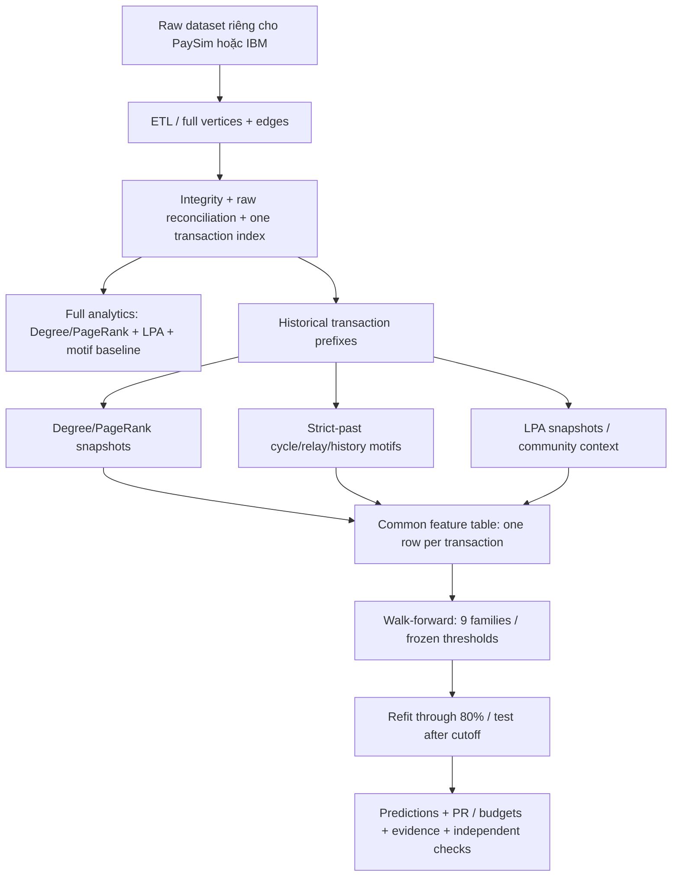

# GraphGuard — Transaction Graphs for Fraud and Anti-Money Laundering

GraphGuard là project Big Data của Nhóm 6: dùng **Degree/PageRank, temporal motifs và LPA communities** để tạo ngữ cảnh mạng lưới cho từng giao dịch, sau đó đánh giá khả năng nhận diện fraud/laundering bằng nhãn thật. Kết quả cuối gồm risk score, alert, confusion matrix, precision–recall, ngân sách review và giao dịch làm chứng cứ. Trong predictions, `isFraud` là nhãn gốc; `alert` là dự đoán của model.

**Checkpoint 24/10/2026 — đã dừng theo yêu cầu để push:** IBM hoàn tất 15/15 cells; PaySim dừng ở8/15, trong cell9/snapshot5 (PageRank2/10). Theo cells là23/30≈76,7%; full gate và benchmark PaySim chưa hoàn tất. Điểm dừng, kiểm chứng đã có và kế hoạch ngày mai: [agent_job.md](agent_job.md).

**CPU lượt tiếp theo:** user đã cho phép mục tiêu khoảng90%+, thay cap10%/2luồng. Profile mới chưa được cài/kiểm chứng; số runtime đã lưu thuộc profile cũ. Không tự RunAll theo profile cũ sau checkpoint. Giữ RAM/commit reserve, mutex và watchdog; điều chỉnh CPU/parallelism có kiểm chứng trước khi chạy tiếp.

## Đọc và trình bày ở đâu?

| Notebook độc lập | Dataset / mục tiêu |
|---|---|
| [IBM_full_system.ipynb](notebooks/IBM_full_system.ipynb) | Toàn bộ IBM HI-Small: phát hiện giao dịch có nhãn laundering |
| [PaySIM_full_system.ipynb](notebooks/PaySIM_full_system.ipynb) | Toàn bộ PaySim: phát hiện giao dịch có nhãn fraud |

Mỗi notebook đi theo cùng thứ tự: môi trường → full input/index → raw reconciliation → Degree/PageRank → LPA → motif baseline → motif features → point-in-time feature table → validation → frozen test → graphs/case evidence → independent verification. Các cell ngắn gọi `from src... import ...`; thuật toán đầy đủ ở module Python tương ứng để người đọc tra source trực tiếp.

Hai notebook `03_khanh_*` giữ lại phần trình bày motif của giai đoạn trước. Output đã lưu ở đó là **historical**, không thay nghiệm thu source/full-system mới. Toy notebook `02_n4_toy_motif.ipynb` chỉ dùng minh họa.

## Objective và dữ liệu

Đơn vị đánh giá là **một giao dịch**, tương ứng một physical edge. Hệ thống học bằng nhãn training; mọi graph feature được tạo từ giao dịch đã quan sát, không lấy nhãn fraud, community fraud rate hay Patterns làm input. Account/community là ngữ cảnh điều tra, chưa có ground truth riêng để gọi là tài khoản/cộng đồng phạm tội.

| | PaySim | IBM AML HI-Small |
|---|---:|---:|
| Full transactions | 6.362.620 | 5.078.345 |
| Full accounts | 9.073.900 | 518.581 |
| Positive label | `isFraud` của simulator | `Is Laundering` → `isFraud` |
| Đơn vị thời gian | `step`: giờ mô phỏng | `step`: Unix seconds, hiển thị UTC |
| Tiền | Amount của simulator | Payment/receiving currency giữ riêng |
| Kết luận phù hợp | Fraud trên dữ liệu tổng hợp | Laundering trên dữ liệu tổng hợp |

Nguồn dữ liệu: [PaySim](https://www.kaggle.com/datasets/ealaxi/paysim1), [IBM AML-Data](https://github.com/IBM/AML-Data). Raw/full Parquet lưu local, xem [hướng dẫn dữ liệu](data/raw/README.md). IBM Patterns chỉ dùng tham khảo typology/hậu kiểm. Không cộng nominal amounts khác currency; không trộn hai dataset thành một AML score.

**Full data** nghĩa là graph analytics và common feature table bao phủ mọi account/transaction của input. Để đo dự đoán theo thời gian, các mô hình chỉ học ở phần quá khứ và được chấm trên phần tương lai; không chấm training rows rồi gọi đó là test full.

## Pipeline thống nhất



Full analytics mô tả toàn graph; **không dùng analytics cuối kỳ để chấm các giao dịch trước đó**. Detector lấy PageRank/LPA từ snapshot trước block đang chấm; motif dùng `time < transaction_time`. Label chỉ được join ở bước fit/evaluate, không vào feature computation.

| Bước | Source chính | Kết quả lưu cho toàn bộ population |
|---|---|---|
| Task 1: ETL/integrity/raw reconciliation | `src/paysim/etl_mapping.py`, `src/ibm_aml/etl.py`, `src/motif/pipeline.py` | Full vertices/edges và indexed `transactions.parquet`; multiset differences hai chiều |
| Task 2: Degree/PageRank | `src/paysim/metrics.py` | `account_metrics.parquet`, degree distribution; top-10 chỉ là view |
| Task 3: baseline queries | `src/{paysim,ibm_aml}/motif_finding.py` | Original cycle/relay/audit summary, tách rõ label-conditioned audit |
| Task 3: causal motif features | `src/motif/features.py` | `motif_features.parquet`: cycle/relay/fanin/fanout/reciprocal/history |
| Task 4: LPA / profiles | `src/{paysim,ibm_aml}/community_detection.py` | `communities.parquet`, all-community summary, currency profiles |
| Historical snapshots / fusion | `src/motif/{config,modeling,pipeline}.py` | `snapshots/`, `features.parquet`, models/scales/training metadata |
| Presentation | `src/motif/presentation.py` | Embedded PNGs, saved figures, small aggregate tables và actual witness |
| Full cross-dataset comparison | `src/comparison/degree_distribution.py` | PMF chung từ accepted full degree CSVs; CSV/PNG/manifest, không Spark mới |
| Independent acceptance | `src/common/project_audit.py`, `tests/test_project_audit.py` | Coverage, arithmetic/oracles, exported predictions, source/input/output hashes |

Output chuẩn: `results/full_system/<dataset>/run_<UTC>/`. `latest.json` chỉ trỏ đến run hoàn tất đã qua kiểm tra artifacts; notebook còn phải qua notebook gate riêng. Thư mục này được Git ignore vì chứa dữ liệu/models lớn; notebook giữ bảng và hình để trình bày. Clone mới cần input local và chạy lại để nghiệm thu.

Root `results/<dataset>/` và các file trực tiếp trong `results/comparison/` là sample/historical. Comparison mới ở `results/comparison/full/` chỉ đọc hai accepted full runs và kiểm tra N/degree sum/hash; gate không lấy sample thay cho full. Không join event IDs giữa các run: index là run-local, hash nội dung có thể trùng ở duplicate transactions.

## Benchmark: tham số và cách đọc

Các tham số sau được khai báo trước full benchmark, không chỉnh sau khi xem test:

| Thành phần | Thiết lập |
|---|---|
| PageRank | 10 iterations; reset probability 0,15; parallel edges giữ multiplicity; normalize tổng rank = số accounts |
| LPA | 5 synchronous iterations; undirected messages; parallel/self-loop multiplicity; isolate giữ label |
| Backend full | Spark SQL/DataFrame, disk checkpoints; LPA tie chọn minimum signed hash label, có collision check |
| Snapshots | Cutoffs theo quantile thời gian 20/40/50/65/80%; actual timestamps ghi trong output; giữ timestamp ties |
| Validation | Expanding train ≤40 / val (40,50]; train ≤50 / val (50,65]; train ≤65 / val (65,80] |
| Final test | Fit qua cutoff 80%, test sau đó; **reused internal temporal holdout** |
| Classifier | Weighted decision tree, maxDepth 5, minInstancesPerNode 50, seed 2026, maxBins 64 |
| Class weight | Positive weight = căn bậc hai của negative/positive training count |
| Amount scales | Fit q90 trên training prefix theo type/currency, không fit trên test |
| Threshold | Grid khai báo trong config; chọn mean validation F1, tie theo worst F1 / ít FP / đơn giản hơn / threshold cao hơn |
| Review budget | Exactly K = ceil(0,1% / 0,5% / 1% số test rows); tie theo score ↓, event key ↑, event ID ↑ |

LPA tie policy được ghi rõ thay vì mặc định numeric community ID của hai backend giống nhau. PageRank đối chiếu với reference độc lập và GraphX trên fixture; LPA có modal-vote oracle riêng. Backend full ưu tiên disk spill/checkpoint để chạy được graph lớn dưới cùng resource caps. Xem implementation gốc [Spark PageRank](https://github.com/apache/spark/blob/v3.5.1/graphx/src/main/scala/org/apache/spark/graphx/lib/PageRank.scala), [Spark LPA](https://github.com/apache/spark/blob/v3.5.1/graphx/src/main/scala/org/apache/spark/graphx/lib/LabelPropagation.scala).

Block trước snapshot đầu: centrality/community chưa có history nên bằng 0 và có unseen flags. Motif vẫn tính strict-past theo từng transaction. Seen/unseen được xác định tại cutoff snapshot; accounts mới trong block vẫn được giữ đủ rows. Zero feature không có nghĩa model dự đoán tất cả là negative. Không dùng numeric LPA label ID, balance cuối kỳ hay community fraud rate làm feature. Raw PaySim balance cùng giờ có ambiguity về thứ tự; reconciliation kiểm tra toàn bộ edges và vertex IDs/types, balance này không vào model.

Chín families dùng cùng rows/splits/tree/weight/threshold budget:

| Family | Feature ngoài transaction type/currency/amount/FX |
|---|---|
| `transaction_only` | Không có graph context |
| `transaction_novelty` | Src/dst seen flags: matched-tree cold-start control |
| `transaction_centrality` | Degree/PageRank + seen flags |
| `motif_assisted` | Temporal motifs và role history |
| `transaction_community` | Community size/cross fraction/out-transactions/same-group |
| `full_fusion` | Centrality + motifs + community |
| `without_centrality` | Motifs + community |
| `without_motifs` | Centrality + community |
| `without_community` | Centrality + motifs |

Báo TP/FP/FN/TN, precision, recall, F1, average precision, alert rate, precision/recall@K, cold-start groups và Wilson intervals cho precision/recall. AP dùng score ties gộp chính xác. Weighted score **không phải calibrated probability**. Wilson intervals là mô tả row-level, không giải quyết phụ thuộc giữa các giao dịch.

Cách đánh giá theo thời gian lấy cảm hứng từ [AMLworld](https://arxiv.org/html/2306.16424v3); đây là protocol riêng của repo, không tái hiện benchmark bài báo. Test đã được xem ở các phiên bản trước nên không coi là independent unseen external test. Cần dữ liệu chưa dùng để khẳng định khả năng tổng quát hóa.

## Kết quả full-system

**IBM đã hoàn tất; PaySim được user yêu cầu dừng, gate chung còn pending.** Không điền số từ fixture hay từ pilot sample vào bảng benchmark full. Các bảng `test_metrics.csv`, `review_budgets.csv`, `walk_forward.csv`, `frozen_rules.json` và notebook outputs sẽ là nguồn số liệu.

PaySim directed 3-cycle = 0 là negative finding đã được kiểm chứng ở baseline; fraud có thể xuất hiện qua relay và history. IBM label-conditioned cycle audit là phân tích hậu kiểm, không phải blind detection. Graph pattern hợp lệ có thể không fraud; fraud cũng không nhất thiết tạo cycle. Chọn full fusion chỉ khi validation ủng hộ; phần cải thiện của graph phải đọc cùng ablations và novelty control.

## Phân công cả nhóm theo PCCV

Nguồn ownership/deadline là file local `BDA - PCCV - Trang tính1.csv`. Bảng này mô tả nhiệm vụ được giao, không suy ra tác giả mọi dòng code hay thay thế phê duyệt của reviewer.

| Thành viên | Nhiệm vụ theo phân công | Source / tài liệu liên quan |
|---|---|---|
| **Tuệ Minh** | Lead; Task 1 PaySim/final checks; GraphX vs GraphFrames; duyệt partitioning; tích hợp và code freeze | `src/paysim/graph_analysis.py`, `scripts/check_project.ps1`, `Makefile`, Part A/B |
| **Thảo** | SparkSession, layout/common contract, PaySim/IBM ETL, Parquet, integrity và QA raw IBM | `src/common/`, `src/paysim/{etl_mapping,export_parquet}.py`, `src/ibm_aml/etl.py`, `docs/person2_handoff.md` |
| **Châu Anh** | Task 2 Degree/PageRank hai dataset; hỗ trợ CC/LPA, kiểm tra stability và final Task 4 PaySim | `src/{paysim,ibm_aml}/metrics.py`, tests/reference checks và community stability |
| **Khánh** | Toy/motif PaySim và IBM; review/final PageRank theory, IBM ETL và Task 4 IBM | `src/{paysim,ibm_aml}/motif_finding.py`, `src/motif/`, `src/ibm_aml/verify_communities.py`, hai notebook `03_khanh_*` |
| **Hoàng** | LPA/CC theory; Task 4 hai dataset; review/final Task 3 IBM | `src/{paysim,ibm_aml}/community_detection.py`, `docs/CC_vs_LPA_Note.md` |
| **Phương** | PageRank derivation; review/final Task 2/3; cross-dataset comparison | `src/comparison/degree_distribution.py`, `docs/PartA_Theory.md`, `docs/PartB_Comparison.md` |
| **Tuấn Anh** | Vertex-cut/edge-cut; review/final GraphX–GraphFrames; sửa CC/LPA theory; tổng hợp Part B và report cùng Tuệ Minh | `docs/PartA_Theory.md`, `docs/PartB_Experiments.md`, `docs/PartB_Comparison.md` |

Các mốc final được đối chiếu đúng CSV: Phương final Task 2 IBM; Hoàng final Task 3 IBM; Khánh final Task 4 IBM. Những nhiệm vụ tổng hợp/review không bắt buộc phải tạo một module Python mang tên từng thành viên. Part A, Part B và comparison là deliverables của cả nhóm; hai notebook của Khánh là phương tiện trình bày phần được giao, không đại diện toàn project.

## Chạy trên Windows PowerShell

Cần Python 3.12, JDK17 và Windows `.venv`; dependency pins trong `requirements.txt`. Chạy tại repository root. Chỉ một notebook/Spark/test gate nặng tại một thời điểm; phải đóng kernel/process trước lệnh tiếp theo.

```powershell
# Setup một lần; raw input theo data/raw/README.md
powershell.exe -NoProfile -ExecutionPolicy Bypass -File .\scripts\setup_windows.ps1
& .\.venv\Scripts\python.exe -m pip check

# Chỉ khi cần dựng lại processed data; ETL ghi lại output
& .\.venv\Scripts\python.exe -m src.paysim.export_parquet
& .\.venv\Scripts\python.exe -m src.ibm_aml.etl

# Chạy full-system và lưu từng cell; IBM xong mới chạy PaySim
$env:GRAPHGUARD_MAX_HEAP = '5g'
$env:OPENBLAS_NUM_THREADS = '1'
$env:OMP_NUM_THREADS = '1'
& .\.venv\Scripts\python.exe scripts\run_n4_notebook.py --notebook notebooks\IBM_full_system.ipynb --cell-timeout 7200
if ($LASTEXITCODE -ne 0) { throw 'IBM failed; inspect before continuing' }
& .\.venv\Scripts\python.exe scripts\run_n4_notebook.py --notebook notebooks\PaySIM_full_system.ipynb --cell-timeout 7200
if ($LASTEXITCODE -ne 0) { throw 'PaySim failed; inspect before continuing' }

# So sánh full degree từ hai accepted runs, không khởi động Spark
& .\.venv\Scripts\python.exe -m src.comparison.degree_distribution
if ($LASTEXITCODE -ne 0) { throw 'Full comparison failed' }

# Full artifact/notebook verification, không chạy Spark
powershell.exe -NoProfile -ExecutionPolicy Bypass -File .\scripts\check_project.ps1 -ArtifactsOnly

# make check tương đương: artifacts + native suites + original full Task 3 gate
powershell.exe -NoProfile -ExecutionPolicy Bypass -File .\scripts\check_project.ps1 -MaxHeap 5g

# Tạo mới cả hai notebook outputs rồi kiểm tra, tuần tự; mất nhiều thời gian
powershell.exe -NoProfile -ExecutionPolicy Bypass -File .\scripts\check_project.ps1 -Refresh -MaxHeap 5g
```

CLI cùng pipeline, không tạo notebook outputs:

```powershell
& .\.venv\Scripts\python.exe -m src.motif.pipeline --full-system --dataset ibm_aml
# Chờ process kết thúc rồi mới chạy dataset kế tiếp
& .\.venv\Scripts\python.exe -m src.motif.pipeline --full-system --dataset paysim
```

Task 2/4 và degree-comparison CLI mặc định full; sample chỉ dùng khi ghi rõ `--sample`. CLI riêng mỗi task không thay notebook full-system acceptance. Không dùng lệnh legacy `--signals` sample như kết quả cuối.

## Tài nguyên và kiểm chứng

Guard native Windows bắt buộc: mutex một workload, CPU hard cap 10%, tối đa 2 logical CPUs, heap 5 GiB / job commit cap 8 GiB và khoảng 8 GiB host RAM/commit reserve. Admission kiểm tra lại trước Java; disk spill cần ít nhất 12 GiB free. Không bỏ guard hay tăng cap sau OOM/pressure stop. Backend GPU chưa được hỗ trợ. Chính sách: [AGENTS.md](AGENTS.md), [PowerShell skill](.agents/skills/graphguard-powershell/SKILL.md).

Gate full kiểm tra raw reconciliation, source/input/output hashes, coverage all accounts/all transactions, independent community totals/currency, exported prediction confusion/AP, selected-model reload, snapshot strict-past và notebook execution/images/metrics. Tiny fixtures có negative cases (future snapshot, ground-truth feature, artifact tampering, fixture giả full). **Software PASS không khẳng định predictive quality cao**; kết luận đọc từ benchmark và false positives/negatives.

| Tài liệu | Nội dung |
|---|---|
| [agent_job.md](agent_job.md) | Kế hoạch/checklist full-system và tiến độ thực thi |
| [Project audit](docs/Project_Code_Audit_2026-10-22.md) | Checklist sửa lỗi, evidence theo ngày và giới hạn |
| [Part B](docs/PartB_Experiments.md), [Comparison](docs/PartB_Comparison.md) | Báo cáo thực nghiệm; bảng cũ cần đọc kèm scope/date |
| [Part A](docs/PartA_Theory.md), [CC–LPA](docs/CC_vs_LPA_Note.md) | Lý thuyết; CC là optional GO/NO-GO, không đồng nhất với LPA |
| [DE handoff](docs/person2_handoff.md), [schema comparison](docs/DE_Paysim_IBM_Comparison.md) | Mapping hai dataset |
| [BIG_Data_Group6.md](BIG_Data_Group6.md) | Đề bài, data contract và scope cả nhóm |
