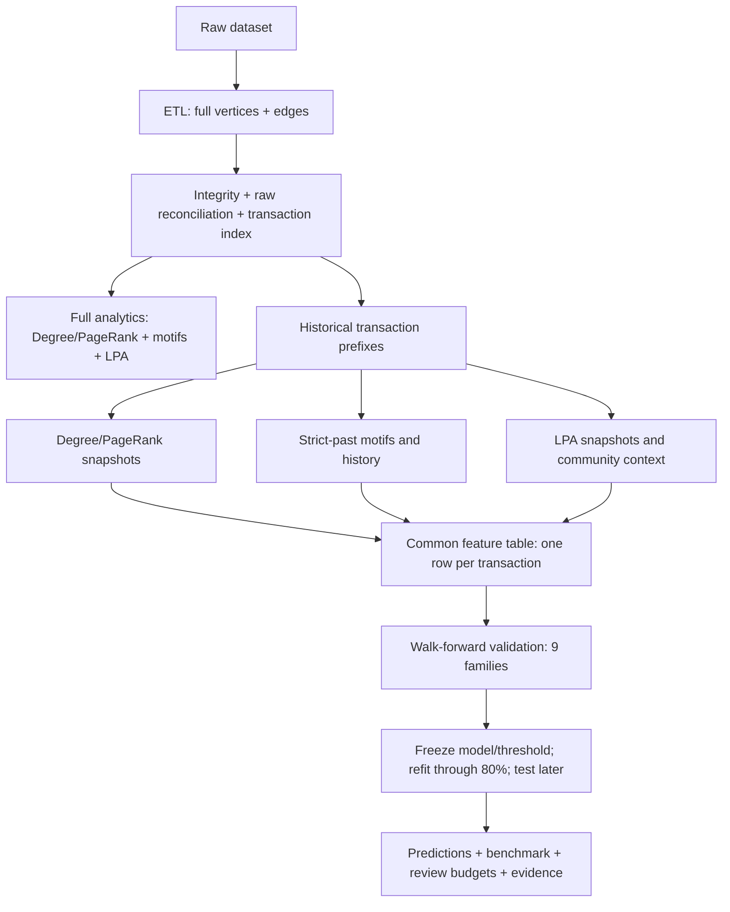

# GraphGuard — Fraud & Anti-Money Laundering

GraphGuard phân tích mạng lưới giao dịch bằng **Degree/PageRank, temporal motifs và LPA communities**, rồi kết hợp các đặc trưng thành mô hình chấm điểm rủi ro cho từng giao dịch. Kết quả gồm score, cảnh báo, benchmark và giao dịch làm chứng cứ để hỗ trợ review.

**Đã chạy full cả hai datasets:** IBM **35/35 code cells, 13 hình**; PaySim **36/36 code cells, 12 hình**. Mỗi dataset có **9 phương án đối chứng**; full project gate đã PASS trên Windows Python 3.12 / JDK 17.

## 1. Dữ liệu và notebook trình bày

| Dataset | Accounts | Transactions | Nhãn dương | Notebook có code và output |
|---|---:|---:|---|---|
| IBM AML HI-Small | 518.581 | 5.078.345 | 5.177 laundering | [IBM full system](notebooks/IBM_full_system.ipynb) |
| PaySim | 9.073.900 | 6.362.620 | 8.213 fraud | [PaySim full system](notebooks/PaySIM_full_system.ipynb) |

Mỗi notebook đi từ input đến kết quả cuối, có giải thích Markdown, code thuật toán thực thi và biểu đồ. Các kernel quan trọng được đối chiếu logic với module Python bằng AST. Trong output, `isFraud` là **nhãn gốc**; `risk_score` và `alert` là **kết quả của mô hình**.

## 2. Pipeline thống nhất



Full analytics mô tả toàn graph. Đặc trưng dùng để dự đoán được tính theo thời điểm: motif chỉ dùng giao dịch trước quyết định; Degree/PageRank và community lấy từ snapshot quá khứ. Mọi phương án dùng cùng transaction index và tập đánh giá trong từng dataset.

## 3. Kết quả và hiệu quả hệ thống

**T** = thông tin giao dịch; **C** = Degree/PageRank; **M** = motifs/history; **L** = community context. Mô hình và ngưỡng được chọn bằng validation trước khi đánh giá test.

| Dataset | Phương án | Precision | Recall | F1 | AP | Alerts |
|---|---|---:|---:|---:|---:|---:|
| IBM | T — baseline | 9,07% | 48,30% | 15,27% | 5,62% | 9.584 |
| IBM | T+C+M+L — được chọn | 10,09% | 27,79% | 14,80% | 5,87% | 4.956 |
| PaySim | T — baseline | 81,01% | 19,67% | 31,65% | 17,00% | 1.032 |
| PaySim | T+C+M+L | 58,31% | 26,00% | 35,96% | 28,98% | 1.895 |
| PaySim | T+M+L — được chọn | 58,12% | 26,09% | 36,02% | 26,58% | 1.908 |

**Hệ thống có hiệu quả trong việc bổ sung ngữ cảnh graph cho xếp hạng và review giao dịch.** Trên PaySim, phương án được chọn nâng F1 từ **31,65% lên 36,02%**, AP từ **17,00% lên 26,58%**, số TP từ **836 lên 1.109**. Trên IBM, full fusion nâng precision từ **9,07% lên 10,09%**, nâng AP từ **5,62% lên 5,87%** và giảm số cảnh báo từ **9.584 xuống 4.956**, giúp tập trung danh sách review.

Benchmark còn có precision/recall theo ngân sách review **0,1% / 0,5% / 1%**, ba validation folds, năm khoảng test theo thời gian và khoảng Wilson 95% cho precision/recall. Model reload và phép tính metrics độc lập xác nhận kết quả xuất ra khớp với predictions.

Xem [toàn bộ số liệu và protocol](docs/PartB_Experiments.md), [so sánh hai datasets và ablations](docs/PartB_Comparison.md). Biểu đồ degree của hai full graphs có sẵn trong repo:


## 4. Tìm code theo chức năng

```text
graphguard-amls-detection/
├── src/
│   ├── common/                 # Spark session, integrity, hardware guard, audit
│   ├── paysim/                 # ETL, Degree/PageRank, relay motifs, LPA PaySim
│   ├── ibm_aml/                # ETL, Degree/PageRank, cycle motifs, LPA IBM
│   ├── motif/
│   │   ├── config.py           # Feature groups, windows, folds và thresholds
│   │   ├── features.py         # Strict-past fan-in/out, relay, reciprocal, cycle
│   │   ├── modeling.py         # Shared preprocessing, weighted tree, scoring
│   │   ├── pipeline.py         # Full pipeline, snapshots, validation và test
│   │   └── presentation.py     # Notebook views, graphs và case evidence
│   └── comparison/
│       └── degree_distribution.py
├── notebooks/
│   ├── IBM_full_system.ipynb
│   └── PaySIM_full_system.ipynb
├── scripts/                    # Setup, download, notebook runner và check gates
├── tests/                      # Unit tests, independent oracles, native checks
├── docs/                       # Lý thuyết, code explainer, benchmark và audit
└── results/comparison/full/     # CSV, biểu đồ và manifest so sánh degree full
```

| Muốn đọc phần nào? | File bắt đầu |
|---|---|
| Mapping raw → graph | [PaySim ETL](src/paysim/etl_mapping.py), [IBM ETL](src/ibm_aml/etl.py) |
| Degree và PageRank | [Shared full backend](src/paysim/metrics.py), [IBM adapter](src/ibm_aml/metrics.py) |
| Motif queries | [PaySim relay](src/paysim/motif_finding.py), [IBM cycle](src/ibm_aml/motif_finding.py) |
| LPA / communities | [Shared full backend](src/paysim/community_detection.py), [IBM adapter](src/ibm_aml/community_detection.py) |
| Kết hợp và đánh giá | [Pipeline](src/motif/pipeline.py), [modeling](src/motif/modeling.py), [independent audit](src/common/project_audit.py) |

[Code Explainer](docs/Code_Explainer.md) hướng dẫn đọc từng chặng và vị trí code cells trong hai notebook. [Part A](docs/PartA_Theory.md) trình bày nền tảng thuật toán; [project brief](BIG_Data_Group6.md) mô tả bài toán và data contract.

## 5. Chạy lại trên Windows PowerShell

Cần **Python 3.12, JDK 17** và dependency pins trong [requirements.txt](requirements.txt). Chạy tại repository root. Raw CSV và full Parquet được tạo local; [hướng dẫn dữ liệu](data/raw/README.md) ghi rõ cách tải và kiểm tra input.

```powershell
# Chuẩn bị môi trường và dữ liệu một lần
powershell.exe -NoProfile -ExecutionPolicy Bypass -File .\scripts\setup_windows.ps1
powershell.exe -NoProfile -ExecutionPolicy Bypass -File .\scripts\download_datasets.ps1
& .\.venv\Scripts\python.exe -m src.paysim.export_parquet
& .\.venv\Scripts\python.exe -m src.ibm_aml.etl
```

```powershell
# Chạy tuần tự, lưu output sau từng cell
$env:GRAPHGUARD_MAX_HEAP = '5g'
$env:OPENBLAS_NUM_THREADS = '1'
$env:OMP_NUM_THREADS = '1'
& .\.venv\Scripts\python.exe scripts\run_n4_notebook.py --notebook notebooks\IBM_full_system.ipynb --cell-timeout 7200
if ($LASTEXITCODE -ne 0) { throw 'IBM execution failed' }
& .\.venv\Scripts\python.exe scripts\run_n4_notebook.py --notebook notebooks\PaySIM_full_system.ipynb --cell-timeout 7200
if ($LASTEXITCODE -ne 0) { throw 'PaySim execution failed' }
& .\.venv\Scripts\python.exe -m src.comparison.degree_distribution
if ($LASTEXITCODE -ne 0) { throw 'Comparison failed' }

# Entry point của make check
powershell.exe -NoProfile -ExecutionPolicy Bypass -File .\scripts\check_project.ps1 -MaxHeap 5g
```

Để đọc bài, mở hai notebook với output đã lưu. Để tái lập, các lệnh trên tạo đầy đủ input, models và artifacts tại máy chạy. Profile đã kiểm chứng dùng toàn bộ CPU khả dụng, heap **5 GiB**, job cap **8 GiB**, khoảng **8 GiB** host reserve và một workload nặng tại một thời điểm. Quy trình chi tiết ở [PowerShell skill](.agents/skills/graphguard-powershell/SKILL.md); trạng thái nghiệm thu ở [project audit](docs/Project_Code_Audit_2026-10-22.md).
