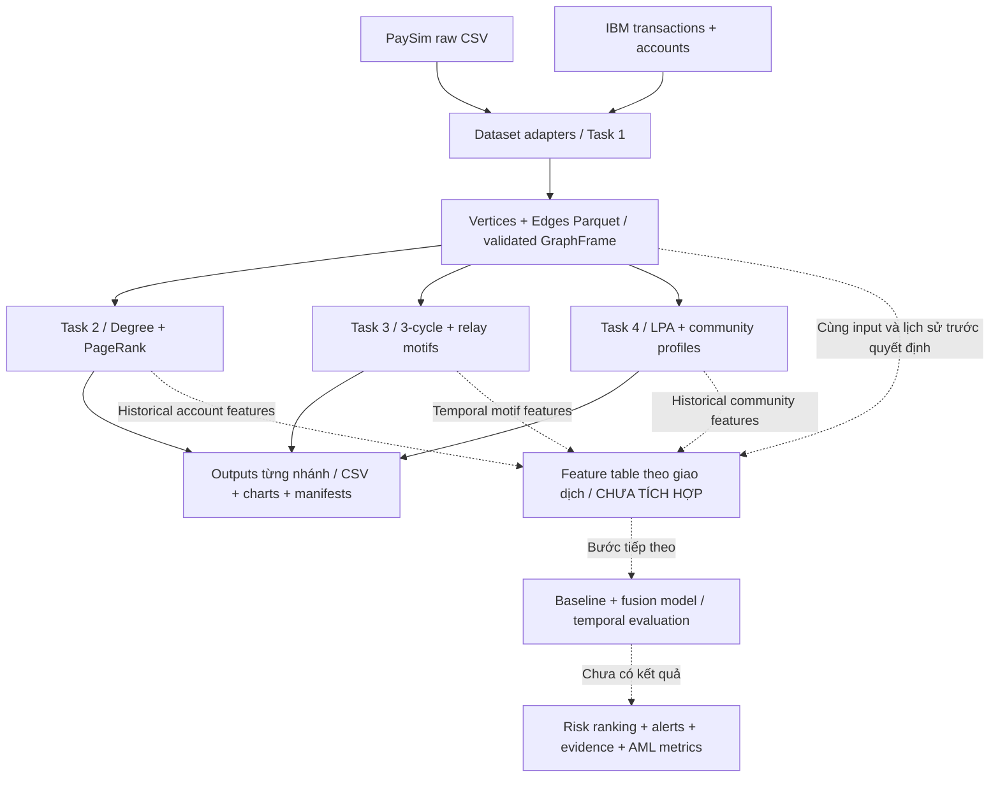

# GraphGuard — Graph Analytics for Fraud and Anti-Money Laundering

**Dự án Big Data của Nhóm 6** phân tích mạng lưới giao dịch bằng PySpark và GraphFrames: xây graph, tìm tài khoản trung tâm, truy vấn dòng tiền nhiều bước và phân tích cộng đồng. Mục tiêu là tạo **ứng viên cần điều tra kèm chứng cứ**, đồng thời đo được tín hiệu nào thật sự giúp nhận diện giao dịch fraud/laundering.

PaySim là dataset core theo đề; IBM AML HI-Small là phần mở rộng đã triển khai. Dự án hiện có đủ code Task 1–4, kết quả từng nhánh và kiểm chứng tự động. **Mô hình kết hợp cả ba nhánh chưa được triển khai; chưa có kết quả AML cuối của mô hình kết hợp.**

## 1. Objective và câu hỏi nghiên cứu

Đơn vị dự đoán khi đánh giá detector là **một giao dịch**, tương ứng một edge. Với IBM, đối chiếu dự đoán với `Is Laundering` được ETL ánh xạ thành `isFraud`; với PaySim, đối chiếu nhãn fraud của simulator. Account/community là ngữ cảnh và đầu ra điều tra bổ sung, không tự động có nhãn “tội phạm”.

| Câu hỏi | Phần thực hiện | Bằng chứng cần có |
|---|---|---|
| Có xây được transaction graph toàn vẹn từ raw data không? | Task 1 — ETL / Graph Construction | Schema, counts, null/key/endpoint checks, raw reconciliation theo phạm vi đã chạy |
| Những tài khoản nào là hub theo mức độ tham gia và centrality? | Task 2 — Degree + PageRank | Degree distribution, top 10 PageRank, tham số và scope sample/full |
| Có cycle hoặc relay đáng điều tra không? | Task 3 — Motif Finding | Các cạnh giao dịch thật, hướng, thời gian, amount/currency; phân biệt số vòng và tổ hợp đa cạnh |
| Các tài khoản được gom thành cộng đồng như thế nào? | Task 4 — LPA / communities | Assignments, summary đầy đủ, internal/cross edges, stability và currency profiles |
| Kết hợp ba loại ngữ cảnh có giúp phát hiện laundering hơn baseline không? | Bước tích hợp tiếp theo | Cùng transaction population, causal features, temporal validation và ablation trên test |

Graph pattern là tín hiệu cấu trúc. Một cycle hợp pháp vẫn có thể xuất hiện; fraud cũng có thể không tạo cycle. Vì vậy đầu ra cuối cần cả **risk ranking, alert có threshold đã khóa, TP/FP/FN/TN và chứng cứ giao dịch**, thay vì chỉ đếm motif hoặc báo số test PASS.

## 2. Datasets và ý nghĩa kết quả

| | PaySim — core theo đề | IBM AML HI-Small — mở rộng AML |
|---|---|---|
| Bản chất | Mobile-money synthetic data cho nghiên cứu fraud | Synthetic bank transactions có nhãn laundering |
| Full graph hiện có | 6.362.620 edges; 9.073.900 accounts | 5.078.345 edges; 518.581 accounts; 5.177 positive labels |
| Sample hiện có | 100.729 edges; 194.195 accounts; 153 fraud edges | 99.869 edges; 119.043 accounts; 89 laundering edges |
| Thời gian | `step` là giờ mô phỏng | `step` là Unix epoch seconds; giữ cả timestamp |
| Tiền | Giữ amount của simulator | Giữ nguyên payment/receiving currency; không cộng nominal amount khác currency |
| Vai trò trong kết luận | Chứng minh pipeline và phân tích fraud/relay | Đánh giá trực tiếp mục tiêu nhận diện laundering trên nhãn tổng hợp |

Nguồn: [PaySim dataset](https://www.kaggle.com/datasets/ealaxi/paysim1), [bài báo PaySim](https://www.msc-les.org/proceedings/emss/2016/EMSS2016_249.pdf), [IBM AML-Data](https://github.com/IBM/AML-Data) và [bài báo AMLworld](https://arxiv.org/html/2306.16424v3). Hai dataset đều tổng hợp; kết quả không chứng minh hiệu quả điều tra ngoài thực tế.

Raw input gồm một CSV PaySim và ba file IBM: `HI-Small_Trans.csv`, `HI-Small_accounts.csv`, `HI-Small_Patterns.txt`. Patterns chỉ phục vụ audit/minh họa typology, **không làm feature detector**. Không cần tải tất cả biến thể IBM để chạy HI-Small. Raw CSV/full Parquet được lưu local theo hướng dẫn trong [data/raw/README.md](data/raw/README.md).

PaySim directed 3-cycle bằng **0** là negative finding đã kiểm chứng. Theo phạm vi được ghi trong [tài liệu dự án](BIG_Data_Group6.md), nhóm giữ query cycle đối chứng và phân tích thêm relay `TRANSFER → CASH_OUT`; không đổi dữ liệu để ép có cycle. IBM là phần mở rộng, không thay thế PaySim core.

<a id="kiến-trúc"></a>

## 3. Kiến trúc và trách nhiệm các nhánh



Graph giữ đa cạnh và self-loop từ dữ liệu; mỗi edge là một giao dịch. Degree đếm transaction edges, không mặc định là số đối tác khác nhau. PageRank dùng `resetProbability=0.15`, `maxIter=10`; LPA dùng GraphX backend, `maxIter=5` và checkpoint. Summary cộng đồng có nhãn fraud chỉ dùng **phân tích sau chạy**, không đưa tỷ lệ fraud của test vào feature.

Connected Components là phần mở rộng theo GO/NO-GO trong PCCV; chưa có pipeline CC được nghiệm thu ở đây. LPA và CC không được dùng như cùng một thuật toán. Bằng chứng thực thi hiện là Windows `local[2]`, chưa phải benchmark trên cụm phân tán.

Hai lớp kết quả được giữ riêng: **analytics theo đề** mô tả graph trên scope đã chọn; **detector** phải tính feature theo thời gian quyết định và đánh giá trên giao dịch tương lai. CSV top 10 hoặc label ID của LPA không phải sẵn một feature table cho detector.

## 4. Phân công cả nhóm theo PCCV

Nguồn ownership/deadline là file local `BDA - PCCV - Trang tính1.csv`. Bảng này mô tả nhiệm vụ được giao, không suy ra tác giả mọi dòng code hay thay thế phê duyệt của reviewer.

| Thành viên | Nhiệm vụ theo phân công | Source / tài liệu liên quan |
|---|---|---|
| **Tuệ Minh** | Lead; Task 1 PaySim/final checks; GraphX vs GraphFrames; duyệt partitioning; tích hợp và code freeze | `src/paysim/graph_analysis.py`, `scripts/check_project.ps1`, `Makefile`, Part A/B |
| **Thảo** | SparkSession, layout/common contract, PaySim/IBM ETL, Parquet, integrity và QA raw IBM | `src/common/`, `src/paysim/{etl_mapping,export_parquet}.py`, `src/ibm_aml/etl.py`, `docs/person2_handoff.md` |
| **Châu Anh** | Task 2 Degree/PageRank hai dataset; hỗ trợ CC/LPA, kiểm tra stability và final Task 4 PaySim | `src/{paysim,ibm_aml}/metrics.py`, tests/reference checks và community stability |
| **Khánh** | Toy/motif PaySim và IBM; review/final PageRank theory, IBM ETL và Task 4 IBM | `src/{paysim,ibm_aml}/motif_finding.py`, `src/motif/`, `src/ibm_aml/verify_communities.py`, hai notebook `03_khanh_*` |
| **Hoàng** | LPA/CC theory; Task 4 hai dataset; review/final Task 3 IBM | `src/{paysim,ibm_aml}/community_detection.py`, `docs/CC_vs_LPA_Note.md` |
| **Phương** | PageRank derivation; review/final Task 2/3; cross-dataset comparison | `src/comparison/degree_distribution.py`, `docs/PartA_Theory.md`, `docs/PartB_Comparison.md` |
| **Tuấn Anh** | Vertex-cut/edge-cut; review/final GraphX–GraphFrames; sửa CC/LPA theory; tổng hợp Part B và report cùng Tuệ Minh | `docs/PartA_Theory.md`, `docs/PartB_Experiments.md`, `docs/PartB_Comparison.md` |

Các mốc final được đối chiếu đúng CSV: Phương final Task 2 IBM; Hoàng final Task 3 IBM; Khánh final Task 4 IBM. Những nhiệm vụ tổng hợp/review không bắt buộc phải tạo một module Python mang tên từng thành viên. Part A, Part B và comparison là deliverables của cả nhóm; hai notebook của Khánh là phương tiện trình bày phần được giao, không đại diện toàn project.

## 5. Code và output theo nhiệm vụ

| Nhánh | Entry point chính | Output hiện có / scope |
|---|---|---|
| ETL / Task 1 | `src/paysim/export_parquet.py`, `src/paysim/graph_analysis.py`, `src/ibm_aml/etl.py` | Full/sample vertices/edges Parquet, integrity checks; Task 1 PaySim sample manifest |
| Task 2 | `src/paysim/metrics.py`, `src/ibm_aml/metrics.py` | Root `results/<dataset>/`: **sample** degree CSV/PNG, `top10_pagerank.csv`, `task2_run.json`; CLI hỗ trợ full/custom input |
| Task 3 baseline | `src/{paysim,ibm_aml}/motif_finding.py` | **Full** motif summary, relay/cycle CSV; kiểm tra độc lập và run evidence |
| Motif-assisted experiment | `src/motif/{features,modeling,pipeline}.py` | **Full** temporal experiment trong notebook; CLI có thể export model/features/report vào thư mục mới |
| Task 4 | `src/{paysim,ibm_aml}/community_detection.py` | Root **sample** assignments, top-50/all-summary, IBM amounts theo currency và `task4_run.json`; full IBM review trong notebook |
| Comparison | `src/comparison/degree_distribution.py` | `results/comparison/`: degree PMF CSV/PNG, scope **sample** |
| Kiểm chứng | `src/common/project_audit.py`, `scripts/check_project.ps1`, `tests/` | Bounded references, native fixtures, manifest/output checks và full Task 3 gate |
| Đánh giá nhánh riêng | `src/common/project_audit.py --signals ...` | **Sample pilot** centrality/community; predictions, validation/test metrics, baseline và manifests trong `results/project_check/signals/` |

Không ghép trực tiếp output root sample của Task 2/4 với `event_id` full của notebook motif: chưa cùng population, cutoff hoặc transaction index. Xem [audit và phương án tích hợp](docs/Project_Code_Audit_2026-10-22.md#review-ngay-2310--diem-chat-luong-va-phuong-an-tich-hop).

## 6. Kết quả đã có và giới hạn

### 6.1. Analytics theo đề

- **PaySim full:** 0 directed 3-cycle; 30 relay >10.000 trong 24 giờ, gồm 2 cặp cùng giờ chưa biết thứ tự thực. Các cạnh relay baseline có nhãn 0; 30 ứng viên không phải 30 fraud TP.
- **IBM full:** audit trên các cạnh đã gắn nhãn cho 54 directed account cycles, 2.491 transaction combinations và 45 bộ ba account không xét chiều. Đây là **label-conditioned audit**, không phải phát hiện mù 54 vụ laundering. Query không dùng nhãn, ba cạnh USD >10.000, trả 0.
- **Task 2 sample:** top-10 PageRank khớp reference độc lập, degree sum bằng `2E`; số incident fraud được đối chiếu sau khi chọn hub.
- **LPA sample:** PaySim 186.932 communities trên 194.195 accounts; IBM 86.223/119.043. Hai lượt PaySim sample có 0 canonical membership changes; không suy rộng thành bảo đảm deterministic.
- **LPA IBM full review:** gán đủ 518.581 accounts, 314.829 communities; 853.796 internal + 4.224.549 cross-community edges. Tất cả summary/currency được checker đối chiếu, gồm đủ 5.177 positive labels.

### 6.2. Detector experiment hiện tại: transaction-only và motif-assisted

Các feature motif/history không nhận nhãn; cây quyết định có giám sát học bằng nhãn training. Ba validation folds mở rộng 40→50%, 50→65%, 65→80% chọn family/threshold; refit đến 80%, đánh giá phần còn lại. Timestamp ties không chia đôi. Test này **đã được xem ở phiên bản trước**, nên là reused internal temporal holdout.

| Dataset / model | Test TP / FP / FN | Precision | Recall | F1 | Average precision |
|---|---:|---:|---:|---:|---:|
| PaySim transaction-only | 889 / 713 / 3.361 | 55,49% | 20,92% | 30,38% | 12,45% |
| PaySim motif-assisted | 1.191 / 1.489 / 3.059 | 44,44% | 28,02% | 34,37% | 20,71% |
| IBM transaction-only | 885 / 9.057 / 912 | 8,90% | 49,25% | 15,08% | 5,60% |
| IBM motif-assisted | 474 / 4.059 / 1.323 | 10,46% | 26,38% | 14,98% | 5,65% |

Mẫu số test: PaySim **1.248.736 giao dịch / 4.250 positives**; IBM **1.015.564 / 1.797**. Weighted tree score chưa được hiệu chuẩn thành xác suất. PaySim tăng F1/AP nhưng chưa tách đóng góp count motif khỏi role history. IBM giảm FP và giảm recall, F1 giảm nhẹ; không kết luận thêm motif luôn tốt hơn baseline.

### 6.3. Centrality/community pilot chưa đủ làm detector độc lập

Trên sample temporal holdout, precision của rule được validation chọn chỉ khoảng **0,07–0,36%**; PaySim community cảnh báo **100%** test. IBM centrality/community lần lượt chỉ có **1 TP**. Đây là kết quả yếu, dù code và phép tính đã PASS kiểm chứng. Chi tiết confusion matrices, novelty baseline và ảnh hưởng cold-start nằm trong [audit](docs/Project_Code_Audit_2026-10-22.md).

Không so điểm pilot sample này trực tiếp với motif full. Không có score cuối của fusion và không ghi trước rằng fusion sẽ cải thiện.

## 7. Phương án đánh giá kết hợp — bước tiếp theo, chưa triển khai

**Đề xuất của nhóm triển khai:** dùng một mô hình nhỏ trên feature table chung theo giao dịch; giữ ba nhánh graph làm nguồn feature. Không cộng thủ công ba điểm không cùng thang đo hoặc dùng `isFraud` trong motif/community để tạo nhãn dự đoán.

1. **Một input, một transaction index, một lịch đánh giá.** Giữ từng dòng duplicate; tạo index một lần rồi truyền cùng table cho mọi nhánh. `event_id` hiện là run-local; hash nội dung có thể trùng, nên không join ID của các run độc lập.
2. **Cùng thời điểm có thông tin, kể cả training rows.** Motif/history chỉ dùng `time < t`. Degree/PageRank/LPA lấy snapshot kết thúc trước batch đang chấm; tất cả mô hình dùng cùng lịch snapshot. Không gán snapshot cuối training cho mọi training row vì sẽ nhìn tương lai của các dòng trước đó; phải tạo snapshot trước từng block cả trong train. Lag của PageRank/LPA và strict-past motif được ghi rõ. Có thể cập nhật bằng giao dịch đã quan sát ở batch trước, không dùng nhãn validation/test. Giữ unseen-account flags riêng; không mặc định unseen = fraud.
3. **Feature đúng loại.** Transaction/type/amount scales fit trên train; Degree/PageRank của src/dst; cycle/relay/reciprocal/history; community size/internal/cross interaction và cờ quan hệ cùng nhóm từ snapshot. Không dùng label ID số học, fraud_rate hậu kiểm, balance cuối kỳ hoặc Patterns làm feature. Giữ currency/time semantics riêng theo dataset.
4. **Ablation công bằng.** Transaction-only; transaction + centrality; transaction + motif; transaction + community; full fusion; full fusion bỏ lần lượt từng nhóm. Giữ nguyên rows/splits/model family/tuning budget, báo thêm motif-counts so với role-history nếu muốn khẳng định lợi ích motif.
5. **Chọn trên validation, khóa trước test.** Giữ walk-forward chung; dùng baseline và family nhỏ hiện có trước khi cân nhắc model phức tạp. Báo AP, precision/recall/F1, alert rate và precision/recall tại ngân sách review đã khai báo. Ngưỡng lấy từ validation; khi không đạt yêu cầu thì báo chưa đạt, không ép positives.
6. **Xuất kết quả có thể kiểm toán.** Mỗi transaction có dataset/input/run ID, event ID, thời gian/as-of, score, alert, threshold và chứng cứ feature/witness. Nhãn thật chỉ join khi đánh giá. Có bảng metrics/ablation, PR curve, alert-budget curve và ví dụ TP/FP/FN. Test cũ vẫn phải ghi reused; cần batch/dataset chưa dùng nếu muốn kết luận ngoài mẫu mới.

Bài báo [AMLworld](https://arxiv.org/html/2306.16424v3#A4) mô tả graph features xử lý theo thứ tự thời gian để tránh dùng tương lai. Với nhãn hiếm, ưu tiên đọc precision–recall thay vì chỉ accuracy; xem [Saito & Rehmsmeier](https://journals.plos.org/plosone/article?id=10.1371/journal.pone.0118432). Phương án ở đây là thiết kế cho repo, không tuyên bố tái hiện benchmark của bài báo.

IBM dùng để đánh giá laundering trực tiếp; PaySim giữ vai trò core/fraud đối chứng. Tách báo cáo theo dataset, không trộn nhãn và không lấy trung bình F1 hai dataset thành một “AML score”. Điểm tài khoản/community sau gộp giao dịch chỉ là investigative ranking nếu chưa định nghĩa ground truth riêng. Pattern/ring-level precision/recall chỉ báo khi có mapping ground truth độc lập phù hợp.

## 8. Chạy project trên Windows PowerShell

Cần **Python 3.12**, **JDK 17**, PowerShell 5.1+; dependency pin trong `requirements.txt`. Chạy tại repo root bằng Windows `.venv\Scripts\python.exe`. Từng lệnh nặng phải kết thúc và đóng Python/kernel trước lệnh kế tiếp.

```powershell
# Setup và kiểm tra dependency
powershell.exe -NoProfile -ExecutionPolicy Bypass -File .\scripts\setup_windows.ps1
& .\.venv\Scripts\python.exe -m pip check

# Tải raw input còn thiếu; -VerifyOnly để chỉ kiểm tra dữ liệu local
powershell.exe -NoProfile -ExecutionPolicy Bypass -File .\scripts\download_datasets.ps1

# Giới hạn heap các caller về tối đa 5 GiB; guard bắt buộc vẫn hoạt động
$env:GRAPHGUARD_MAX_HEAP = '5g'
$env:OPENBLAS_NUM_THREADS = '1'
$env:OMP_NUM_THREADS = '1'

# ETL full + sample; các lệnh ETL ghi lại Parquet, chỉ chạy khi cần tạo lại input
& .\.venv\Scripts\python.exe -m src.paysim.export_parquet
& .\.venv\Scripts\python.exe -m src.ibm_aml.etl

# Task 1: kiểm tra PaySim sample đã có
& .\.venv\Scripts\python.exe -m src.paysim.graph_analysis --sample

# Task 2: mặc định sample; thêm --full để chọn full và output scope riêng
& .\.venv\Scripts\python.exe -m src.paysim.metrics
& .\.venv\Scripts\python.exe -m src.ibm_aml.metrics

# Task 3 baseline full
& .\.venv\Scripts\python.exe -m src.paysim.motif_finding
& .\.venv\Scripts\python.exe -m src.ibm_aml.motif_finding

# Task 4 sample; IBM full/custom dùng --input-dir và --output-dir riêng
& .\.venv\Scripts\python.exe -m src.paysim.community_detection --check-stability
& .\.venv\Scripts\python.exe -m src.ibm_aml.community_detection

# Degree comparison sample
& .\.venv\Scripts\python.exe -m src.comparison.degree_distribution
```

Lần chạy ghi đè producers làm manifest/bảng phụ thuộc có thể hết hiệu lực; chạy gate sau khi thay input/source/output. Detector experiment CLI dùng output directory **mới/rỗng**, ví dụ `--analysis --driver-memory 5g --output-dir .\results\motif\v2\ibm_run_new` trên adapter IBM. Chi tiết API/model export ở `src/motif/pipeline.py`; exported IDs chỉ có ý nghĩa cùng run.

## 9. Kiểm chứng và notebooks

```powershell
# Cùng entry point với make check; mặc định profile tối đa 5g
powershell.exe -NoProfile -ExecutionPolicy Bypass -File .\scripts\check_project.ps1 -MaxHeap 5g

# Artifact/unit checks nhẹ, không Spark
powershell.exe -NoProfile -ExecutionPolicy Bypass -File .\scripts\check_project.ps1 -ArtifactsOnly

# Tạo lại 4 pilot nếu chưa có: dùng SignalRoot mới/rỗng; các producer chạy tuần tự
powershell.exe -NoProfile -ExecutionPolicy Bypass -File .\scripts\check_project.ps1 -Refresh -SignalRoot '.\results\project_check\signals_new'

# Dùng cùng root đó khi kiểm chứng lại
powershell.exe -NoProfile -ExecutionPolicy Bypass -File .\scripts\check_project.ps1 -SignalRoot '.\results\project_check\signals_new'
```

Gate gồm dependency, 44 test nhẹ, 26 artifact checks, native guard/algorithm suites và Task 3 full gate. Nó kiểm tra sample PageRank/LPA, manifests, notebook outputs/hashes, 4 pilot, IBM ETL full và motif full hai dataset. **PASS không xác nhận detector tốt, chưa nghiệm thu fusion và không thay phê duyệt con người.** PaySim full raw reconciliation và Task 2 full chưa được chứng minh chỉ bằng gate này. Log Task 3 ở `results/ibm_aml/check_task3.log`; preflight JSON ở `results/project_check/latest.json`.

Một số input/evidence không được track: raw CSV, full Parquet, `results/project_check/`, model/check runs. Clone mới cần dựng input và tạo pilot trước khi gate đầy đủ PASS; output notebook đã lưu không thay thế bước chạy trên máy mới. Task 4 checker riêng có ở `scripts/check_task4.ps1`; full review dùng `-Full -Runs 1 -DriverMemory 5g`, không kết luận stability từ một lượt.

| Notebook | Mục đích |
|---|---|
| [00_dataset_exploration](notebooks/00_dataset_exploration.ipynb) | Khám phá dữ liệu; output cũ là historical, chưa được chạy lại toàn bộ trong audit mới |
| [02_n4_toy_motif](notebooks/02_n4_toy_motif.ipynb) | Demo 3-cycle trên toy graph |
| [03_khanh_PaySIM_motif](notebooks/03_khanh_PaySIM_motif.ipynb) | Phần PaySim của Khánh: toy, baseline, experiment, evidence, PageRank review |
| [03_khanh_IBM_motif](notebooks/03_khanh_IBM_motif.ipynb) | Phần IBM của Khánh: raw ETL review, motifs, experiment, LPA/checker |

Chọn Windows `.venv` kernel, **Restart Kernel → Run All**, chỉ một notebook mỗi lượt. Muốn chạy bằng CLI, dùng `scripts/run_n4_notebook.py --notebook <path>` với `.venv\Scripts\python.exe`. Hai notebook 03 đã chạy đủ **12/12 và 15/15 cells**, mỗi file **6 hình và 22 source hashes**, ngày 22/10. Output vẫn khớp source khi review; xem [audit](docs/Project_Code_Audit_2026-10-22.md) cho gate và phạm vi kiểm chứng mới nhất.

<a id="bảo-vệ-tài-nguyên-trên-máy-windows"></a>

## 10. Tài nguyên và tài liệu

Guard Windows chạy trước Java: mutex một workload, CPU hard cap **10%**, tối đa **2 logical CPUs**, RAM/commit reserve. Profile full notebook/gate yêu cầu **5 GiB heap / 8 GiB job cap**; sample 4/7 GiB. Cần đủ budget + reserve và ít nhất 12 GiB đĩa trống để spill. Không bỏ guard, chạy song song hoặc tăng cap sau OOM/pressure stop. GPU chưa có backend được kiểm chứng; không mặc định offload. Runbook chi tiết ở [skill PowerShell](.agents/skills/graphguard-powershell/SKILL.md) và [AGENTS.md](AGENTS.md).

| Tài liệu | Nội dung |
|---|---|
| [BIG_Data_Group6.md](BIG_Data_Group6.md) | Mục tiêu, scope core/bonus, data contract và kế hoạch của nhóm |
| [PageRank theory](docs/PartA_Theory.md) / [CC–LPA note](docs/CC_vs_LPA_Note.md) | Hiện có nội dung 3.3 và note 3.4; bản Part A 3.1/3.2 hoàn chỉnh chưa được xác nhận trong repo |
| [Part B](docs/PartB_Experiments.md) | Task 1–4 và kết quả thực nghiệm; đọc scope/date của từng bảng |
| [Comparison](docs/PartB_Comparison.md) | So sánh hai dataset |
| [DE handoff](docs/person2_handoff.md) / [schema comparison](docs/DE_Paysim_IBM_Comparison.md) | Mapping và khác biệt ETL |
| [Audit, điểm review và kế hoạch fusion](docs/Project_Code_Audit_2026-10-22.md) | Checklist DONE FIXED, evidence, giới hạn và việc còn thiếu để có kết quả cuối |

Cấu trúc chính: `src/common/` dùng chung; `src/paysim/` và `src/ibm_aml/` là adapters/Task 1–4; `src/motif/` là experiment dùng chung; `src/comparison/` là so sánh; `tests/` và `scripts/` là kiểm chứng. CSV phân công là tài liệu điều phối local, không dùng cột Status để thay bằng chứng code/results.
