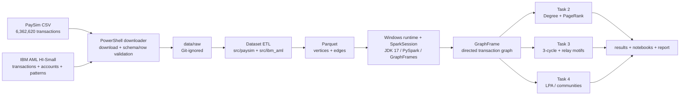

# GraphGuard AML — Distributed Transaction-Graph Analytics

GraphGuard là dự án Big Data xây dựng đồ thị giao dịch có hướng từ hai bộ dữ liệu tài chính tổng hợp, sau đó phân tích **Degree/PageRank**, **Motif Finding** và **Community Detection** bằng **PySpark 3.5.1 + GraphFrames 0.12.2**. Dự án tập trung vào khả năng tái lập trên Windows, tính toàn vẹn của graph và cách diễn giải thận trọng: kết quả graph tạo danh sách cần điều tra, không tự động chứng minh gian lận hay rửa tiền.

## Kiến trúc



## Trạng thái và phạm vi

Phần của Khánh đến **Final Task 4 IBM (07/10)** được trình bày trong hai notebook độc lập: [`03_khanh_PaySIM_motif.ipynb`](notebooks/03_khanh_PaySIM_motif.ipynb) cho PaySim và [`03_khanh_IBM_motif.ipynb`](notebooks/03_khanh_IBM_motif.ipynb) cho IBM AML HI-Small. Mỗi notebook có giải thích tiếng Việt, cell import/lời gọi ngắn, kết quả thật và biểu đồ nhúng; thuật toán được quản lý trong các module Python, chỉ đọc input dataset tương ứng. PASS kỹ thuật không thay phê duyệt của người review và không xác nhận toàn bộ công việc của cả nhóm.

Hai dataset được dùng:

| Dataset | Vai trò | File local | Ghi chú |
|---|---|---|---|
| [PaySim](https://www.kaggle.com/datasets/ealaxi/paysim1) | Dataset chính; fraud trong mobile-money simulation | `data/raw/paysim/PS_20174392719_1491204439457_log.csv` | 6,362,620 giao dịch; `step` là giờ mô phỏng |
| [IBM Transactions for AML](https://www.kaggle.com/datasets/ealtman2019/ibm-transactions-for-anti-money-laundering-aml) | Mở rộng để phân tích cycle/typology AML | `data/raw/ibm_aml/HI-Small_Trans.csv`, `HI-Small_accounts.csv`, `HI-Small_Patterns.txt` | `Trans` + `accounts` cho ETL; `Patterns` cho audit/kịch bản motif |

IBM AML có 18 file, gồm 6 biến thể HI/LI × Small/Medium/Large, mỗi biến thể có `Trans`, `accounts`, `Patterns`. Project và bảng phân công dùng **HI-Small** xuyên suốt; ba file của biến thể này là bộ đầy đủ cần thiết. 15 file còn lại là các biến thể thay thế, không phải phần bổ sung cho HI-Small; tải cả archive 41,61 GB không phục vụ pipeline hiện tại. PaySim chỉ cần CSV giao dịch trong bảng trên. Raw CSV và full Parquet không được commit; `HI-Small_Patterns.txt` nhỏ nên đã được track trong repo. Hãy đọc điều khoản/license trên trang nguồn trước khi sử dụng hoặc chia sẻ dữ liệu.

## Cài đặt trên Windows PowerShell 5.1+

Yêu cầu bắt buộc: **Windows Python 3.12**, **JDK 17**, Git và khoảng 2 GB cho dataset. Khi bắt đầu tính toán cần thêm **ít nhất 12 GiB trống** trên ổ temp/workspace để spill. Profile bảo vệ cần khoảng 16 GiB RAM trở lên; các lần chạy full được kiểm chứng trên máy 32 GiB, không bảo đảm full chạy được ở mức RAM tối thiểu. Repo hỗ trợ đường dẫn có khoảng trắng và tiếng Việt; không cần activate virtual environment.

```powershell
# Chạy PowerShell tại thư mục muốn chứa project
git clone https://github.com/harvey105/graphguard-amls-detection.git
Set-Location '.\graphguard-amls-detection'

# Nếu máy chưa có Python/JDK
winget install --id Python.Python.3.12 --exact
winget install --id EclipseAdoptium.Temurin.17.JDK --exact

# Tạo .venv, cài requirements và Hadoop 3.3.4 native tools có kiểm SHA256
powershell.exe -NoProfile -ExecutionPolicy Bypass -File .\scripts\setup_windows.ps1
```

`setup_windows.ps1` luôn dùng `.venv\Scripts\python.exe`, kiểm tra Python 3.12, JDK 17, `pip check`, và cài đúng phiên bản trong `requirements.txt`. Nếu vừa cài JDK/Python bằng `winget`, hãy mở một cửa sổ PowerShell mới trước khi setup.

## Bảo vệ tài nguyên trên máy Windows

**Chỉ chạy một tác vụ nặng tại một thời điểm**: notebook, Spark CLI, ETL, LPA hoặc gate. Đóng kernel/Python của tác vụ trước trước khi bắt đầu tác vụ tiếp theo; `spark.stop()` có thể vẫn để JVM tồn tại. Không chạy hai notebook song song hoặc chạy `make check` khi notebook đang chạy.

`src/common/hardware_guard.py` được gọi bắt buộc trước khi `get_graph_session` khởi động Java. Windows Job Object giới hạn cả nhóm Python/JVM con; named mutex từ chối tác vụ thứ hai. Trên máy 32 GiB: tối đa **2 logical CPUs**, CPU hard cap **10%**, JVM heap **6 GiB**, tổng committed memory của job **10 GiB**; giữ khoảng **8 GiB** RAM và Windows commit dự phòng. Trần giảm hoặc từ chối trên máy nhỏ/bận. GC/compiler JVM cũng chỉ thấy 2 processor; ưu tiên tiến trình dưới bình thường. Đây là giới hạn cho job, không đổi power plan/BIOS của máy.

Admission cần đủ RAM/commit cho budget cộng reserve và ≥12 GiB trống ở ổ temp/workspace. Watchdog kiểm tra mỗi 2 giây; thiếu reserve trong 2 mẫu liên tiếp, CPU host ≥85% kéo dài, disk còn <5 GiB hoặc mất khả năng giám sát làm **dừng nhóm tiến trình của chính job**. Windows thu hồi JVM con nếu Python/kernel chết. Giới hạn commit có thể khiến ứng dụng báo OOM thay vì tiếp tục cấp phát. Resource stop là FAIL; không tự retry/tăng RAM/tăng worker. Dùng column projection, disk spill và giải phóng cache; không stress-test máy.

Cơ chế này dùng [Windows Job Objects](https://learn.microsoft.com/en-us/windows/win32/procthread/job-objects) và [CPU hard cap](https://learn.microsoft.com/en-us/windows/win32/api/winnt/ns-winnt-jobobject_cpu_rate_control_information). CPU temperature chưa được đọc đáng tin cậy trên máy này; giới hạn phần mềm **không bảo đảm chống lỗi tản nhiệt, nguồn hoặc phần cứng**. Nếu có tiếng lạ/tắt máy bất thường, dừng tính toán và kiểm tra máy.

GPU RTX A4500 hiện chưa được pipeline sử dụng. GraphFrames/GraphX và Spark ML trong stack Windows native đã pin chạy trên CPU; thêm GPU không tự offload các thao tác đó. [NVIDIA RAPIDS](https://docs.nvidia.com/datascience/platform-support/index.html) có yêu cầu nền tảng riêng; chưa có backend GPU của project được kiểm chứng nên không cài plugin/driver hay chuyển WSL để chạy tiếp.

Thứ tự kiểm chứng, mỗi lệnh kết thúc rồi mới chạy lệnh kế tiếp:

```powershell
& .\.venv\Scripts\python.exe -m unittest tests.test_hardware_guard -v
powershell.exe -NoProfile -ExecutionPolicy Bypass -File .\scripts\check_task3.ps1
& .\.venv\Scripts\python.exe .\scripts\run_n4_notebook.py --notebook .\notebooks\03_khanh_PaySIM_motif.ipynb
& .\.venv\Scripts\python.exe .\scripts\run_n4_notebook.py --notebook .\notebooks\03_khanh_IBM_motif.ipynb
```

Notebook runner lưu output sau mỗi cell hoàn tất bằng ghi tạm + flush + atomic replace trên cùng filesystem, giữ bản đã lưu nếu lần ghi tiếp theo thất bại. File tạm được dọn sau khi lưu; khi kernel bị dừng vẫn giữ output từng phần. Runtime cuối notebook báo peak job commit, RAM còn thấp nhất và CPU host cao nhất quan sát được. Test hardware guard dùng tiến trình con nhỏ và áp lực mô phỏng, không cố làm cạn tài nguyên thật.

### Kiểm chứng bản bàn giao motif v2 — 19/10/2026

Đã kiểm chứng **48 test khác nhau** qua gate Task 3 và lần chạy bổ sung cho expiry-prefix/atomic checkpoint; gate full đối chiếu lại CSV baseline trên cả hai dataset. Sau lần máy tắt bình thường, 8 test hardware guard được chạy lại và PASS trước khi tiếp tục. Các kiểm tra dùng Windows Python 3.12.10, JDK 17, Spark 3.5.1 và GraphFrames 0.12.2.

| Notebook / phạm vi đo | Cell đã chạy | PNG nhúng | Peak job commit | RAM trống thấp nhất | CPU host cao nhất |
|---|---:|---:|---:|---:|---:|
| PaySim, toàn phiên | 12/12 | 6 | 7,51 GiB | 14,62 GiB | 27,3% |
| IBM, phiên review LPA | 15/15 tổng cộng | 6 | 6,26 GiB | 14,90 GiB | 60,9% |

CPU host bao gồm các ứng dụng khác; CPU hard cap của riêng job vẫn là 10%. IBM cell 1–12 đã lưu trước lệnh tắt máy từ Start menu lúc 02:27 ngày 19/10; sau khi kiểm tra event log, kernel mới chỉ khởi tạo lại session và chạy cell 13–15. Metadata `graphguard_execution.segments` ghi rõ hai phiên. Không có final resource snapshot của phiên motif IBM trước khi tắt máy; không suy ra peak toàn notebook từ số đo LPA. Mỗi notebook ghi 21 SHA-256 source đầy đủ trong metadata. Kernel/JVM đã đóng sau kiểm chứng.

Notebook `00_dataset_exploration.ipynb` chỉ được chuyển phần khởi tạo sang guard chung; output cũ đã đánh dấu historical, chưa chạy lại toàn bộ exploration. Các kết quả hiện hành của Khánh nằm trong hai notebook `03_khanh_*`.

## Tải và kiểm tra hai datasets

Script dùng `kagglehub` từ `.venv` để bảo đảm đủ **4 file**: một CSV PaySim và ba file IBM HI-Small. Nó kiểm tra dung lượng, header/số dòng của CSV và số khối kịch bản trong Patterns; chỉ tải file còn thiếu hoặc không đạt kiểm tra. Public dataset thường tải được không cần đăng nhập; nếu Kaggle yêu cầu consent/xác thực, tạo token tại Kaggle Settings và đặt `$env:KAGGLE_API_TOKEN` trước khi chạy.

```powershell
# Tải cả PaySim và IBM AML HI-Small, sau đó tự kiểm tra
powershell.exe -NoProfile -ExecutionPolicy Bypass -File .\scripts\download_datasets.ps1

# Chỉ kiểm tra lại dữ liệu đã có, không truy cập mạng
powershell.exe -NoProfile -ExecutionPolicy Bypass -File .\scripts\download_datasets.ps1 -VerifyOnly

# Tải/kiểm tra riêng từng dataset khi cần
powershell.exe -NoProfile -ExecutionPolicy Bypass -File .\scripts\download_datasets.ps1 -Dataset PaySim
powershell.exe -NoProfile -ExecutionPolicy Bypass -File .\scripts\download_datasets.ps1 -Dataset IbmAml

# Tải lại đúng một file, ví dụ file kịch bản IBM
powershell.exe -NoProfile -ExecutionPolicy Bypass -File .\scripts\download_datasets.ps1 -Dataset IbmAml -FileName HI-Small_Patterns.txt -Force

# Chủ động tải lại bản sạch
powershell.exe -NoProfile -ExecutionPolicy Bypass -File .\scripts\download_datasets.ps1 -Force
```

Kết quả hợp lệ kết thúc bằng `All selected datasets passed verification.` và các dòng `[PASS]` tương ứng. Chi tiết manifest nằm tại `data/raw/README.md`.

## Chạy và kiểm chứng mốc N4

```powershell
# Chạy module toy motif và execute lại notebook bằng Windows .venv
powershell.exe -NoProfile -ExecutionPolicy Bypass -File .\scripts\run_n4.ps1

# Kiểm tra dependency độc lập
& .\.venv\Scripts\python.exe -m pip check
```

Mở `notebooks/02_n4_toy_motif.ipynb` trong VS Code và chọn interpreter `.venv\Scripts\python.exe`. Kết quả mong đợi: 3 raw motif matches do ba phép xoay, tương ứng 1 chu trình duy nhất.

Task 1 PaySim sample hiện có thể gọi bằng:

```powershell
& .\.venv\Scripts\python.exe -m src.paysim.graph_analysis --sample
```

IBM AML HI-Small dùng cả transactions và accounts CSV; chạy ETL và kiểm tra bằng PowerShell:

```powershell
& .\.venv\Scripts\python.exe -m src.ibm_aml.etl
& .\.venv\Scripts\python.exe .\tests\test_ibm_aml_etl.py
& .\.venv\Scripts\python.exe .\tests\test_ibm_aml_etl.py --sample
```

ETL ghi full Parquet vào `data/processed/ibm_aml/` và sample vào `data/processed/sample/ibm_aml/`. Với bản HI-Small hiện tại, full graph có 518.581 tài khoản, 5.078.345 giao dịch, 0 `External/Unknown`; sample có 89 giao dịch gắn nhãn gian lận. Trên IBM, `step` là Unix epoch seconds và `amount` giữ nguyên tiền tệ gốc: lọc ngưỡng tiền phải kèm `payment_currency`. Truy vấn 3-cycle trên các cạnh `isFraud=1` cho 7.473 motif rows thô nhưng chỉ 45 bộ ba đỉnh duy nhất sau khi khử phép xoay và đa cạnh; đây là tín hiệu theo nhãn, không tự chứng minh 45 vòng rửa tiền thật. Xem `docs/person2_handoff.md` để biết cách đếm đúng.

## Kiểm tra motif và review Task 4 IBM

Chạy tại thư mục gốc repo, với full IBM và PaySim Parquet đã được ETL tạo:

```powershell
# Entry point trực tiếp, không cần cài GNU Make
powershell.exe -NoProfile -ExecutionPolicy Bypass -File .\scripts\check_task3.ps1

# Cùng quy trình, nếu đã có GNU Make cho Windows trong PATH
make check

# Review LPA IBM sample: kiểm tra CSV và so sánh 2 lần chạy
powershell.exe -NoProfile -ExecutionPolicy Bypass -File .\scripts\check_task4.ps1

# Kiểm tra full IBM, 1 lần chạy; không kết luận stability từ 1 lần
powershell.exe -NoProfile -ExecutionPolicy Bypass -File .\scripts\check_task4.ps1 -Full -Runs 1

# Các target tương ứng khi có GNU Make cho Windows
make check-task4
make check-task4-full
```

`check` xác nhận Windows Python 3.12/JDK 17, phiên bản Spark/GraphFrames, `pip check`, test motif/CSV/fingerprint, cùng schema/integrity của full IBM graph. Nó chạy lại motif trên **cả full IBM và full PaySim**, đối chiếu từng dòng với CSV bàn giao và kiểm tra manifest có hash input/output, mã nguồn và runtime. IBM phải có **54 directed cycles**, **2.491 tổ hợp giao dịch**, **45 bộ ba không xét chiều**; query không dùng nhãn với ba cạnh USD >10.000 phải có **0** kết quả. PaySim phải có **0 cycle** và **30 relay**, gồm 2 cặp cùng giờ chưa biết thứ tự thật. Evidence cục bộ giữ tại `results/motif/check_runs/`, log ở `results/ibm_aml/check_task3.log`.

`check-task4` chạy code LPA của Hoàng và checker riêng của Khánh: kiểm tra ID tài khoản đầy đủ/không trùng, label nguyên/không null, summary của **tất cả cộng đồng**, thống kê giao dịch/fraud/internal edges và tiền theo từng `payment_currency`. CSV top 50 vẫn dành cho trình bày; `community_summary_all.csv` dùng nghiệm thu, `community_amounts_by_currency.csv` giữ riêng đơn vị tiền. Evidence và CSV review nằm tại `results/ibm_aml/task4_check/{sample,full}/run_N/`; log ở `results/ibm_aml/check_task4.log`. Hai lần LPA được so sánh theo thành viên cụm, bỏ qua việc đổi số label; khác biệt được báo cáo, không bị tự động coi là lỗi thuật toán.

LPA giữ backend GraphX và `maxIter=5`, đưa topology `id/src/dst` vào thuật toán rồi join lại vertex metadata. Gate hiện giới hạn 2 worker; sample dùng heap `4g`, full yêu cầu `6g`, luôn chịu giới hạn CPU/RAM và admission của hardware guard. Các thông số `-DriverMemory`/`-Parallelism` và `--driver-memory`/`--parallelism` không được vượt trần bảo vệ. Lần chạy full cũ ở `4g` đã gặp OOM; không tự tăng tài nguyên nếu tái diễn. `task4_run.json` ghi runtime/heap thực của process LPA, `task4_check.json` ghi đối chiếu độc lập; cả hai có hash input/output/source. Không suy ra cấu hình full này phù hợp với mọi máy từ một lần kiểm tra.

Thiếu Parquet/file bàn giao hoặc sai dữ liệu làm check thất bại. Đây là các gate cho **Task 3 và Task 4 IBM**, chưa kiểm chứng mọi task trong repository. Manifest chỉ ghi thực chứng tự động, không thay thế review của Hoàng hay duyệt final của Tuệ Minh. Tiêu chí review và giới hạn diễn giải được ghi trong notebook tương ứng của từng dataset bên dưới.

## Notebook trình bày theo từng dataset

| Notebook | Nội dung theo thứ tự | Input cần có |
|---|---|---|
| [PaySim](notebooks/03_khanh_PaySIM_motif.ipynb) | Toy → baseline → causal motifs/role histories → 3-fold validation → ablation/test/TP/FP/FN → review PageRank 3.3 | Full PaySim Parquet và CSV relay bàn giao |
| [IBM AML HI-Small](notebooks/03_khanh_IBM_motif.ipynb) | Review ETL → toy/baseline → causal motifs theo currency/time → 3-fold validation → ablation/test → review LPA | Raw IBM HI-Small, full/sample IBM Parquet và CSV motif bàn giao |

Mở notebook của dataset muốn trình bày trong VS Code/Jupyter, chọn Windows interpreter `.venv\Scripts\python.exe`, rồi **Restart Kernel → Run All**. Hai notebook độc lập: mỗi file tự kiểm tra dependency, khởi tạo Spark và dừng Spark ở cuối. Không cần chạy notebook còn lại. Phần review PageRank là kiến thức chung, được giữ ở phụ lục notebook PaySim vì đây là dataset chính; các ví dụ toán/toy được ghi rõ là dữ liệu tự tạo để minh họa.

Cả hai notebook dùng heap tối đa `6g` và `local[2]` cho pipeline motif v2. Các output và biểu đồ được lưu ngay trong notebook; thời gian chạy thực tế có ở cell cuối. Không xuất thêm CSV/PNG/log vào repo, checkpoint tạm nằm ngoài repo. Các hàm export model/CSV được giữ trong Python và không được notebook gọi. Nếu chưa đăng ký kernel `graphguard-windows`, có thể chọn trực tiếp interpreter `.venv` trong VS Code.

Notebook import trực tiếp thuật toán production; không duy trì bản sao hàm trong cell. Các import nằm ngay tại bước sử dụng để Ctrl+click đến source. Cell cuối ghi SHA256 source của lần chạy; khi sửa module, chạy lại notebook trước khi bàn giao.

## Motif v2: Python pipeline và notebook trình bày

Các CLI/CSV Task 3 ban đầu giữ vai trò **baseline**, không thay số 0 để ép ra fraud. Pipeline v2 được dùng chung bởi notebook và CLI, mở rộng fan-in, fan-out, relay, reciprocal (vòng hai tài khoản), cycle ba tài khoản và role history. Expiry events (+count ở s+1, −count ở s+H+1) và unbounded prefix sums tính đúng cửa sổ s<t≤s+H, tránh bounded-window rescans tại hub. Tài khoản/cặp chỉ có một timestamp được bỏ trước khi tạo marker vì mọi strict-past history đều bằng 0; left join/fill-zero vẫn giữ đủ giao dịch. Cycle/reciprocal giữ witness ID; star witnesses được truy vấn theo event ID khi cần giải thích, tránh liệt kê O(degree²) cặp. Self-loop/FX/amount=0 không làm witness dòng tiền nhưng vẫn nằm trong mẫu số đánh giá.

Có hai mô hình cây quyết định nhỏ để kiểm định đóng góp của motif: **transaction-only** và **motif-assisted**. Đây là bước chấm rủi ro có giám sát từ nhãn training; truy vấn tạo feature không nhận nhãn. Không đưa account ID, absolute timestamp, PageRank tương lai hoặc tỷ lệ fraud cộng đồng test vào feature. Amount được chuẩn hóa bằng q90 training theo currency/type; score từ cây có trọng số không được gọi là xác suất fraud đã hiệu chuẩn.

Protocol cố định có 3 fold thời gian mở rộng: 40→50%, 50→65%, 65→80%; giữ timestamp ties. Chọn family/threshold bằng mean validation F1, kiểm tra worst-fold/std, ưu tiên mô hình đơn giản khi hòa. **Transaction-only có thể được chọn nếu motif không giúp.** Khóa cấu hình, refit đến 80% rồi đánh giá phần còn lại. Báo TP/FP/FN/TN, precision/recall/F1, exact average precision và Wilson 95% CI. Khoảng CI chỉ mô tả theo giả định binomial, chưa hiệu chỉnh tương quan tài khoản. Test đã được khám phá ở v1 nên được ghi là **reused internal temporal holdout**, không phải benchmark mới độc lập.

Kết quả full của bản v2 (ngưỡng chọn riêng theo validation, test nội bộ đã dùng trước):

| Dataset / model | TP | FP | FN | Precision | Recall | F1 | Average precision |
|---|---:|---:|---:|---:|---:|---:|---:|
| PaySim transaction-only | 889 | 713 | 3.361 | 55,49% | 20,92% | 30,38% | 12,45% |
| PaySim motif-assisted | 1.191 | 1.489 | 3.059 | 44,44% | 28,02% | 34,37% | 20,71% |
| IBM transaction-only | 885 | 9.057 | 912 | 8,90% | 49,25% | 15,08% | 5,60% |
| IBM motif-assisted | 474 | 4.059 | 1.323 | 10,46% | 26,38% | 14,98% | 5,65% |

Test PaySim có 1.248.736 giao dịch/4.250 fraud; IBM có 1.015.564/1.797 laundering. CV chọn motif-assisted ở cả hai: weighted score threshold 0,70 (PaySim) và 0,50 (IBM). Cây PaySim chủ yếu dùng lịch sử nơi nhận, loại giao dịch và amount: **đây là bằng chứng cho bộ graph context, chưa chứng minh count motif dương tính có đóng góp độc lập**. PaySim vẫn không có cycle. IBM có cycle TP với chứng cứ ba cạnh thật; **F1 giảm 0,10 điểm phần trăm** và FP giảm khoảng 55% đi cùng recall giảm; AP chỉ nhích nhẹ. Không kết luận hai dataset đều cải thiện mạnh hay đã giải quyết bài toán fraud.

Chạy cùng quy trình từ Windows PowerShell, dùng output directory mới cho từng lần:

```powershell
# PaySim full; lưu metrics, model, scales, examples, report và manifest
& .\.venv\Scripts\python.exe -m src.paysim.motif_finding --analysis --output-dir .\results\motif\v2\paysim_run1

# IBM full
& .\.venv\Scripts\python.exe -m src.ibm_aml.motif_finding --analysis --output-dir .\results\motif\v2\ibm_run1

# API CLI chung, hỗ trợ đổi input/resource và xuất feature để tích hợp
& .\.venv\Scripts\python.exe -m src.motif.pipeline --dataset ibm_aml --input-dir '.\data\processed\ibm_aml' --output-dir '.\results\motif\v2\ibm_run2' --driver-memory 6g --parallelism 2 --export-features

# Guardrail + synthetic end-to-end; điểm synthetic không đại diện dataset thật
& .\.venv\Scripts\python.exe -m unittest tests.test_motif_v2 -v
```

CLI từ chối output directory không rỗng để bảo toàn bằng chứng cũ. `load_exported_model` kiểm tra hash rồi nạp model/scales để suy luận lại; `--export-features` lưu Parquet có witness để ghép PageRank/LPA từ cùng snapshot. `event_key` là content fingerprint có thể trùng; `event_id` giữ từng dòng trong cùng run, không phải raw transaction ID ổn định giữa các run. **Notebook không gọi export**: mọi bảng/hình ở ngay trong notebook, chỉ dùng temp ngoài repo.

| Python module | Trách nhiệm |
|---|---|
| `src/motif/config.py` | Dataset units, windows, folds, resource/model parameters |
| `src/motif/features.py` | Contract validation và motif/role features không dùng nhãn |
| `src/motif/modeling.py` | Preprocessing trên prefix, cây quyết định, ablation, AP/CI |
| `src/motif/pipeline.py` | State machine prepare → select → fit → evaluate, CLI, model/artifact hashes |
| `src/motif/presentation.py` | Windows notebook session, bảng/biểu đồ, ví dụ có chứng cứ |
| `src/motif/reviews.py` | Các nhiệm vụ review ETL/PageRank/LPA của Khánh |

Nguồn phương pháp: [IBM AMLworld, Appendix D](https://arxiv.org/html/2306.16424v3#A4) về feature đồ thị theo thời gian; [GraphFrames motif API](https://graphframes.io/04-user-guide/04-motif-finding.html). Đây là triển khai riêng, không tái hiện score của các mô hình trong bài báo. Kết luận hiệu quả phải đọc từ output full-data đã lưu trong từng notebook, gồm cả baseline tốt hơn và các FN/FP.

## Cấu trúc repository và phân công code

```text
graphguard-amls-detection/
├── .agents/skills/graphguard-powershell/  # Quy ước workflow Windows của team
├── data/
│   ├── raw/                               # CSV tải local, Git-ignored
│   │   ├── paysim/                        # PS_201743..._log.csv
│   │   └── ibm_aml/                       # HI-Small_Trans.csv + HI-Small_accounts.csv + HI-Small_Patterns.txt
│   └── processed/sample/paysim/           # Sample vertices/edges Parquet đã track
├── docs/                                  # Part A/B, handoff và báo cáo N4
├── notebooks/
│   ├── 00_dataset_exploration.ipynb       # Khám phá dữ liệu
│   ├── 02_n4_toy_motif.ipynb              # N4 toy 3-cycle, mốc 21/09
│   ├── 03_khanh_PaySIM_motif.ipynb         # PaySim: cycle, relay, review PageRank
│   └── 03_khanh_IBM_motif.ipynb            # IBM: review ETL, cycle, review LPA
├── results/
│   ├── motif/toy_cycle_summary.json       # Bằng chứng máy đọc được của N4
│   └── paysim/                            # Log/kết quả pipeline PaySim
├── scripts/
│   ├── setup_windows.ps1                  # Python 3.12 + deps + Hadoop native tools
│   ├── download_datasets.ps1              # Tải và verify 4 file raw cần thiết
│   ├── run_n4.ps1                         # Entry point PowerShell cho demo N4
│   └── run_n4_notebook.py                 # Execute notebook bằng Windows kernel
├── src/
│   ├── common/
│   │   ├── spark_session.py               # N2: Spark/GraphFrames session dùng chung
│   │   ├── windows_runtime.py              # JAVA/Hadoop/Python/subst cho Windows
│   │   └── graph_utils.py                  # Helper load/save/validate graph
│   ├── motif/                             # Toy, causal features, walk-forward pipeline, notebook views
│   ├── paysim/
│   │   ├── etl_mapping.py                 # N2: raw PaySim -> vertex/edge schema
│   │   ├── export_parquet.py              # Xuất graph PaySim ra Parquet
│   │   ├── graph_analysis.py               # N1: Task 1 construction + integrity
│   │   ├── metrics.py                      # N6: Task 2, lịch 30/09–04/10
│   │   ├── motif_finding.py                # N4: Task 3, lịch 30/09–04/10
│   │   └── community_detection.py          # N5/N6: Task 4, lịch 29/09–04/10
│   └── ibm_aml/
│       ├── etl.py                          # N2: IBM ETL, lịch 27–30/09
│       ├── metrics.py                      # N6/N3: IBM Task 2, lịch 01–07/10
│       ├── motif_finding.py                # N4/N5: IBM Task 3, lịch 01–07/10
│       └── community_detection.py          # N5/N4: IBM Task 4, lịch 01–07/10
├── tests/                                  # Kiểm tra mapping vertices/edges Task 1
├── requirements.txt                        # Dependency pin cho Python 3.12
└── README.md
```

Ánh xạ trên được tổng hợp từ file phân công local `BDA - PCCV - Trang tính1.csv`. File CSV này là tài liệu điều phối nội bộ và được `.gitignore`; các ngày trong cây là deadline/ownership, không phải cam kết rằng scaffold đã hoàn thiện. Mốc tích hợp báo cáo là 19–24/10/2026 và hạn nộp là 26/10/2026.

## Quy ước phát triển

- Python chứa ETL và thuật toán; PowerShell là entry point setup/run/verify của team.
- Chạy bằng `& .\.venv\Scripts\python.exe ...`; không dùng kết quả WSL làm bằng chứng Windows.
- Không commit raw dataset, full processed Parquet, `.venv`, Spark warehouse hoặc checkpoint.
- LPA/Connected Components phải cấu hình checkpoint qua `src/common/spark_session.py`.
- `PageRank cao ≠ fraud` và một motif/community chỉ là tín hiệu điều tra; luôn đối chiếu nhãn, thời gian, amount và giới hạn dataset.

## Tài liệu chính

- `docs/N4_Motif_Toy_2026-09-21.md`: demo và kết quả motif N4.
- `docs/PartA_Theory.md`: nền tảng GraphX/GraphFrames, partitioning, PageRank, CC/LPA.
- `docs/HANDOFF_2026-09-20_Refactor.md`: thay đổi layout và import paths.
- `AGENTS.md`: quy ước làm việc trong repository.
