# IBM AML — kết quả FULL

Run **run_20261024T081350344149Z**, status completed, scope full. Toàn bộ 5,078,345 giao dịch, 518,581 tài khoản, 5,177 positives. Test 1,017,821 giao dịch/1,799 positives.

## Integrity và full graph

| check | value |
| --- | --- |
| num_vertices | 518581 |
| num_edges | 5078345 |
| null_vertices | 0 |
| null_edges | 0 |
| dangling_src | 0 |
| dangling_dst | 0 |
| dangling_edges | 0 |
| self_loops | 591212 |

Raw reconciliation vertices/edges đều raw-minus-Parquet=0 và Parquet-minus-raw=0 trong report. Full transaction index unique_ids=5078345; future_snapshot_rows=0.

| mean_total_degree | communities | internal_edges | cross_edges |
| --- | --- | --- | --- |
| 19.585542085035897 | 314722 | 852930 | 4225415 |

[Degree distribution](datasets/ibm_aml/tables/degree_distribution.csv), [top PageRank](datasets/ibm_aml/tables/top10_pagerank.csv), [community sizes](datasets/ibm_aml/tables/community_size_distribution.csv), [top communities](datasets/ibm_aml/tables/community_top50.csv). Đây là exports của full graph; top-list chỉ rút gọn phần hiển thị.

## Baseline motif gốc và predictive coverage

| dataset | fraud_edges | label_audit_raw_cycles | directed_account_cycles | transaction_combinations | USD_above_10000_cycles |
| --- | --- | --- | --- | --- | --- |
| ibm_aml | 5177 | 7473 | 54 | 2491 | 0 |

Baseline có label-audit/raw join và directed distinct-account cycles với quy tắc lọc khác nhau; không cộng các counts thành số fraud đã phát hiện. USD_above_10000_cycles=0 chỉ là một truy vấn cũ, không phải toàn bộ kết quả mô hình.

| scope | motif | covered_transactions | covered_positives | positive_coverage | positive_fraction_when_present |
| --- | --- | --- | --- | --- | --- |
| full | cycle3_count | 304 | 92 | 1.78% | 30.26% |
| full | relay_24h | 2493223 | 1393 | 26.91% | 0.06% |
| full | relay_168h | 3516472 | 2427 | 46.88% | 0.07% |
| full | reciprocal_24h | 1099 | 148 | 2.86% | 13.47% |
| full | reciprocal_168h | 4455 | 305 | 5.89% | 6.85% |
| full | fanin_24h | 1721890 | 2799 | 54.07% | 0.16% |
| full | fanin_168h | 3286253 | 4016 | 77.57% | 0.12% |
| full | fanout_24h | 2717315 | 1687 | 32.59% | 0.06% |
| full | fanout_168h | 3251885 | 2295 | 44.33% | 0.07% |
| test | cycle3_count | 132 | 41 | 2.28% | 31.06% |
| test | relay_24h | 599171 | 461 | 25.63% | 0.08% |
| test | relay_168h | 740099 | 795 | 44.19% | 0.11% |
| test | reciprocal_24h | 257 | 39 | 2.17% | 15.18% |
| test | reciprocal_168h | 1579 | 109 | 6.06% | 6.90% |
| test | fanin_24h | 427877 | 909 | 50.53% | 0.21% |
| test | fanin_168h | 706216 | 1395 | 77.54% | 0.20% |
| test | fanout_24h | 608459 | 532 | 29.57% | 0.09% |
| test | fanout_168h | 709096 | 791 | 43.97% | 0.11% |

Coverage là các tập chồng lấp, không phải classifier TP và không cộng các dòng thành tổng fraud. `full` và `test` có mẫu số khác nhau. [CSV đầy đủ](datasets/ibm_aml/tables/motif_coverage.csv).

## Validation: chọn family và ngưỡng trước test

| family | threshold | mean_F1 | worst_F1 | std_F1 | TP | FP | FN | folds |
| --- | --- | --- | --- | --- | --- | --- | --- | --- |
| transaction_only | 0.5 | 6.03% | 0.00% | 5.24% | 693 | 12944 | 1638 | 3 |
| transaction_novelty | 0.5 | 6.03% | 0.00% | 5.24% | 693 | 12944 | 1638 | 3 |
| transaction_centrality | 0.5 | 5.85% | 0.00% | 5.10% | 626 | 12134 | 1705 | 3 |
| motif_assisted | 0.5 | 10.61% | 7.56% | 2.64% | 661 | 10023 | 1670 | 3 |
| transaction_community | 0.5 | 6.03% | 0.00% | 5.24% | 693 | 12944 | 1638 | 3 |
| full_fusion | 0.5 | 10.83% | 7.56% | 2.84% | 647 | 9604 | 1684 | 3 |
| without_centrality | 0.5 | 10.64% | 7.56% | 2.67% | 660 | 9985 | 1671 | 3 |
| without_motifs | 0.5 | 5.78% | 0.00% | 5.06% | 631 | 12569 | 1700 | 3 |
| without_community | 0.5 | 10.72% | 7.56% | 2.77% | 648 | 9711 | 1683 | 3 |

Winner **full_fusion**, threshold **0.5**. [108 combinations](datasets/ibm_aml/tables/validation_leaderboard.csv), [324 fold rows](datasets/ibm_aml/tables/walk_forward.csv), [frozen rules](datasets/ibm_aml/provenance/frozen_rules.json).

## Final test: toàn bộ 9 families

| model | threshold | TP | FP | FN | TN | alerts | precision | recall | F1 | average_precision |
| --- | --- | --- | --- | --- | --- | --- | --- | --- | --- | --- |
| transaction_only | 0.5 | 869 | 8715 | 930 | 1007307 | 9584 | 9.07% | 48.30% | 15.27% | 5.62% |
| transaction_novelty | 0.5 | 869 | 8715 | 930 | 1007307 | 9584 | 9.07% | 48.30% | 15.27% | 5.62% |
| transaction_centrality | 0.5 | 884 | 8780 | 915 | 1007242 | 9664 | 9.15% | 49.14% | 15.42% | 5.83% |
| motif_assisted | 0.5 | 465 | 3894 | 1334 | 1012128 | 4359 | 10.67% | 25.85% | 15.10% | 5.67% |
| transaction_community | 0.5 | 869 | 8715 | 930 | 1007307 | 9584 | 9.07% | 48.30% | 15.27% | 5.62% |
| full_fusion | 0.5 | 500 | 4456 | 1299 | 1011566 | 4956 | 10.09% | 27.79% | 14.80% | 5.87% |
| without_centrality | 0.5 | 465 | 3894 | 1334 | 1012128 | 4359 | 10.67% | 25.85% | 15.10% | 5.67% |
| without_motifs | 0.5 | 905 | 9338 | 894 | 1006684 | 10243 | 8.84% | 50.31% | 15.03% | 5.95% |
| without_community | 0.5 | 479 | 3896 | 1320 | 1012126 | 4375 | 10.95% | 26.63% | 15.52% | 5.83% |

Selected-model 95% Wilson: precision 9.28%–10.96%, recall 25.77%–29.91%. Chỉ dùng CI này trong phạm vi row-level binomial; không khẳng định external stability.

## Review budget — chỉ family validation chọn

| review_fraction | K | TP_at_K | precision_at_K | recall_at_K |
| --- | --- | --- | --- | --- |
| 0.10% | 1018 | 105 | 10.31% | 5.84% |
| 0.50% | 5090 | 505 | 9.92% | 28.07% |
| 1.00% | 10179 | 789 | 7.75% | 43.86% |

[Đủ 27 budget rows](datasets/ibm_aml/tables/review_budgets.csv); [PR curve selected](datasets/ibm_aml/tables/pr_curve_full_fusion.csv). Các family khác cũng có PR curve riêng.

## Reliability theo thời gian

| test_period | transactions | fraud | TP | FP | FN | precision | recall | F1 | average_precision |
| --- | --- | --- | --- | --- | --- | --- | --- | --- | --- |
| 0 | 203929 | 205 | 44 | 693 | 161 | 5.97% | 21.46% | 9.34% | 2.82% |
| 1 | 203134 | 141 | 19 | 985 | 122 | 1.89% | 13.48% | 3.32% | 1.13% |
| 2 | 203756 | 198 | 56 | 972 | 142 | 5.45% | 28.28% | 9.14% | 2.89% |
| 3 | 203828 | 159 | 42 | 886 | 117 | 4.53% | 26.42% | 7.73% | 2.45% |
| 4 | 203174 | 1096 | 339 | 920 | 757 | 26.93% | 30.93% | 28.79% | 16.89% |

| model | threshold | mean_F1 | worst_F1 | std_F1 | test_period_min_F1 | test_period_max_F1 | test_period_std_F1 | positive_periods |
| --- | --- | --- | --- | --- | --- | --- | --- | --- |
| full_fusion | 0.5 | 10.83% | 7.56% | 2.84% | 3.32% | 28.79% | 9.88% | 5 |

Không lấy trung bình đơn giản 5 F1 làm full-test F1; full-test dùng summed confusion counts. [Cold-start groups](datasets/ibm_aml/tables/selected_cold_start.csv) và [amounts theo currency/case](datasets/ibm_aml/tables/selected_amounts_by_currency.csv) bổ sung bối cảnh.

## Feature importance và evidence thật

| feature | importance |
| --- | --- |
| scaled_amount | 0.4391222934453772 |
| type_index | 0.403075402135633 |
| fanin_168h | 0.08733185503386826 |
| src_pagerank | 0.03176724552331108 |
| fanout_24h | 0.020571383058777228 |
| reciprocal_168h | 0.011785217826563058 |
| dst_community_cross_fraction | 0.0036518176501650207 |
| fanin_24h | 0.0018323162539129658 |
| sender_out_24h | 0.0008624690723921473 |

| event_id | src | dst | step | type | amount | payment_currency | isFraud | example_model | evidence_kind |
| --- | --- | --- | --- | --- | --- | --- | --- | --- | --- |
| 377957140586 | 222_811B83280 | 150240_812D22980 | 1662310140 | ACH | 660.96 | Saudi Riyal | 1.0 | full_fusion | chronological 3-cycle witness |
| 25769808489 | 150240_812D22980 | 119_811C597B0 | 1662453720 | ACH | 10005.08 | Saudi Riyal | 1.0 | full_fusion | chronological 3-cycle witness |
| 395137022447 | 119_811C597B0 | 222_811B83280 | 1662698760 | ACH | 52873.69 | Saudi Riyal | 1.0 | full_fusion | chronological 3-cycle witness |

Case gồm một test TP và hai giao dịch strict-past witness, nên witness có thể nằm ở training period. Cycle thật không chứng minh tree dùng cycle để tạo alert: kiểm tra importance và leaf rules; selected IBM tree không dùng cycle/relay feature trong các split. Không gọi 3 giao dịch witness là 3 test TP.

[Toàn bộ TP/FP/FN examples](datasets/ibm_aml/examples/) là các records minh họa thật từ full test của 9 models; không dùng examples để ước lượng performance. [Các tree/leaf rules đã fit](datasets/ibm_aml/model_details/) cho phép giải thích score không cần Spark.

## Toàn bộ figures có sẵn

### ablation_and_pr

Ablation 9 families và PR trên test.

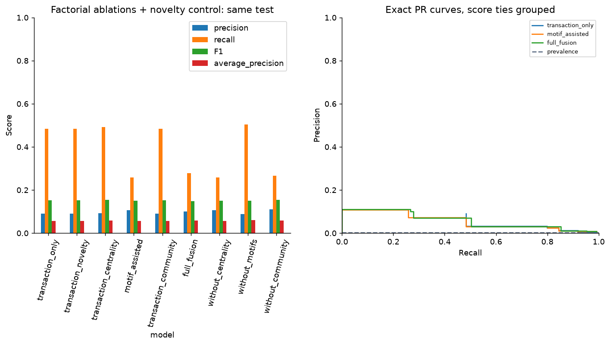

### confusion

Nhầm lẫn của family đã freeze.

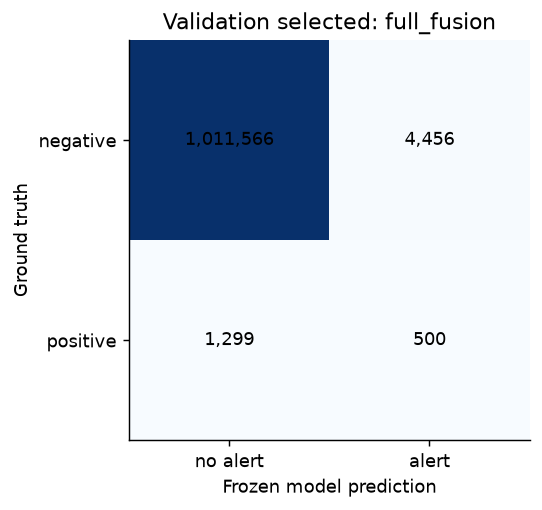

### full_communities

Quy mô/cấu trúc LPA full; community ID không phải fraud label.

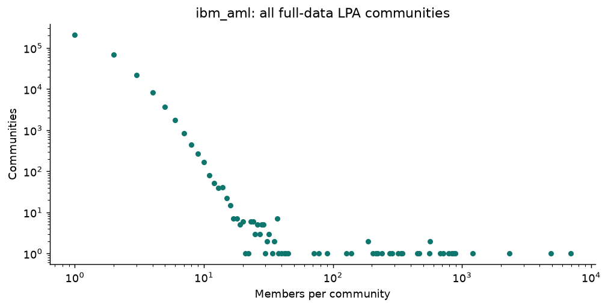

### full_degree

Độ phân bố kết nối trên full graph.

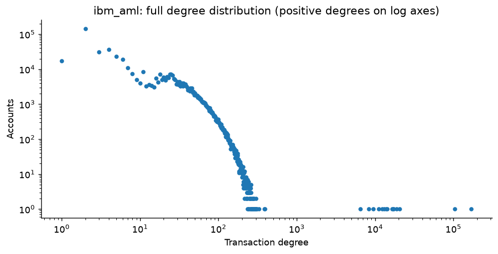

### full_pagerank

Tài khoản trung tâm theo PageRank; không phải fraud ranking.

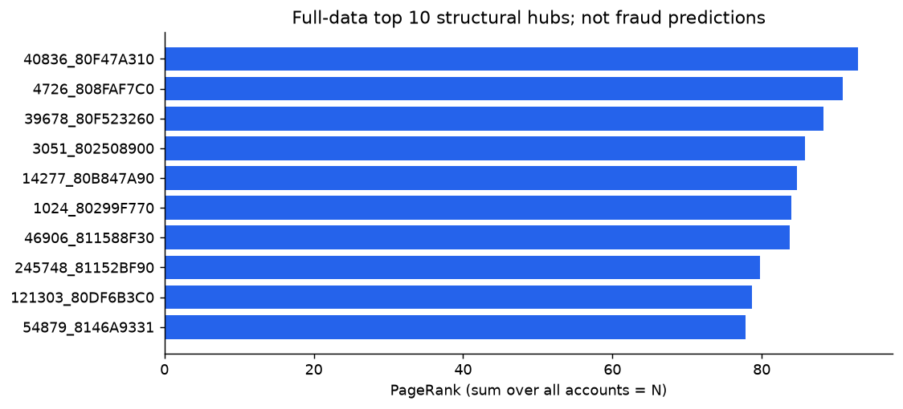

### graph_contributions

Chênh lệch ablation theo nhóm feature.

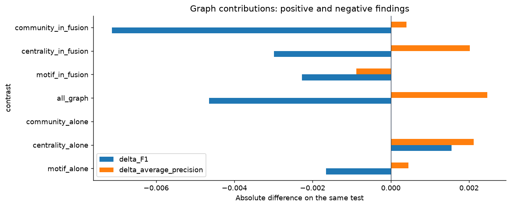

### motif_coverage

Structural coverage, tách full và test.

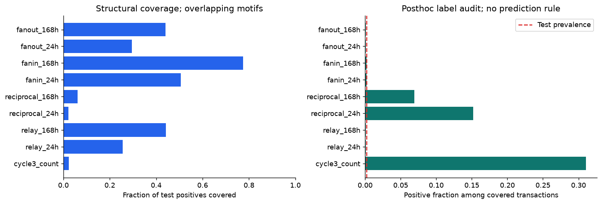

### review_budgets

Precision/recall tại review budget cố định.

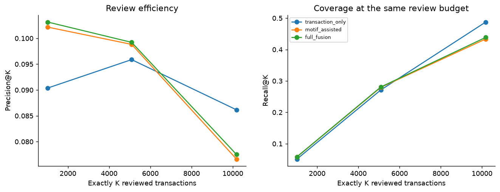

### selected_case

Chronological witness thật; không phải causal attribution.

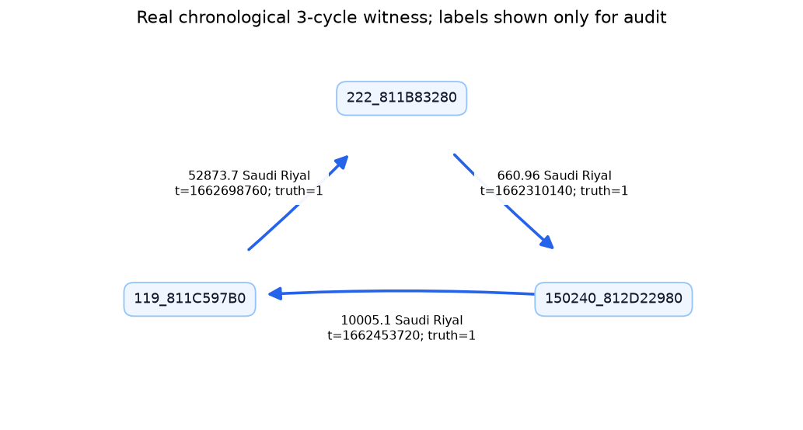

### selected_importance

Impurity importance của selected tree.

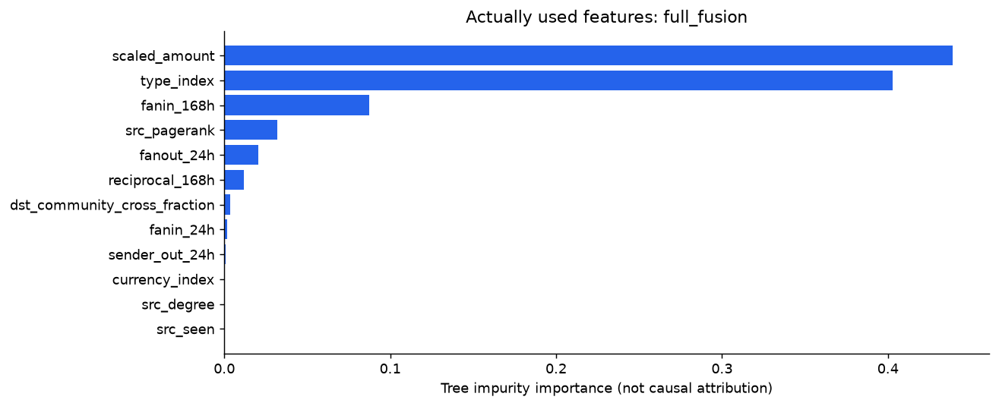

### temporal_protocol

Cutoff, snapshot và nguyên tắc dùng lịch sử.

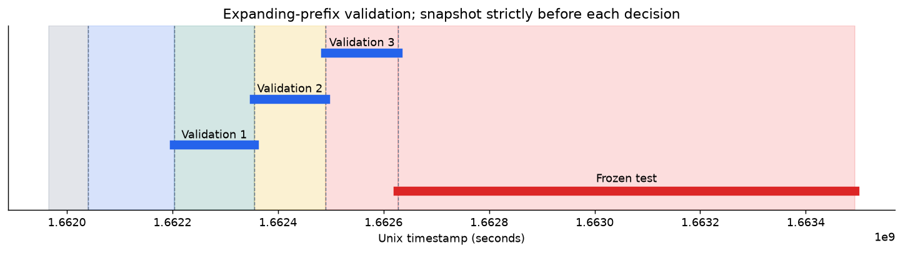

### temporal_stability

5 khoảng test và biến thiên.

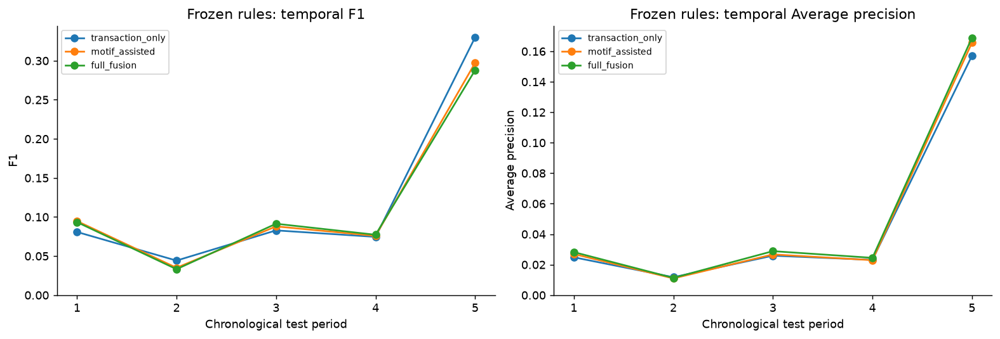

### validation

Chọn family/ngưỡng bằng validation.

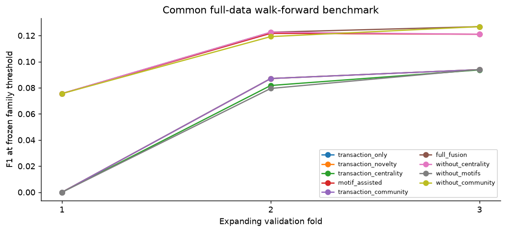

## Runtime đo trong lượt chạy sẵn có

| dataset | phase | status | elapsed_seconds | phase_average_job_cpu_percent | phase_measured_interval_seconds | peak_job_commit_gib_cumulative | minimum_available_ram_gib_cumulative | maximum_job_cpu_percent_cumulative |
| --- | --- | --- | --- | --- | --- | --- | --- | --- |
| ibm_aml | raw_reconciliation | PASS | 66.024 | 46.5 | 101.265 | 5.22 | 14.4 | 89.89 |
| ibm_aml | centrality_full | PASS | 39.927 | 35.67 | 39.969 | 5.23 | 14.27 | 89.89 |
| ibm_aml | communities_full | PASS | 69.736 | 38.32 | 70.5 | 5.24 | 14.27 | 89.89 |
| ibm_aml | motif_baseline | PASS | 11.112 | 41.39 | 11.484 | 5.24 | 14.27 | 89.89 |
| ibm_aml | motif_features | PASS | 149.841 | 62.5 | 150.032 | 6.21 | 13.39 | 90.43 |
| ibm_aml | motif_benchmark | PASS | 7.586 | 50.67 | 8.203 | 6.21 | 13.39 | 90.43 |
| ibm_aml | common_features | PASS | 749.761 | 41.18 | 750.109 | 6.27 | 13.39 | 90.43 |
| ibm_aml | validation | PASS | 427.915 | 50.93 | 428.688 | 6.27 | 13.39 | 91.67 |
| ibm_aml | frozen_test | PASS | 238.956 | 48.16 | 252.812 | 5.99 | 14.21 | 88.36 |
| ibm_aml | reliability | PASS | 7.449 | 11.21 | 10.484 | 5.99 | 14.21 | 88.36 |

CPU % theo toàn bộ logical CPUs; một phase I/O/serial không giữ 90% là bình thường. Peak/min/max hardware trong phase record có thể cumulative theo kernel; không cộng chúng. Tổng elapsed các phase không phải wall-clock benchmark độc lập; IBM có checkpoint reuse sau lỗi trình bày và thời gian kernel cuối không đại diện cả run.
