# PaySim — kết quả FULL

Run **run_20261024T084918669391Z**, status completed, scope full. Toàn bộ 6,362,620 giao dịch, 9,073,900 tài khoản, 8,213 positives. Test 1,248,736 giao dịch/4,250 positives.

## Integrity và full graph

| check | value |
| --- | --- |
| num_vertices | 9073900 |
| num_edges | 6362620 |
| null_vertices | 0 |
| null_edges | 0 |
| dangling_src | 0 |
| dangling_dst | 0 |
| dangling_edges | 0 |
| self_loops | 0 |

Raw reconciliation vertices/edges đều raw-minus-Parquet=0 và Parquet-minus-raw=0 trong report. Full transaction index unique_ids=6362620; future_snapshot_rows=0.

| mean_total_degree | communities | internal_edges | cross_edges |
| --- | --- | --- | --- |
| 1.402400290944357 | 5433491 | 0 | 6362620 |

[Degree distribution](datasets/paysim/tables/degree_distribution.csv), [top PageRank](datasets/paysim/tables/top10_pagerank.csv), [community sizes](datasets/paysim/tables/community_size_distribution.csv), [top communities](datasets/paysim/tables/community_top50.csv). Đây là exports của full graph; top-list chỉ rút gọn phần hiển thị.

## Baseline motif gốc và predictive coverage

| dataset | raw_cycles | relay_pairs | same_hour | fraud_transfer_edges | fraud_cashout_edges |
| --- | --- | --- | --- | --- | --- |
| paysim | 0 | 30 | 2 | 0 | 0 |

Raw cycle=0; relay baseline có 30 pairs, cùng giờ=2. Đây là query baseline mô tả; không đồng nhất với relay strict-past coverage theo transaction bên dưới. Không đặt label=1 cho relay khi artifacts không xác nhận.

| scope | motif | covered_transactions | covered_positives | positive_coverage | positive_fraction_when_present |
| --- | --- | --- | --- | --- | --- |
| full | cycle3_count | 0 | 0 | 0.00% | — |
| full | relay_24h | 24 | 0 | 0.00% | 0.00% |
| full | relay_168h | 94 | 0 | 0.00% | 0.00% |
| full | reciprocal_24h | 0 | 0 | 0.00% | — |
| full | reciprocal_168h | 0 | 0 | 0.00% | — |
| full | fanin_24h | 2354211 | 1026 | 12.49% | 0.04% |
| full | fanin_168h | 3486578 | 2342 | 28.52% | 0.07% |
| full | fanout_24h | 1105 | 2 | 0.02% | 0.18% |
| full | fanout_168h | 5558 | 6 | 0.07% | 0.11% |
| test | cycle3_count | 0 | 0 | 0.00% | — |
| test | relay_24h | 5 | 0 | 0.00% | 0.00% |
| test | relay_168h | 21 | 0 | 0.00% | 0.00% |
| test | reciprocal_24h | 0 | 0 | 0.00% | — |
| test | reciprocal_168h | 0 | 0 | 0.00% | — |
| test | fanin_24h | 240844 | 154 | 3.62% | 0.06% |
| test | fanin_168h | 602017 | 895 | 21.06% | 0.15% |
| test | fanout_24h | 186 | 0 | 0.00% | 0.00% |
| test | fanout_168h | 1226 | 1 | 0.02% | 0.08% |

Coverage là các tập chồng lấp, không phải classifier TP và không cộng các dòng thành tổng fraud. `full` và `test` có mẫu số khác nhau. [CSV đầy đủ](datasets/paysim/tables/motif_coverage.csv).

## Validation: chọn family và ngưỡng trước test

| family | threshold | mean_F1 | worst_F1 | std_F1 | TP | FP | FN | folds |
| --- | --- | --- | --- | --- | --- | --- | --- | --- |
| transaction_only | 0.7 | 7.01% | 2.15% | 4.66% | 451 | 18119 | 1206 | 3 |
| transaction_novelty | 0.7 | 14.95% | 7.56% | 6.41% | 450 | 4857 | 1207 | 3 |
| transaction_centrality | 0.5 | 14.98% | 7.56% | 6.44% | 448 | 4827 | 1209 | 3 |
| motif_assisted | 0.7 | 15.01% | 8.67% | 5.79% | 451 | 4444 | 1206 | 3 |
| transaction_community | 0.7 | 14.95% | 7.56% | 6.41% | 450 | 4857 | 1207 | 3 |
| full_fusion | 0.7 | 15.10% | 8.67% | 5.56% | 431 | 4291 | 1226 | 3 |
| without_centrality | 0.7 | 15.84% | 8.67% | 6.95% | 451 | 4217 | 1206 | 3 |
| without_motifs | 0.5 | 14.98% | 7.56% | 6.44% | 448 | 4827 | 1209 | 3 |
| without_community | 0.7 | 15.10% | 8.67% | 5.56% | 431 | 4291 | 1226 | 3 |

Winner **without_centrality**, threshold **0.7**. [108 combinations](datasets/paysim/tables/validation_leaderboard.csv), [324 fold rows](datasets/paysim/tables/walk_forward.csv), [frozen rules](datasets/paysim/provenance/frozen_rules.json).

## Final test: toàn bộ 9 families

| model | threshold | TP | FP | FN | TN | alerts | precision | recall | F1 | average_precision |
| --- | --- | --- | --- | --- | --- | --- | --- | --- | --- | --- |
| transaction_only | 0.7 | 836 | 196 | 3414 | 1244290 | 1032 | 81.01% | 19.67% | 31.65% | 17.00% |
| transaction_novelty | 0.7 | 1109 | 628 | 3141 | 1243858 | 1737 | 63.85% | 26.09% | 37.05% | 20.29% |
| transaction_centrality | 0.5 | 1096 | 615 | 3154 | 1243871 | 1711 | 64.06% | 25.79% | 36.77% | 22.71% |
| motif_assisted | 0.7 | 1109 | 799 | 3141 | 1243687 | 1908 | 58.12% | 26.09% | 36.02% | 26.58% |
| transaction_community | 0.7 | 1109 | 628 | 3141 | 1243858 | 1737 | 63.85% | 26.09% | 37.05% | 20.29% |
| full_fusion | 0.7 | 1105 | 790 | 3145 | 1243696 | 1895 | 58.31% | 26.00% | 35.96% | 28.98% |
| without_centrality | 0.7 | 1109 | 799 | 3141 | 1243687 | 1908 | 58.12% | 26.09% | 36.02% | 26.58% |
| without_motifs | 0.5 | 1096 | 615 | 3154 | 1243871 | 1711 | 64.06% | 25.79% | 36.77% | 22.71% |
| without_community | 0.7 | 1105 | 790 | 3145 | 1243696 | 1895 | 58.31% | 26.00% | 35.96% | 28.98% |

Selected-model 95% Wilson: precision 55.90%–60.32%, recall 24.80%–27.44%. Chỉ dùng CI này trong phạm vi row-level binomial; không khẳng định external stability.

## Review budget — chỉ family validation chọn

| review_fraction | K | TP_at_K | precision_at_K | recall_at_K |
| --- | --- | --- | --- | --- |
| 0.10% | 1249 | 900 | 72.06% | 21.18% |
| 0.50% | 6244 | 1523 | 24.39% | 35.84% |
| 1.00% | 12488 | 2044 | 16.37% | 48.09% |

[Đủ 27 budget rows](datasets/paysim/tables/review_budgets.csv); [PR curve selected](datasets/paysim/tables/pr_curve_without_centrality.csv). Các family khác cũng có PR curve riêng.

## Reliability theo thời gian

| test_period | transactions | fraud | TP | FP | FN | precision | recall | F1 | average_precision |
| --- | --- | --- | --- | --- | --- | --- | --- | --- | --- |
| 0 | 254687 | 226 | 61 | 140 | 165 | 30.35% | 26.99% | 28.57% | 15.36% |
| 1 | 266247 | 216 | 66 | 206 | 150 | 24.26% | 30.56% | 27.05% | 16.10% |
| 2 | 271053 | 116 | 35 | 47 | 81 | 42.68% | 30.17% | 35.35% | 13.63% |
| 3 | 207968 | 1336 | 371 | 107 | 965 | 77.62% | 27.77% | 40.90% | 37.18% |
| 4 | 248781 | 2356 | 576 | 299 | 1780 | 65.83% | 24.45% | 35.65% | 29.08% |

| model | threshold | mean_F1 | worst_F1 | std_F1 | test_period_min_F1 | test_period_max_F1 | test_period_std_F1 | positive_periods |
| --- | --- | --- | --- | --- | --- | --- | --- | --- |
| without_centrality | 0.7 | 15.84% | 8.67% | 6.95% | 27.05% | 40.90% | 5.67% | 5 |

Không lấy trung bình đơn giản 5 F1 làm full-test F1; full-test dùng summed confusion counts. [Cold-start groups](datasets/paysim/tables/selected_cold_start.csv) và [amounts theo currency/case](datasets/paysim/tables/selected_amounts_by_currency.csv) bổ sung bối cảnh.

## Feature importance và evidence thật

| feature | importance |
| --- | --- |
| receiver_in_168h | 0.46498322847266377 |
| scaled_amount | 0.2724945334883197 |
| type_index | 0.26252223803901664 |

| event_id | src | dst | step | type | amount | payment_currency | isFraud | example_model | evidence_kind |
| --- | --- | --- | --- | --- | --- | --- | --- | --- | --- |
| 60129557010 | C676427076 | C1523524779 | 470 | CASH_OUT | 864994.24 | PaySim unit | 1.0 | without_centrality | transaction only; no eligible motif witness |

Case hiện có là một test TP CASH_OUT; không có eligible motif witness. Vì vậy không có hình selected_case.png cho PaySim. Không vẽ thêm đường đi giả để minh họa. Cycle coverage=0 và relay covered-positive test=0 được giữ nguyên trong benchmark.

[Toàn bộ TP/FP/FN examples](datasets/paysim/examples/) là các records minh họa thật từ full test của 9 models; không dùng examples để ước lượng performance. [Các tree/leaf rules đã fit](datasets/paysim/model_details/) cho phép giải thích score không cần Spark.

## Toàn bộ figures có sẵn

### ablation_and_pr

Ablation 9 families và PR trên test.

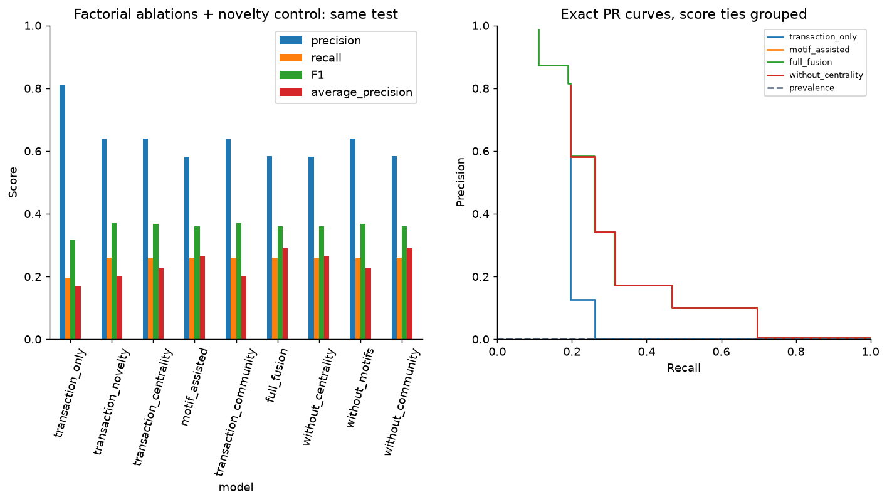

### confusion

Nhầm lẫn của family đã freeze.

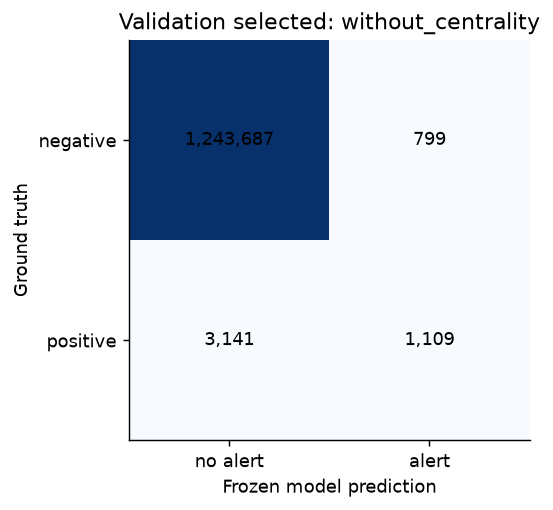

### full_communities

Quy mô/cấu trúc LPA full; community ID không phải fraud label.

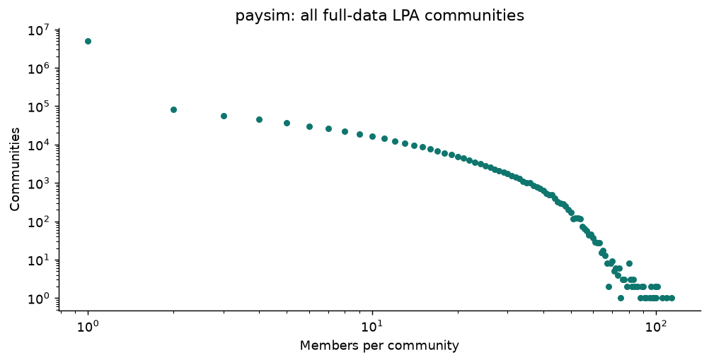

### full_degree

Độ phân bố kết nối trên full graph.

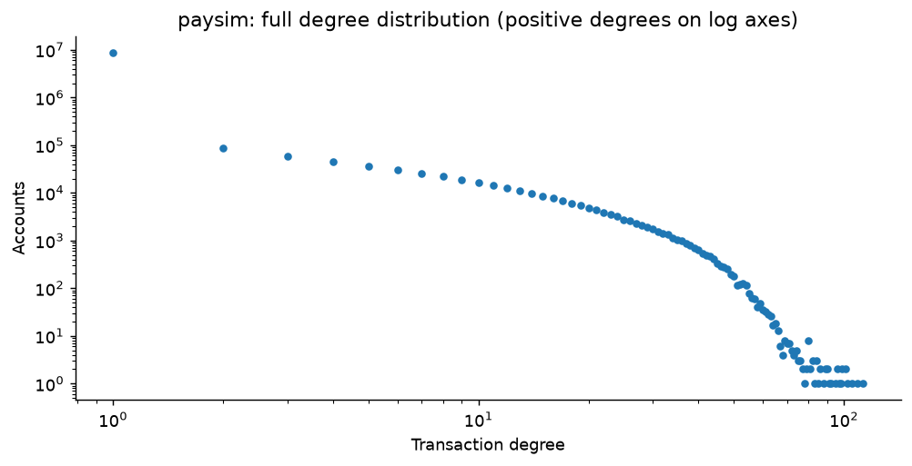

### full_pagerank

Tài khoản trung tâm theo PageRank; không phải fraud ranking.

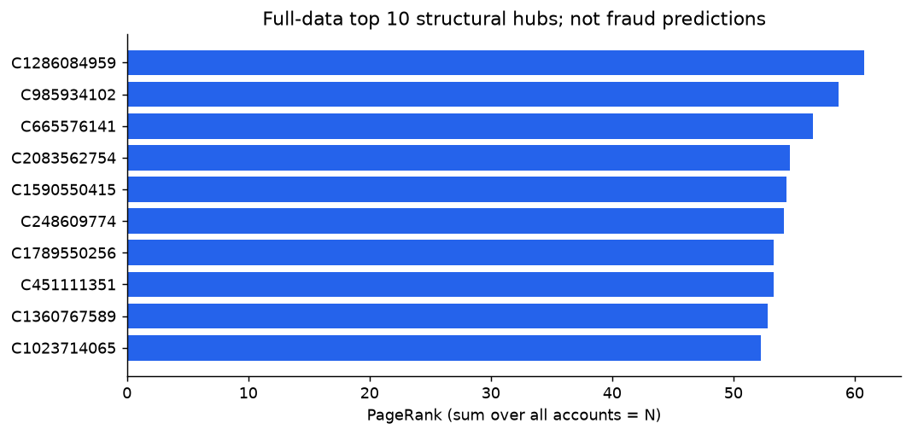

### graph_contributions

Chênh lệch ablation theo nhóm feature.

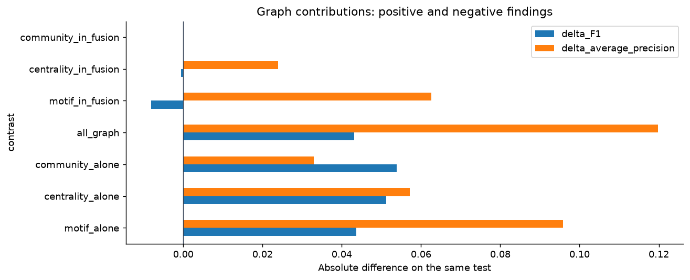

### motif_coverage

Structural coverage, tách full và test.

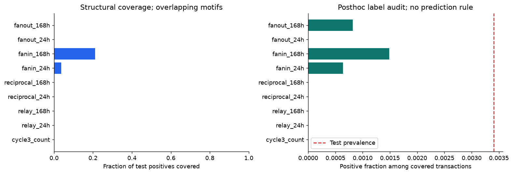

### review_budgets

Precision/recall tại review budget cố định.

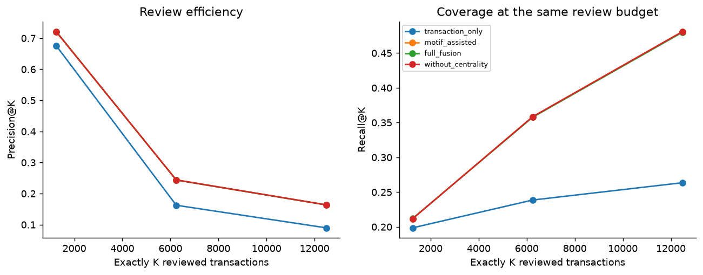

### selected_importance

Impurity importance của selected tree.

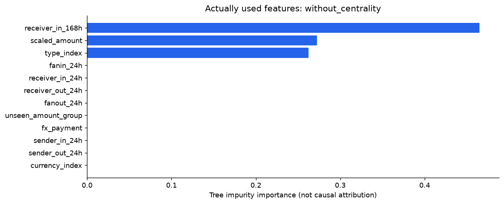

### temporal_protocol

Cutoff, snapshot và nguyên tắc dùng lịch sử.

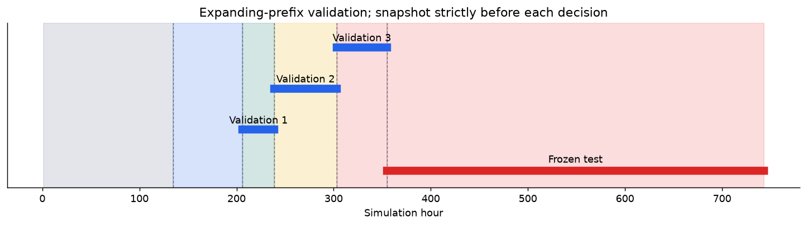

### temporal_stability

5 khoảng test và biến thiên.

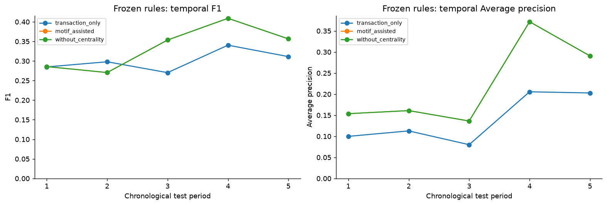

### validation

Chọn family/ngưỡng bằng validation.

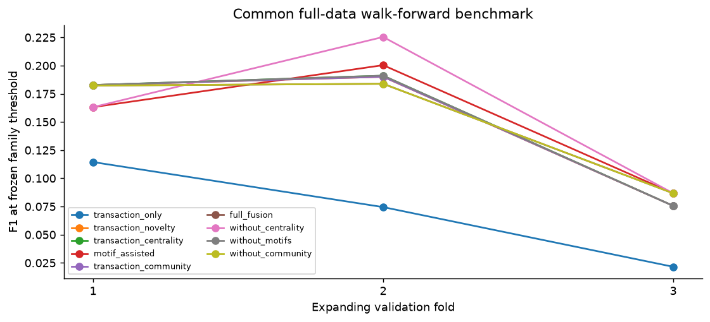

## Runtime đo trong lượt chạy sẵn có

| dataset | phase | status | elapsed_seconds | phase_average_job_cpu_percent | phase_measured_interval_seconds | peak_job_commit_gib_cumulative | minimum_available_ram_gib_cumulative | maximum_job_cpu_percent_cumulative |
| --- | --- | --- | --- | --- | --- | --- | --- | --- |
| paysim | raw_reconciliation | PASS | 58.007 | 51.03 | 103.922 | 5.31 | 14.79 | 86.56 |
| paysim | centrality_full | PASS | 102.446 | 59.36 | 102.5 | 5.93 | 13.63 | 86.56 |
| paysim | communities_full | PASS | 271.678 | 56.99 | 272.485 | 5.99 | 13.27 | 86.9 |
| paysim | motif_baseline | PASS | 27.041 | 57.52 | 27.718 | 5.99 | 13.27 | 86.9 |
| paysim | motif_features | PASS | 103.701 | 61.12 | 103.922 | 6.06 | 13.02 | 90.06 |
| paysim | motif_benchmark | PASS | 8.083 | 54.04 | 8.735 | 6.06 | 13.02 | 90.06 |
| paysim | common_features | PASS | 1133.274 | 49.93 | 1133.64 | 6.58 | 13.02 | 90.06 |
| paysim | validation | PASS | 437.617 | 51.11 | 438.422 | 6.58 | 13.02 | 90.06 |
| paysim | frozen_test | PASS | 257.488 | 46.65 | 257.844 | 6.58 | 13.02 | 90.06 |
| paysim | reliability | PASS | 7.9 | 12.28 | 10.062 | 6.58 | 13.02 | 90.06 |

CPU % theo toàn bộ logical CPUs; một phase I/O/serial không giữ 90% là bình thường. Peak/min/max hardware trong phase record có thể cumulative theo kernel; không cộng chúng. Tổng elapsed các phase không phải wall-clock benchmark độc lập; IBM có checkpoint reuse sau lỗi trình bày và thời gian kernel cuối không đại diện cả run.
