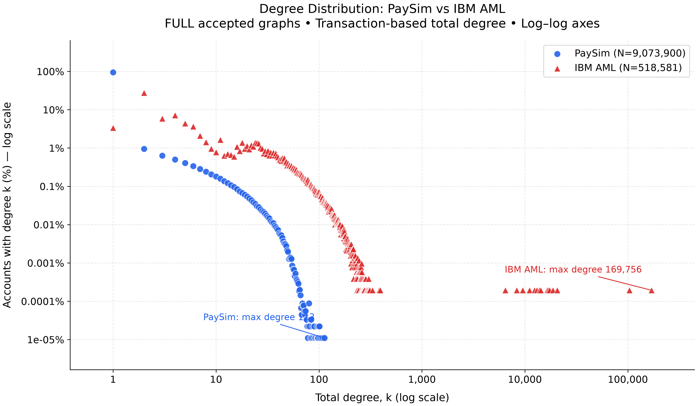

# Đối chiếu hai dataset và vai trò fusion

| dataset | transactions | accounts | mean_total_degree | communities | internal_edges | cross_edges |
| --- | --- | --- | --- | --- | --- | --- |
| ibm_aml | 5078345 | 518581 | 19.585542085035897 | 314722 | 852930 | 4225415 |
| paysim | 6362620 | 9073900 | 1.402400290944357 | 5433491 | 0 | 6362620 |

[CSV full degree comparison](comparison/degree_distribution_paysim_vs_ibm.csv) và [provenance](comparison/comparison_run.json). Đồ thị IBM dày hơn theo mean degree, còn PaySim thưa và endpoint novelty cao; cần đọc benchmark riêng trước khi diễn giải motif và community. LPA internal edges của PaySim=0 ở cấu hình 5 vòng đã chạy; không đủ để tự kết luận fraud, cũng không tự chứng minh toàn graph bipartite.

Fusion đã thực hiện bằng **feature-level fusion**, một weighted decision tree trên T+C+M+L, so với 8 đối chứng/ablations. Không cộng tay Degree score, PageRank, motif count và LPA label. Không tự chọn trọng số ba phần bằng test. IBM chọn T+C+M+L; PaySim chọn T+M+L trên validation, trong khi T+C+M+L vẫn được kiểm nghiệm đầy đủ.

## Mọi cấu hình trên cả hai holdout

| dataset | model | threshold | precision | recall | F1 | average_precision | TP | FP | alerts |
| --- | --- | --- | --- | --- | --- | --- | --- | --- | --- |
| ibm_aml | transaction_only | 0.5 | 9.07% | 48.30% | 15.27% | 5.62% | 869 | 8715 | 9584 |
| ibm_aml | transaction_novelty | 0.5 | 9.07% | 48.30% | 15.27% | 5.62% | 869 | 8715 | 9584 |
| ibm_aml | transaction_centrality | 0.5 | 9.15% | 49.14% | 15.42% | 5.83% | 884 | 8780 | 9664 |
| ibm_aml | motif_assisted | 0.5 | 10.67% | 25.85% | 15.10% | 5.67% | 465 | 3894 | 4359 |
| ibm_aml | transaction_community | 0.5 | 9.07% | 48.30% | 15.27% | 5.62% | 869 | 8715 | 9584 |
| ibm_aml | full_fusion | 0.5 | 10.09% | 27.79% | 14.80% | 5.87% | 500 | 4456 | 4956 |
| ibm_aml | without_centrality | 0.5 | 10.67% | 25.85% | 15.10% | 5.67% | 465 | 3894 | 4359 |
| ibm_aml | without_motifs | 0.5 | 8.84% | 50.31% | 15.03% | 5.95% | 905 | 9338 | 10243 |
| ibm_aml | without_community | 0.5 | 10.95% | 26.63% | 15.52% | 5.83% | 479 | 3896 | 4375 |
| paysim | transaction_only | 0.7 | 81.01% | 19.67% | 31.65% | 17.00% | 836 | 196 | 1032 |
| paysim | transaction_novelty | 0.7 | 63.85% | 26.09% | 37.05% | 20.29% | 1109 | 628 | 1737 |
| paysim | transaction_centrality | 0.5 | 64.06% | 25.79% | 36.77% | 22.71% | 1096 | 615 | 1711 |
| paysim | motif_assisted | 0.7 | 58.12% | 26.09% | 36.02% | 26.58% | 1109 | 799 | 1908 |
| paysim | transaction_community | 0.7 | 63.85% | 26.09% | 37.05% | 20.29% | 1109 | 628 | 1737 |
| paysim | full_fusion | 0.7 | 58.31% | 26.00% | 35.96% | 28.98% | 1105 | 790 | 1895 |
| paysim | without_centrality | 0.7 | 58.12% | 26.09% | 36.02% | 26.58% | 1109 | 799 | 1908 |
| paysim | without_motifs | 0.5 | 64.06% | 25.79% | 36.77% | 22.71% | 1096 | 615 | 1711 |
| paysim | without_community | 0.7 | 58.31% | 26.00% | 35.96% | 28.98% | 1105 | 790 | 1895 |

## Chênh lệch ablation được export

Các delta dưới đây là **tỷ lệ thô**; nhân 100 ra điểm phần trăm. Các family dùng threshold riêng đã freeze, nên đây là so sánh cả cấu hình, không phải causal contribution của feature.

### ibm_aml

| contrast | enhanced | reference | delta_precision | delta_recall | delta_F1 | delta_average_precision |
| --- | --- | --- | --- | --- | --- | --- |
| motif_alone | motif_assisted | transaction_only | 0.016003889827850212 | -0.22456920511395217 | -0.001660767324320911 | 0.0004508098949925973 |
| centrality_alone | transaction_centrality | transaction_only | 0.0008015566783491079 | 0.008337965536409087 | 0.0015515392008429996 | 0.002120674554254902 |
| community_alone | transaction_community | transaction_only | 0.0 | 0.0 | 0.0 | 0.0 |
| all_graph | full_fusion | transaction_only | 0.010215859496793808 | -0.2051139521956643 | -0.0046453367518004 | 0.002465901021399 |
| motif_in_fusion | full_fusion | without_motifs | 0.012534791176509297 | -0.22512506948304617 | -0.002268767923174403 | -0.0008789965801132976 |
| centrality_in_fusion | full_fusion | without_centrality | -0.005788030331056404 | 0.01945525291828787 | -0.0029845694274794887 | 0.002015091126406403 |
| community_in_fusion | full_fusion | without_community | -0.008597901533494698 | 0.011673151750972721 | -0.0071283386288144845 | 0.0004027877455433024 |

### paysim

| contrast | enhanced | reference | delta_precision | delta_recall | delta_F1 | delta_average_precision |
| --- | --- | --- | --- | --- | --- | --- |
| motif_alone | motif_assisted | transaction_only | -0.22884062210521183 | 0.06423529411764708 | 0.04363511464293984 | 0.09581373400177831 |
| centrality_alone | transaction_centrality | transaction_only | -0.16951644398533883 | 0.061176470588235304 | 0.05117677372948154 | 0.0571256779721287 |
| community_alone | transaction_community | transaction_only | -0.17162040942014434 | 0.06423529411764708 | 0.05392258766896624 | 0.03289270538962469 |
| all_graph | full_fusion | transaction_only | -0.226964062915465 | 0.06329411764705892 | 0.04309522276401834 | 0.11978129814725971 |
| motif_in_fusion | full_fusion | without_motifs | -0.057447618930126176 | 0.002117647058823613 | -0.008081550965463202 | 0.06265562017513102 |
| centrality_in_fusion | full_fusion | without_centrality | 0.0018765591897468292 | -0.0009411764705881676 | -0.0005398918789215057 | 0.0239675641454814 |
| community_in_fusion | full_fusion | without_community | 0.0 | 0.0 | 0.0 | 0.0 |

Không gộp laundering label của IBM với fraud label của PaySim thành một confusion matrix/F1 chung. Objective báo cáo là kiểm chứng transaction screening theo ground truth hiện có và phân tích bằng chứng đồ thị; không có ring-level ground truth để tuyên bố recall của cả đường dây.
