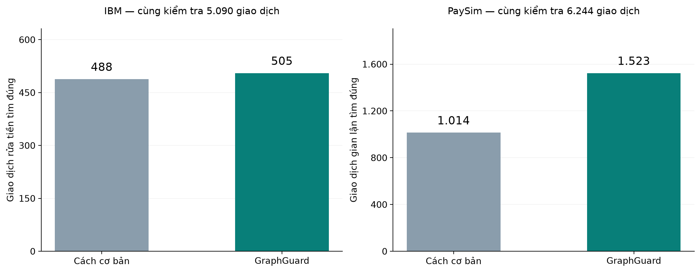

# GraphGuard: nên kiểm tra giao dịch nào trước?

Xem thêm lịch sử chuyển tiền và các tài khoản liên quan có giúp tìm đúng nhiều giao dịch cần kiểm tra hơn không? Báo cáo này giải thích kết quả thử nghiệm và ý nghĩa của chúng.

Hai bộ dữ liệu đều mô phỏng các giao dịch tài chính. Giao dịch rửa tiền trong IBM và giao dịch gian lận trong PaySim đã được đánh dấu sẵn. Báo cáo dùng các dấu này để kiểm tra kết quả của từng cách làm.

## 1. Vì sao cần chọn giao dịch để kiểm tra trước?

Một hệ thống tài chính có thể ghi nhận hàng triệu giao dịch, trong khi đội kiểm tra chỉ có thể xem xét một phần trong số đó. Vì vậy, câu hỏi quan trọng là: nên chọn những giao dịch nào để xem trước?

Cách cơ bản trong thử nghiệm này chỉ xem thông tin của từng giao dịch, chẳng hạn loại giao dịch và số tiền. GraphGuard xem thêm các giao dịch đã xảy ra trước đó và mối liên hệ giữa các tài khoản. Mục tiêu là chọn một danh sách có nhiều giao dịch cần kiểm tra hơn với cùng số lượt xem xét.

Để biết cách nào chọn tốt hơn, chúng tôi đối chiếu danh sách được chọn với các giao dịch đã được bộ dữ liệu đánh dấu là rửa tiền hoặc gian lận. Một giao dịch được chọn và trùng với dấu có sẵn được tính là một giao dịch tìm đúng.

> Kết quả chính: trên PaySim, GraphGuard tìm đúng nhiều giao dịch gian lận hơn cách cơ bản ở cả ba số lượng kiểm tra đã thử. Trên IBM, GraphGuard nhỉnh hơn khi kiểm tra ít giao dịch, nhưng kém hơn khi tăng số lượng kiểm tra. Các phần dưới đây giải thích vì sao cần đọc hai kết quả này riêng biệt.

## 2. Degree/PageRank, Motif Finding và LPA giúp hiểu thêm điều gì?

Số tiền và loại giao dịch cho biết thông tin của một lần chuyển tiền. Để hiểu rõ hơn, GraphGuard còn xem tài khoản tham gia giao dịch ra sao, tiền đã đi qua những tài khoản nào và các tài khoản được phân thành nhóm như thế nào.

**Ba phần được kết nối trong báo cáo này**

| Phần phân tích | Câu hỏi được giải đáp | Cách dùng trong báo cáo |
| --- | --- | --- |
| Degree và PageRank | Tài khoản nào tham gia nhiều giao dịch hoặc giữ vị trí nổi bật trong mạng lưới chuyển tiền? | Xác định vai trò của tài khoản, trước khi xem xét hành vi chuyển tiền cụ thể. |
| Motif Finding và lịch sử giao dịch | Có kiểu chuyển tiền nào lặp lại, chẳng hạn tiền đi qua ba tài khoản rồi quay về điểm xuất phát? Trước đó tài khoản đã nhận hoặc chuyển tiền ra sao? | Tìm các kiểu chuyển tiền đáng chú ý và bổ sung thông tin về những gì đã xảy ra trước giao dịch đang xem. |
| Phân nhóm bằng LPA | Tài khoản được xếp vào nhóm nào? Giao dịch diễn ra trong nhóm hay giữa các nhóm? | Bổ sung thông tin về nhóm tài khoản khi đánh giá một giao dịch. |

Các kết quả trên được dùng để thử nhiều cách chọn giao dịch cần kiểm tra. Sau đó, chúng tôi đo xem mỗi cách tìm đúng được bao nhiêu giao dịch. Nhờ vậy, báo cáo vừa giải thích các thuật toán tìm thấy điều gì, vừa kiểm tra xem thông tin đó có thực sự giúp ích hay không.

Các nhóm do LPA tạo ra dựa trên mối liên hệ giao dịch giữa các tài khoản. Một tài khoản giao dịch nhiều hoặc thuộc một nhóm nhất định chưa đủ để kết luận có sai phạm.

## 3. Vì sao cần đọc kết quả IBM và PaySim riêng biệt?

Hai bộ dữ liệu có cách các tài khoản tham gia giao dịch rất khác nhau. Trên PaySim, khoảng 95 trong mỗi 100 tài khoản chỉ xuất hiện trong một giao dịch của toàn bộ dữ liệu. Trên IBM, con số này chỉ khoảng 3 trong mỗi 100 tài khoản.

Điều đó có nghĩa là với nhiều tài khoản PaySim, có rất ít giao dịch khác của cùng tài khoản để xem lại. IBM ghi nhận nhiều giao dịch trên mỗi tài khoản hơn, nên có thêm thông tin để xem tài khoản đã tham gia chuyển tiền ra sao. Những con số này chưa cho biết một tài khoản giao dịch với bao nhiêu đối tác khác nhau.

Tuy nhiên, có nhiều thông tin hơn chưa chắc đã chọn được giao dịch tốt hơn. Cần xem thông tin cụ thể nào đi kèm với rửa tiền hoặc gian lận, rồi mới so sánh kết quả chọn giao dịch. Vì vậy, chúng tôi bắt đầu từ các kiểu chuyển tiền mà Motif Finding tìm thấy.

## 4. Tiền chuyển theo vòng có đáng chú ý không?

Một kiểu được xem xét là tiền đi qua ba tài khoản rồi quay về tài khoản ban đầu: **A → B → C → A**. Có thể hình dung A chuyển cho B, B chuyển cho C, rồi C chuyển lại cho A. Công cụ tìm những giao dịch liên quan đến kiểu chuyển tiền này theo điều kiện của dự án.

Trong phần dữ liệu IBM dùng để đánh giá, có 132 giao dịch liên quan đến kiểu chuyển tiền theo vòng này. Trong đó, 41 giao dịch được đánh dấu là rửa tiền. Nói cách khác, trong nhóm 132 giao dịch đang xét, khoảng 31 trong mỗi 100 giao dịch có dấu rửa tiền.

Nhưng toàn bộ phần dữ liệu đánh giá có 1.799 giao dịch được đánh dấu là rửa tiền. Nhóm chuyển tiền theo vòng chỉ chứa 41 giao dịch trong số đó; 1.758 giao dịch còn lại nằm ngoài nhóm này. Vì vậy, chỉ tìm vòng chuyển tiền sẽ bỏ qua phần lớn các giao dịch rửa tiền trong dữ liệu.

### Còn kiểu một tài khoản nhận tiền từ nhiều phía thì sao?

Ở IBM, kiểu nhận tiền từ nhiều phía trong bảy ngày trước đó xuất hiện trong 706.216 giao dịch của phần dữ liệu đánh giá. Trong số này, 1.395 giao dịch có dấu rửa tiền, tương đương khoảng 2 trong mỗi 1.000 giao dịch. Đây là kiểu chuyển tiền thường gặp ở cả giao dịch bình thường và giao dịch rửa tiền.

Hai kết quả dẫn đến hai cách hiểu khác nhau. Chuyển tiền theo vòng xuất hiện ít, nhưng nhóm giao dịch đó có tỷ lệ rửa tiền cao trong dữ liệu IBM. Nhận tiền từ nhiều phía xuất hiện rộng hơn, nên riêng việc thấy kiểu này chưa đủ để đưa một giao dịch lên đầu danh sách kiểm tra.

Trên PaySim, nhóm có kiểu nhận tiền từ nhiều phía còn có tỷ lệ gian lận thấp hơn tỷ lệ của toàn bộ phần dữ liệu đánh giá. Do đó, một kiểu chuyển tiền có thể đáng chú ý trong bộ dữ liệu này nhưng ít hữu ích hơn ở bộ dữ liệu khác.

> Bài học từ Motif Finding: biết tiền đi theo kiểu nào giúp xác định nhóm giao dịch cần tìm hiểu thêm. Để tìm được nhiều trường hợp hơn, vẫn cần xem thêm lịch sử và các thông tin khác của giao dịch.

## 5. Lịch sử giao dịch giúp bổ sung điều gì?

Kết quả PaySim cho thấy thông tin hữu ích đôi khi là điều chưa xuất hiện trong lịch sử. Trong một nhóm giao dịch rút tiền được hệ thống xếp cùng loại và cùng nhóm số tiền, GraphGuard phân biệt hai trường hợp: tài khoản nhận đã có giao dịch nhận tiền trong bảy ngày trước đó, hoặc chưa ghi nhận giao dịch nhận tiền nào trong khoảng thời gian này.

Trong nhóm đang xét, GraphGuard ưu tiên kiểm tra trường hợp chưa có lịch sử nhận tiền hơn. Điều này cho thấy lịch sử có thể giúp phân biệt các giao dịch mà chỉ nhìn loại giao dịch và số tiền thì chưa thấy hết sự khác nhau.

Chưa có lịch sử nhận tiền trong bảy ngày không có nghĩa là tài khoản mới mở hoặc chắc chắn có gian lận. Đây là một thông tin mà hệ thống kết hợp với các thông tin khác để xếp thứ tự kiểm tra.

Phương án GraphGuard được chọn cho PaySim thực sự sử dụng thông tin lịch sử nhận tiền. Thông tin nhóm LPA đã được cung cấp nhưng không được phương án này dùng để đưa ra quyết định. Với IBM, phương án được chọn có sử dụng thông tin từ Degree/PageRank, lịch sử chuyển tiền và LPA. Việc sử dụng cả ba phần vẫn cần được kiểm tra bằng kết quả thực tế dưới đây.

## 6. Cùng số lượt kiểm tra, tìm đúng được bao nhiêu giao dịch?

Để so sánh công bằng về số lượt xem xét, chúng tôi cho cách cơ bản và GraphGuard cùng chọn một số lượng giao dịch như nhau trong mỗi bộ dữ liệu. Hai cách có thể chọn những giao dịch khác nhau; điều được giữ bằng nhau là số giao dịch đội kiểm tra sẽ phải xem.

Mỗi hình so sánh hai cách trong cùng một bộ dữ liệu. Cột biểu diễn số giao dịch chọn đúng theo dấu có sẵn trong dữ liệu, không phải số vụ án hoặc số khách hàng.

**PaySim:** cùng kiểm tra 6.244 giao dịch, cách cơ bản tìm đúng 1.014 giao dịch gian lận, còn GraphGuard tìm đúng 1.523. Như vậy, GraphGuard tìm đúng nhiều hơn 509 giao dịch trong phép so sánh này.

**IBM:** cùng kiểm tra 5.090 giao dịch, cách cơ bản tìm đúng 488 giao dịch rửa tiền, còn GraphGuard tìm đúng 505. Chênh lệch là 17 giao dịch, nhỏ hơn nhiều so với ví dụ PaySim.

Đây mới là kết quả ở một số lượng kiểm tra cụ thể. Nếu đội kiểm tra xem ít hơn hoặc nhiều hơn, lợi thế có thể thay đổi. Vì vậy, chúng tôi tiếp tục so sánh ở ba số lượng khác nhau.

**IBM: số giao dịch rửa tiền tìm đúng**

| Số giao dịch được kiểm tra | Cách cơ bản tìm đúng | GraphGuard tìm đúng | Chênh lệch của GraphGuard |
| --- | --- | --- | --- |
| 1.018 | 92 | 105 | Nhiều hơn 13 |
| 5.090 | 488 | 505 | Nhiều hơn 17 |
| 10.179 | 877 | 789 | Ít hơn 88 |

**PaySim: số giao dịch gian lận tìm đúng**

| Số giao dịch được kiểm tra | Cách cơ bản tìm đúng | GraphGuard tìm đúng | Chênh lệch của GraphGuard |
| --- | --- | --- | --- |
| 1.249 | 844 | 900 | Nhiều hơn 56 |
| 6.244 | 1.014 | 1.523 | Nhiều hơn 509 |
| 12.488 | 1.120 | 2.044 | Nhiều hơn 924 |

**PaySim:** GraphGuard tìm đúng nhiều hơn cách cơ bản ở cả ba số lượng đã thử. Khi mở rộng từ 6.244 lên 12.488 lượt kiểm tra, GraphGuard tìm thêm 521 giao dịch gian lận, còn cách cơ bản tìm thêm 106. Điều này cho thấy thông tin bổ sung vẫn giúp ích khi đội kiểm tra xem thêm giao dịch.

**IBM:** GraphGuard nhỉnh hơn ở hai số lượng kiểm tra thấp, nhưng khi cùng xem 10.179 giao dịch, GraphGuard tìm đúng 789 giao dịch rửa tiền, thấp hơn 877 của cách cơ bản. Kết quả IBM vì vậy chưa cho thấy GraphGuard luôn là lựa chọn tốt hơn.

### So với một cách làm đơn giản khác thì thế nào?

Chúng tôi còn thử một cách chỉ bổ sung thông tin tài khoản đã từng xuất hiện trong các giao dịch trước đó hay chưa. Trên PaySim, khi cùng xem 1.249 giao dịch, cách này tìm đúng 913 giao dịch gian lận, còn GraphGuard tìm đúng 900. Khi cùng xem 6.244 giao dịch, hai kết quả lần lượt là 1.122 và 1.523.

Như vậy, thêm nhiều loại thông tin chưa chắc luôn tốt hơn một cách làm đơn giản. Cần chọn và kiểm tra cách sử dụng theo số giao dịch mà đội kiểm tra thực sự có thể xem xét.

## 7. Kết quả này có ý nghĩa gì?

Ba phần phân tích có thể nối với nhau theo một mạch: Degree/PageRank cho biết vị trí của tài khoản; Motif Finding cho biết các kiểu chuyển tiền và lịch sử liên quan; LPA bổ sung thông tin về nhóm tài khoản. Cuối cùng, phép so sánh cùng số lượt kiểm tra cho biết việc thêm những thông tin này giúp chọn giao dịch tốt hơn đến mức nào.

Với PaySim, kết quả cho thấy lịch sử nhận tiền có thể giúp GraphGuard chọn được nhiều giao dịch gian lận hơn cách chỉ xem từng giao dịch. Với IBM, một số kiểu chuyển tiền giúp nhận ra nhóm giao dịch đáng tìm hiểu, nhưng lợi ích khi chọn giao dịch để kiểm tra còn nhỏ và thay đổi theo số lượt xem xét.

> Hướng sử dụng phù hợp là hỗ trợ sắp xếp thứ tự xem xét giao dịch. Trước khi áp dụng thực tế, cần xác định đội kiểm tra xem được bao nhiêu giao dịch, thử trên dữ liệu ở giai đoạn khác và đo cả thời gian xử lý mỗi trường hợp.

## Giới hạn và nguồn số liệu

- Hai bộ dữ liệu đều là mô phỏng. Kết quả chưa xác nhận hiệu quả trên giao dịch thật của một ngân hàng.
- Phương án sử dụng cho mỗi bộ dữ liệu được chọn từ bước đánh giá trước đó. Báo cáo giữ nguyên phương án này khi so sánh kết quả cuối cùng. Đây là đánh giá nội bộ; dữ liệu đánh giá đã được xem trong quá trình phát triển dự án.
- Tìm đúng được tính bằng việc trùng với dấu rửa tiền hoặc gian lận có sẵn trong dữ liệu. Số giao dịch tìm đúng không cho biết đã phát hiện bao nhiêu khách hàng, vụ án hoặc đường dây.
- Hai cách có cùng số lượt kiểm tra vẫn có thể tốn thời gian khác nhau vì mức độ phức tạp của từng giao dịch khác nhau. Dự án chưa đo số giờ tiết kiệm hoặc số tiền thiệt hại được ngăn chặn.
- Các giao dịch có thể được cho cùng điểm ưu tiên. Khi đó, thứ tự sắp xếp tiếp theo cũng ảnh hưởng đến số giao dịch được chọn. Cách tính chi tiết được giải thích trong bản kỹ thuật.

Nguồn: [bảng so sánh các phương án](sources/model_comparison.csv), [bảng kết quả theo số lượt kiểm tra](sources/review_budget_comparison.csv), [thống kê các kiểu chuyển tiền](insights/motif_cohort_insights.csv).

[Bản kỹ thuật và cách tính chi tiết](../generated/CONNECTED_RESULTS_REPORT.html) trình bày đầy đủ các phép so sánh, kết quả theo thời gian và giới hạn của từng cách đo. [Tệp kiểm tra báo cáo](revision_validation.json) lưu thông tin đối chiếu nguồn số liệu.
