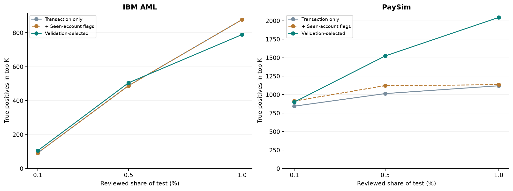
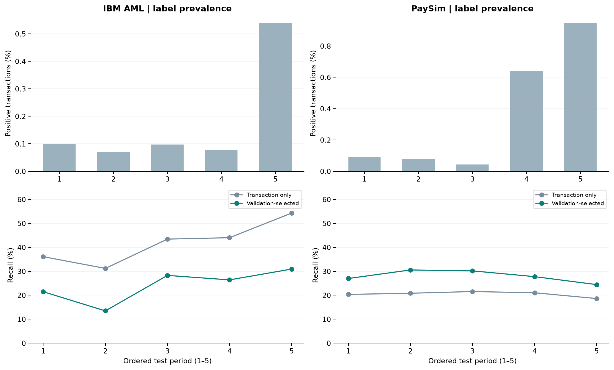

# Từ cấu trúc giao dịch đến giá trị kiểm tra

Tín hiệu nào tập trung positive, thông tin nào được mô hình khai thác, và lợi ích xuất hiện ở đâu trong danh sách cần xem xét?

Phân tích thăm dò từ kết quả đã xuất · Hai bộ dữ liệu mô phỏng · IBM: laundering; PaySim: fraud. Test nội bộ đã được xem trong quá trình phát triển. Mô hình/ngưỡng giữ theo mean validation F1; các mức ngân sách test không được dùng để chọn lại phương án tối ưu.

## 1. Ba phát hiện nối các phần của project

- **IBM · tín hiệu hiếm: 31,06%** — Tỷ lệ laundering trong 132 giao dịch có cycle trên test; chỉ phủ 2,28% laundering.
- **PaySim · độ sâu danh sách: +509** — Chênh lệch ròng số fraud tìm đúng khi cùng xem 6.244 giao dịch; kết quả so với đối chứng chỉ thuộc tính giao dịch.
- **Giá trị phụ thuộc cách dùng: 0,1% → 1%** — PaySim duy trì lợi ích khi mở rộng danh sách; IBM chuyển từ lợi thế nhỏ sang kém đối chứng ở mức 1% đã đánh giá.

Câu hỏi xuyên suốt là: **quan hệ và lịch sử bổ sung giá trị gì so với chỉ nhìn giao dịch riêng lẻ, và giá trị đó phụ thuộc vào dữ liệu và năng lực kiểm tra thế nào?**

Các task tạo thành một chuỗi bằng chứng: cấu trúc mạng → nhóm hành vi → thông tin cây sử dụng → kết quả ưu tiên kiểm tra. Mỗi bước trả lời một câu hỏi riêng; một pattern đáng chú ý chưa tự động trở thành một cảnh báo hiệu quả.

> Phát hiện chính: thông tin graph có nhiều vai trò. Một số motif xác định nhóm nhỏ tập trung positive; lịch sử giúp phân biệt giao dịch; centrality/community cung cấp bối cảnh. Bằng chứng hiện tại chưa cho thấy cần kết hợp đủ ba nhóm để luôn đạt kết quả tốt hơn.

## 2. Hai môi trường giao dịch cung cấp ngữ cảnh khác nhau

**Đặc điểm full graph dùng để đặt bối cảnh**

| Dataset | Giao dịch full | Tài khoản full | Tài khoản degree = 1 | Degree trung bình |
| --- | --- | --- | --- | --- |
| IBM AML | 5.078.345 | 518.581 | 3,37% | 19,59 |
| PaySim | 6.362.620 | 9.073.900 | 94,83% | 1,40 |

PaySim có phần lớn tài khoản chỉ gắn với một giao dịch trong full graph. IBM ghi nhận nhiều giao dịch trên mỗi tài khoản hơn theo degree trung bình; chỉ số này chưa xác định số đối tác duy nhất hay mức lặp lại giữa cùng một cặp tài khoản. Đây là cơ sở đặt giả thuyết rằng lượng ngữ cảnh quan hệ có thể khai thác khác nhau giữa hai dataset; chưa chứng minh cấu trúc này gây ra chênh lệch hiệu năng.

Các chỉ số full graph không mô tả trực tiếp lượng lịch sử có sẵn tại một thời điểm quyết định. Vì vậy, câu chuyện cấu trúc phải được đối chiếu tiếp với feature và kết quả predictive theo thời gian.

Nguồn: [đặc điểm cấu trúc](insights/structure_summary.csv), [dataset overview](sources/tables/dataset_overview.csv).

## 3. Tín hiệu phổ biến và tín hiệu tập trung positive có giá trị khác nhau

Coverage trả lời tín hiệu có mặt ở bao nhiêu positive. Tỷ lệ positive trong nhóm và lift trả lời nhóm đó tập trung positive đến mức nào. Cần đọc cùng số giao dịch có tín hiệu; coverage cao có thể đến từ việc tín hiệu phổ biến trong cả dữ liệu bình thường.

**Mức tập trung nhãn positive khi tín hiệu hiện diện; không phải kết quả classifier**

| Nhóm trên test | Giao dịch | Positive | Positive trong nhóm | Bao phủ positive | Lift / nền |
| --- | --- | --- | --- | --- | --- |
| IBM · cycle | 132 | 41 | 31,061% | 2,28% | 175,73× |
| IBM · qua lại 24h | 257 | 39 | 15,175% | 2,17% | 85,86× |
| IBM · fan-in 168h | 706.216 | 1.395 | 0,198% | 77,54% | 1,12× |
| PaySim · fan-in 168h | 602.017 | 895 | 0,149% | 21,06% | 0,44× |

Trục dọc là lift theo thang log; đường ngang 1× là tỷ lệ positive nền của từng dataset. IBM có nhóm hiếm tập trung laundering cao, trong khi fan-in PaySim nằm dưới nền. Các điểm chỉ là cohort quan sát; nhóm rỗng hoặc có lift bằng 0 không được vẽ trên trục log.

- **IBM: cycle và giao dịch qua lại là nhóm nhỏ tập trung laundering.** Có thể đặt giả thuyết kiểm tra chuyên biệt cho các nhóm này, nhưng coverage thấp giới hạn giá trị phát hiện diện rộng.
- **IBM: fan-in 168h bao phủ rộng nhưng mức tập trung positive chỉ nhỉnh hơn nền.** Tín hiệu xuất hiện ở 69,39% toàn bộ giao dịch test; riêng sự hiện diện chưa đủ để ưu tiên một khối lượng lớn giao dịch.
- **PaySim: có fan-in chưa đồng nghĩa fraud cao hơn.** Tỷ lệ fraud khi fan-in 168h hiện diện thấp hơn nền. Cycle không xuất hiện; relay 168h chỉ phủ 21 giao dịch test và không có fraud trong nhóm quan sát đó.

> Hàm ý: phân biệt tín hiệu phục vụ rà soát nhóm nhỏ với thông tin phục vụ xếp hạng diện rộng. Những nhóm nhỏ có lift cao cần kiểm chứng ở thời gian khác trước khi đề xuất quy tắc cảnh báo. Các cohort chồng lấp, không cộng positive giữa các motif.

Nền test: IBM 0,177%; PaySim 0,340%. [Bảng cohort, công thức và nguồn](insights/motif_cohort_insights.csv).

## 4. PaySim: thiếu lịch sử cũng mang thông tin

Cây PaySim được chọn sử dụng loại giao dịch, số tiền chuẩn hóa và lịch sử nhận tiền trong 168 giờ. Các nhánh cây cho thấy giá trị không chỉ đến từ việc phát hiện một pattern dòng tiền đã hiện diện.

**Hai leaf của cây đã lưu chỉ khác điều kiện lịch sử nhận tiền**

| Điều kiện được giữ giống nhau | Lịch sử nhận tiền | Score của leaf |
| --- | --- | --- |
| CASH_OUT; cùng nhánh số tiền chuẩn hóa | Không có lượt nhận tiền hợp lệ được ghi nhận trong 168h trước | 0,7904 |
| CASH_OUT; cùng nhánh số tiền chuẩn hóa | Có lịch sử nhận tiền hợp lệ trong 168h trước | 0,0000 |

**Trong nhóm điều kiện này, sự vắng mặt của lịch sử nhận tiền là thông tin phân biệt mà cây sử dụng.** Điều đó nối kết quả task history với hiệu quả mô hình dù cycle/relay gần như không cung cấp coverage fraud trên PaySim.

> Đây là logic tổng quát của mô hình đã fit. Chưa có lịch sử trong 168 giờ không chứng minh tài khoản vừa mở; score của weighted tree không phải xác suất fraud đã hiệu chỉnh. Nhánh minh họa chưa xác minh đường đi của bất kỳ case cụ thể nào.

IBM dùng feature thuộc cả C/M/L. Trên PaySim, L có trong cấu hình nhưng không được cây được chọn dùng để chia nhánh; C không nằm trong cấu hình được chọn. Vì vậy, kết quả PaySim hỗ trợ giá trị của bối cảnh lịch sử, chưa chứng minh mô hình phát hiện đường dây hoặc cần đủ ba nhóm graph.

Nguồn: [leaf rules PaySim](sources/datasets/paysim/model_details/without_centrality/leaf_rules.csv), [vocabulary loại giao dịch](sources/datasets/paysim/model_details/without_centrality/saved_model_parameters.json), [feature usage](sources/feature_usage.csv).

## 5. Giá trị nằm ở đâu trong danh sách cần kiểm tra?

Đối chứng T chỉ dùng thuộc tính giao dịch. T + novelty bổ sung cờ tài khoản đã xuất hiện trong lịch sử prefix; đây là đối chứng đơn giản cần giữ để đánh giá giá trị vượt quá thông tin đã thấy tài khoản. Mô hình chọn là full_fusion ở IBM và without_centrality ở PaySim.

**Cùng số lượt kiểm tra trong từng dataset; số đếm là TP@K**

| Dataset | Phần test được xem | K giao dịch | T tìm đúng | T + novelty tìm đúng | Mô hình chọn tìm đúng |
| --- | --- | --- | --- | --- | --- |
| IBM AML | 0,1% | 1.018 | 92 | 92 | 105 |
| IBM AML | 0,5% | 5.090 | 488 | 488 | 505 |
| IBM AML | 1,0% | 10.179 | 877 | 877 | 789 |
| PaySim | 0,1% | 1.249 | 844 | 913 | 900 |
| PaySim | 0,5% | 6.244 | 1.014 | 1.122 | 1.523 |
| PaySim | 1,0% | 12.488 | 1.120 | 1.134 | 2.044 |

Mỗi điểm là một mức đã xuất; đoạn nối chỉ hỗ trợ đọc xu hướng, không xác định điểm giao hay ngân sách tối ưu ở giữa. PaySim: novelty cạnh tranh ở đầu danh sách, mô hình dùng lịch sử nổi bật khi mở rộng. IBM: lợi thế nhỏ chuyển thành bất lợi tại mức 1%.

**PaySim: giá trị nổi bật là độ sâu hữu ích của danh sách.** Ở 0,1%, novelty tìm đúng 913 fraud so với 900 của mô hình được chọn. Khi mở rộng tới 0,5% và 1%, mô hình được chọn lần lượt tìm đúng 1.523 và 2.044, cao hơn novelty 401 và 910. Đây là chênh lệch ròng, chưa xác định danh tính các fraud được thêm vào hoặc bị mất đi giữa hai danh sách.

**Mở rộng cùng danh sách từ 0,5% lên 1%; hiệu suất biên = positive thêm / lượt xem thêm**

| Dataset | Lượt xem thêm | T: positive thêm | T: hiệu suất biên | Mô hình: positive thêm | Mô hình: hiệu suất biên |
| --- | --- | --- | --- | --- | --- |
| IBM AML | 5.089 | 389 | 7,64% | 284 | 5,58% |
| PaySim | 6.244 | 106 | 1,70% | 521 | 8,34% |

**IBM: hiệu quả phụ thuộc độ sâu kiểm tra.** Mô hình tìm hơn T 17 laundering ở 0,5%, nhưng phần danh sách mở rộng tiếp theo tìm ít hơn T 105 laundering; tổng chênh lệch tại 1% thành −88. Kết quả chưa ủng hộ ưu thế nhất quán khi thay T bằng mô hình được chọn.

**Đọc số tìm thêm cùng mẫu số và phần positive còn bỏ sót**

| Dataset | K ở 0,5% | Tỷ lệ tìm đúng trong danh sách: T → mô hình | Bao phủ positive: T → mô hình |
| --- | --- | --- | --- |
| IBM AML | 5.090 | 9,59% → 9,92% | 27,13% → 28,07% |
| PaySim | 6.244 | 16,24% → 24,39% | 23,86% → 35,84% |

### Một đánh đổi khác: dùng ngưỡng cảnh báo đã cố định

IBM: cảnh báo 9.584 → 4.956; tìm đúng 869 → 500; cảnh báo nhầm 8.715 → 4.456. Danh sách ngắn hơn đi cùng mức phát hiện thấp hơn.

PaySim: so với T, mô hình tìm đúng 836 → 1.109 nhưng cảnh báo nhầm 196 → 799. Đối chứng novelty cũng tìm đúng 1.109 với 628 cảnh báo nhầm, ít hơn mô hình được chọn 171. Mô hình được chọn không dẫn đầu ở mọi mục tiêu test.

> Các số tại ngưỡng cố định và các số top-K trả lời hai câu hỏi khác nhau. Chưa có kiểm định paired cho chênh lệch mô hình. Nhiều giao dịch có cùng score nên TP@K còn phụ thuộc thứ tự hòa điểm; bản kỹ thuật trình bày độ nhạy này.

Nguồn: [54 dòng ngân sách](sources/review_budget_comparison.csv), [hiệu suất biên](insights/marginal_review_yield.csv), [18 cấu hình và confusion](sources/model_comparison.csv).

## 6. Kết quả theo thời gian và hàm ý sử dụng

Phân bố positive thay đổi mạnh giữa các kỳ: kỳ cuối chứa 60,92% laundering test IBM; hai kỳ cuối chứa 86,87% fraud test PaySim. Đếm số kỳ thắng như những kỳ có sức nặng bằng nhau sẽ bỏ qua cấu trúc này.

Hai hàng cùng thứ tự kỳ: tỷ lệ positive ở trên, recall ở dưới. IBM có recall mô hình thấp hơn T ở cả 5 kỳ; PaySim có recall cao hơn T ở cả 5 kỳ. Đây là kết quả tại ngưỡng đã cố định, không phải top-K theo từng kỳ.

IBM có F1 cao hơn T ở 3/5 kỳ, nhưng recall thấp hơn ở cả 5/5 kỳ: một kết quả F1 cao hơn chưa đồng nghĩa tìm được nhiều laundering hơn. PaySim cải thiện recall ở cả năm kỳ quan sát; hướng cải thiện này chưa xác nhận khả năng khái quát ngoài dữ liệu mô phỏng.

**Phân biệt phát hiện hiện có với giả thuyết và bước đánh giá tiếp theo**

| Bằng chứng | Hàm ý hiện tại | Câu hỏi kiểm chứng tiếp theo |
| --- | --- | --- |
| IBM: cycle/reciprocal tập trung laundering trong nhóm nhỏ | Giữ như giả thuyết rà soát nhóm hành vi chuyên biệt | Mức tập trung có lặp lại ở giai đoạn khác? Các nhóm này bổ sung positive nào cho danh sách hiện tại? |
| PaySim: lịch sử tạo giá trị ở danh sách sâu hơn | Đánh giá mô hình theo năng lực kiểm tra dự kiến | Nếu chọn theo ngân sách trên validation, lợi thế còn giữ ở giai đoạn mới? |
| IBM: không có ưu thế nhất quán theo ngân sách/recall | Giữ đối chứng và nêu rõ đánh đổi | Có nhóm hành vi nào hưởng lợi và nhóm nào bị giảm phát hiện? |
| C/L có giá trị mô tả; lợi ích predictive khác nhau | Nối các task bằng vai trò bằng chứng | Thông tin nào giúp người kiểm tra hiểu giao dịch hơn, dù không tăng metric tổng hợp? |

Các câu hỏi về positive mới/mất đi, tác động theo nhóm tài khoản và giải thích case cần predictions/feature ở từng giao dịch. Báo cáo này không suy các kết quả đó từ vài examples. Hướng dùng được nêu là đề xuất đánh giá tiếp, chưa phải quyết định triển khai ngân hàng.

Chi tiết bằng chứng và giới hạn: [bản kỹ thuật](../generated/CONNECTED_RESULTS_REPORT.html). Số liệu thời gian: [temporal insights](insights/temporal_insights.csv).

## Nguồn số liệu và cách đọc

Nguồn là các lần chạy full ngày 24/10/2026 và bản kiểm tra aggregate ngày 26/10/2026. Lift, hiệu suất biên, tỷ trọng positive theo kỳ và phân tích hòa điểm được tính bổ sung từ exports; không phải một lần huấn luyện hay đánh giá predictions mới.

- Đơn vị đánh giá là giao dịch có nhãn: IBM laundering và PaySim fraud. Không cộng kết quả giữa hai dataset; TP không đồng nghĩa số vụ án, khách hàng hoặc đường dây.
- Mô hình và ngưỡng giữ nguyên theo mean F1 của 3-fold walk-forward validation. Chưa tối ưu riêng cho từng ngân sách kiểm tra; không chọn lại mô hình bằng kết quả test.
- Full graph chỉ mô tả cấu trúc. Feature C/L của mô hình lấy từ snapshot quá khứ, M dùng strict-past; hình full graph không phải bằng chứng mô hình biết trước tương lai.
- Không có dữ liệu thời gian điều tra, chi phí mỗi ca hoặc tổn thất được ngăn chặn. Cùng số giao dịch được xem chưa đồng nghĩa cùng thời gian hoặc chi phí.
- Các case cũ thiếu feature values để xác minh rule path (CP5 LIMITED). Nhánh cây minh họa là logic tổng quát từ model đã lưu, không phải lời giải thích đã xác nhận cho một case cụ thể.

Phương pháp: [tham số và protocol](sources/02_METHODS_AND_PARAMETERS.md). Phạm vi bằng chứng: [reliability](sources/06_RELIABILITY_AND_VALIDATION.md). Nghiệm thu aggregate gốc: [completion.json](sources/completion.json). Kiểm tra revision hiện tại: [revision_validation.json](revision_validation.json).

Giữ cả hai thư mục `generated` và `business_report` cạnh nhau để dùng các liên kết qua lại offline. Các hình, bảng và tài liệu dẫn trực tiếp đều nằm trong bộ này.
