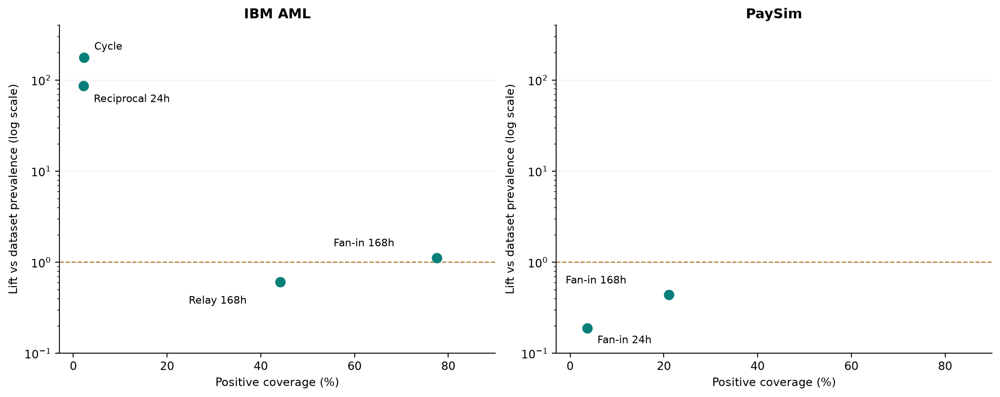
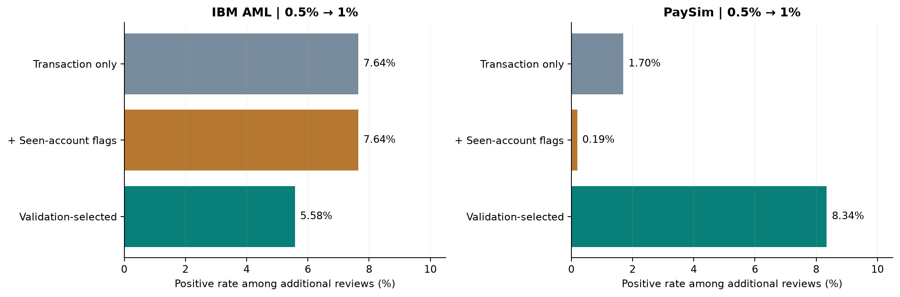

# GraphGuard: bằng chứng cho giá trị của ngữ cảnh giao dịch

Phụ lục phân tích cho báo cáo tổng hợp: cấu trúc → mức tập trung positive → logic mô hình → hiệu quả theo ngân sách và thời gian.

Phân tích thăm dò từ kết quả đã xuất · Hai bộ dữ liệu mô phỏng · IBM: laundering; PaySim: fraud. Test nội bộ đã được xem trong quá trình phát triển. Mô hình/ngưỡng giữ theo mean validation F1; các mức ngân sách test không được dùng để chọn lại phương án tối ưu.

## 1. Câu hỏi phân tích và mức bằng chứng

Câu hỏi: quan hệ và lịch sử bổ sung giá trị gì so với thuộc tính của giao dịch riêng lẻ, và giá trị đó thay đổi theo dataset, ngân sách và thời gian thế nào? Phần pipeline/kỹ thuật đã được trình bày riêng; nội dung này nối các kết quả thành lập luận phân tích.

**Chuỗi bằng chứng dùng để kết nối các task**

| Lớp evidence | Câu hỏi | Không suy trực tiếp thành |
| --- | --- | --- |
| Full descriptive graph | Mạng lưới và lịch sử quan hệ có đặc điểm gì? | Giá trị feature biết tại thời điểm dự đoán hoặc nguyên nhân hiệu năng |
| Cohort motif trên test | Tín hiệu hiện diện ở nhóm nào; mức tập trung positive ra sao? | Recall classifier, đóng góp độc lập hoặc quy tắc cảnh báo đã được xác nhận |
| Saved tree / allowlist | Feature nào được cung cấp, feature nào thực sự dùng và theo chiều nào? | Đóng góp nhân quả hoặc lời giải thích đã xác minh cho từng case |
| Ablation / top-K / temporal | Khác biệt hiệu quả quan sát được ở mục tiêu nào? | Hiệu quả ngân hàng thực tế, tiết kiệm chi phí hoặc phát hiện đường dây |

> Phân tích khám phá trên holdout nội bộ đã được xem trong phát triển. Winner/ngưỡng giữ nguyên theo mean validation F1; không chọn lại mô hình hoặc ngân sách tối ưu từ bảng test. CP0–CP4 và CP6–CP7 của kiểm tra aggregate gốc PASS; CP5 LIMITED vì thiếu feature cho rule-path verification. Revision tài liệu có kiểm tra riêng.

Bản trình bày nghiệp vụ: [Từ cấu trúc giao dịch đến giá trị kiểm tra](../business_report/GRAPHGUARD_BUSINESS_REPORT.html).

## 2. Cấu trúc và tín hiệu: coverage cần đọc cùng lift

**Full graph: các chỉ số mô tả có cùng scope**

| Dataset | Full edges | Full accounts | Degree 1 | Mean degree | LPA groups | Internal edges | Cross edges |
| --- | --- | --- | --- | --- | --- | --- | --- |
| IBM AML | 5.078.345 | 518.581 | 3,37% | 19,59 | 314.722 | 852.930 | 4.225.415 |
| PaySim | 6.362.620 | 9.073.900 | 94,83% | 1,40 | 5.433.491 | 0 | 6.362.620 |

Degree tính theo physical transactions, gồm giao dịch lặp thật; đây không phải số đối tác duy nhất. PaySim có 94,83% tài khoản degree=1, IBM 3,37%. LPA là kết quả 5 vòng đã thực chạy: internal edges=0 ở PaySim không chứng minh graph bipartite hoặc mọi giao dịch cross-community đáng ngờ. LPA groups không phải connected components hay ground-truth fraud rings.

Định nghĩa cohort: S là tín hiệu hiện diện theo định nghĩa feature đã xuất. Population share = N(S)/N; positive coverage = P(S)/P; positive rate = P(S)/N(S); lift = positive rate / (P/N). Nếu N(S)=0, rate và lift không xác định, được để trống thay vì gán 0.

**Cohort tín hiệu khi hiện diện; các tập chồng lấp**

| Dataset | Tín hiệu test | N(S) | P(S) | Population share | Positive coverage | Positive rate | Lift |
| --- | --- | --- | --- | --- | --- | --- | --- |
| IBM AML | cycle3_count | 132 | 41 | 0,01% | 2,28% | 31,061% | 175,73× |
| IBM AML | relay_168h | 740.099 | 795 | 72,71% | 44,19% | 0,107% | 0,61× |
| IBM AML | reciprocal_24h | 257 | 39 | 0,03% | 2,17% | 15,175% | 85,86× |
| IBM AML | reciprocal_168h | 1.579 | 109 | 0,16% | 6,06% | 6,903% | 39,06× |
| IBM AML | fanin_24h | 427.877 | 909 | 42,04% | 50,53% | 0,212% | 1,20× |
| IBM AML | fanin_168h | 706.216 | 1.395 | 69,39% | 77,54% | 0,198% | 1,12× |
| PaySim | cycle3_count | 0 | 0 | 0,00% | 0,00% | — | — |
| PaySim | relay_168h | 21 | 0 | 0,00% | 0,00% | 0,000% | 0,00× |
| PaySim | reciprocal_24h | 0 | 0 | 0,00% | 0,00% | — | — |
| PaySim | reciprocal_168h | 0 | 0 | 0,00% | 0,00% | — | — |
| PaySim | fanin_24h | 240.844 | 154 | 19,29% | 3,62% | 0,064% | 0,19× |
| PaySim | fanin_168h | 602.017 | 895 | 48,21% | 21,06% | 0,149% | 0,44× |

Trục log chỉ vẽ cohort có lift > 0; đường 1× là nền riêng từng dataset. Vị trí là thống kê cohort khi hiện diện, không thể hiện độ lớn liên tục hoặc tương tác của feature trong classifier.

- IBM cycle: 41/132 positive, lift khoảng 175,7× nhưng chỉ bao phủ 2,28% laundering. Reciprocal 24h cũng tập trung positive trên nhóm nhỏ. Đặt giả thuyết rà soát hẹp là hợp lý; chưa xác nhận quy tắc độc lập hoặc ổn định ngoài giai đoạn này.
- IBM fan-in 168h: population share 69,39%, positive coverage 77,54%, lift khoảng 1,12×. Coverage cao không đồng nghĩa khả năng phân biệt mạnh khi chỉ xét presence. Giá trị liên tục/conditional của feature có thể khác thống kê presence.
- PaySim fan-in 168h: lift khoảng 0,44×; fan-in 24h khoảng 0,19×. Pattern presence không phải bằng chứng nhóm có nguy cơ cao hơn nền. Cycle rỗng; relay 168h có 21 giao dịch test và 0 fraud, chưa đủ để kết luận không tồn tại fraud theo hành vi relay ở môi trường khác.
- Các nhóm overlap; không cộng P(S), không suy intersection, không gắn các tỷ lệ này vào TP/FN của mô hình. Nhãn và cơ chế mô phỏng khác nhau nên lift chỉ được chuẩn hóa và diễn giải trong từng dataset.

Full-scope motif và baseline audit vẫn giữ riêng trong sources. Ví dụ PaySim baseline relay_pairs=30 là số cặp theo phép đếm baseline; relay_168h covered_transactions=94 full/21 test là coverage giao dịch theo feature theo thời gian. Không so chúng như cùng đơn vị hoặc cùng điều kiện. [Cohort mới](insights/motif_cohort_insights.csv), [IBM motif gốc](sources/datasets/ibm_aml/tables/motif_coverage.csv), [PaySim motif gốc](sources/datasets/paysim/tables/motif_coverage.csv), [baseline PaySim](sources/datasets/paysim/tables/baseline_summary.csv).

## 3. Feature sử dụng: sự vắng mặt lịch sử là một phần của tín hiệu

**Mức dùng feature trong cây fit trên training prefix**

| Dataset | Frozen family | Nhóm | Feature dùng trong split | Impurity importance |
| --- | --- | --- | --- | --- |
| IBM AML | full_fusion | T | type_index | 40,31% |
| IBM AML | full_fusion | T | scaled_amount | 43,91% |
| IBM AML | full_fusion | C | src_pagerank | 3,18% |
| IBM AML | full_fusion | M | sender_out_24h | 0,09% |
| IBM AML | full_fusion | M | fanin_24h | 0,18% |
| IBM AML | full_fusion | M | fanout_24h | 2,06% |
| IBM AML | full_fusion | M | fanin_168h | 8,73% |
| IBM AML | full_fusion | M | reciprocal_168h | 1,18% |
| IBM AML | full_fusion | L | dst_community_cross_fraction | 0,37% |
| PaySim | without_centrality | T | type_index | 26,25% |
| PaySim | without_centrality | T | scaled_amount | 27,25% |
| PaySim | without_centrality | M | receiver_in_168h | 46,50% |

Impurity importance mô tả cây đã fit; không phải phần trăm cải thiện hiệu quả. Feature không xuất hiện trong split có thể dư thừa với feature khác. Feature có trong split chưa chứng minh bỏ nó sẽ giảm mọi metric.

### Một đối chiếu điều kiện có thể xác minh từ saved tree

**PaySim leaves 14 và 15: chỉ thay đổi điều kiện receiver_in_168h**

| Leaf | Điều kiện chính xác | Score | Alert ở θ=0,7 | Training rows |
| --- | --- | --- | --- | --- |
| 14 | `scaled_amount > 1.1517823480932849 AND type_index IN [0.0, 2.0, 3.0, 4.0] AND type_index NOT IN [0.0, 2.0, 3.0] AND receiver_in_168h <= 0.5` | 0,790449 | Có | 2.167 |
| 15 | `scaled_amount > 1.1517823480932849 AND type_index IN [0.0, 2.0, 3.0, 4.0] AND type_index NOT IN [0.0, 2.0, 3.0] AND receiver_in_168h > 0.5` | 0,000000 | Không | 10.339 |

Vocabulary đã lưu là CASH_IN=0, CASH_OUT=1, DEBIT=2, PAYMENT=3, TRANSFER=4. Kết hợp hai điều kiện type trong bảng cho CASH_OUT. Trong nhánh scaled_amount > 1,1517823481, cây chia receiver_in_168h ở 0,5: không có lượt nhận tiền hợp lệ trong cửa sổ trước đó được chấm score cao hơn nhánh có lịch sử.

Đây là sự tương tác giữa lịch sử, loại giao dịch và nhóm amount; không khái quát mọi tài khoản thiếu lịch sử đều fraud. Cửa sổ 168h không phải tuổi tài khoản. Score weighted tree không được diễn giải như xác suất đã calibrate; scaled_amount không phải ngưỡng tiền chung cho các currency.

IBM selected tree sử dụng C/M/L nhưng không dùng cycle trong split. Điều đó không chứng minh các giao dịch có cycle đều bị bỏ sót: chúng có thể được phân loại qua feature khác. PaySim selected không có C trong allowlist; L có trong allowlist nhưng không xuất hiện trong split. Cần giữ phân biệt cấu hình được cung cấp với thông tin thực sự sử dụng.

Nguồn: [allowlists](sources/tables/exact_feature_allowlists.csv), [feature usage](feature_usage.csv), [leaf rules](sources/datasets/paysim/model_details/without_centrality/leaf_rules.csv), [saved parameters và vocabulary](sources/datasets/paysim/model_details/without_centrality/saved_model_parameters.json).

## 4. Giá trị theo mục tiêu: top-K, ngưỡng và đối chứng novelty

T = thuộc tính giao dịch; novelty = cờ endpoint đã có trong prefix; C = centrality và seen flags; M = motif/history; L = community context. Novelty được giữ làm đối chứng để đánh giá phần giá trị vượt quá việc đã thấy tài khoản.

**Cùng số lượt kiểm tra trong từng dataset; số đếm là TP@K**

| Dataset | Phần test được xem | K giao dịch | T tìm đúng | T + novelty tìm đúng | Mô hình chọn tìm đúng |
| --- | --- | --- | --- | --- | --- |
| IBM AML | 0,1% | 1.018 | 92 | 92 | 105 |
| IBM AML | 0,5% | 5.090 | 488 | 488 | 505 |
| IBM AML | 1,0% | 10.179 | 877 | 877 | 789 |
| PaySim | 0,1% | 1.249 | 844 | 913 | 900 |
| PaySim | 0,5% | 6.244 | 1.014 | 1.122 | 1.523 |
| PaySim | 1,0% | 12.488 | 1.120 | 1.134 | 2.044 |

Đường nối ba điểm không xác định ngân sách tối ưu hoặc điểm giao chính xác. K=ceil(f×Ntest); chỉ so cùng K trong cùng dataset. Không tái dựng top-K từ examples.

PaySim selected so với novelty có ΔTP = −13, +401, +910 tại 0,1%, 0,5%, 1%. Quan sát hỗ trợ giả thuyết lịch sử tăng độ sâu hữu ích của ranking hơn là luôn cải thiện phần đầu danh sách. IBM selected so với T có ΔTP = +13, +17, −88: chưa có ưu thế nhất quán theo ngân sách.

**Hiệu suất biên trên cùng ranking: ΔTP/ΔK**

| Dataset | Model | Khoảng mở rộng | Lượt xem thêm | Positive thêm | Hiệu suất biên |
| --- | --- | --- | --- | --- | --- |
| IBM AML | transaction_only | 0,1% → 0,5% | 4.072 | 396 | 9,72% |
| IBM AML | transaction_only | 0,5% → 1,0% | 5.089 | 389 | 7,64% |
| IBM AML | transaction_novelty | 0,1% → 0,5% | 4.072 | 396 | 9,72% |
| IBM AML | transaction_novelty | 0,5% → 1,0% | 5.089 | 389 | 7,64% |
| IBM AML | full_fusion | 0,1% → 0,5% | 4.072 | 400 | 9,82% |
| IBM AML | full_fusion | 0,5% → 1,0% | 5.089 | 284 | 5,58% |
| PaySim | transaction_only | 0,1% → 0,5% | 4.995 | 170 | 3,40% |
| PaySim | transaction_only | 0,5% → 1,0% | 6.244 | 106 | 1,70% |
| PaySim | transaction_novelty | 0,1% → 0,5% | 4.995 | 209 | 4,18% |
| PaySim | transaction_novelty | 0,5% → 1,0% | 6.244 | 12 | 0,19% |
| PaySim | without_centrality | 0,1% → 0,5% | 4.995 | 623 | 12,47% |
| PaySim | without_centrality | 0,5% → 1,0% | 6.244 | 521 | 8,34% |

Hiệu suất biên khác với precision tích lũy. Đây là mở rộng từng ranking riêng, chưa phải đánh giá một chính sách chuyển mô hình hoặc hợp nhất các danh sách.

### Operating point được cố định trước test

**Đối chứng chính; θ chọn theo mean validation F1, AP đo ranking ở các score bins**

| Dataset | Family | θ | TP | FP | FN | Precision | Recall | F1 | AP |
| --- | --- | --- | --- | --- | --- | --- | --- | --- | --- |
| IBM AML | transaction_only | 0,5 | 869 | 8.715 | 930 | 9,07% | 48,30% | 15,27% | 5,62% |
| IBM AML | transaction_novelty | 0,5 | 869 | 8.715 | 930 | 9,07% | 48,30% | 15,27% | 5,62% |
| IBM AML | full_fusion | 0,5 | 500 | 4.456 | 1.299 | 10,09% | 27,79% | 14,80% | 5,87% |
| PaySim | transaction_only | 0,7 | 836 | 196 | 3.414 | 81,01% | 19,67% | 31,65% | 17,00% |
| PaySim | transaction_novelty | 0,7 | 1.109 | 628 | 3.141 | 63,85% | 26,09% | 37,05% | 20,29% |
| PaySim | without_centrality | 0,7 | 1.109 | 799 | 3.141 | 58,12% | 26,09% | 36,02% | 26,58% |

Trên test PaySim, novelty đạt cùng TP/recall với selected nhưng ít FP hơn 171 tại θ=0,7; F1 cũng cao hơn. Selected có AP cao hơn novelty và lợi thế ở các K lớn hơn. Đây là khác biệt theo mục tiêu; không đổi winner đã freeze. Trên IBM, precision/AP tăng nhẹ đi cùng giảm recall/F1 ở ngưỡng cố định. Chỉ giảm số cảnh báo chưa đủ để kết luận hệ thống hiệu quả hơn.

Nguyên tắc báo cáo: AP/PR cho ranking, P/R/F1/confusion cho operating point, TP@K cho năng lực kiểm tra. Chi phí/giờ điều tra, số khách hàng và mức tổn thất chưa được đo. [18 models](model_comparison.csv), [54 budgets](review_budget_comparison.csv), [hiệu suất biên](insights/marginal_review_yield.csv).

## 5. Hòa điểm và thời gian giới hạn độ mạnh của kết luận

### Nhiều giao dịch có cùng score

Thứ tự top-K gốc giữ risk DESC, event_key ASC, event_id ASC. Baseline PaySim chỉ có 3 mức score; một bin có 7.727 giao dịch cùng score. Khi K cắt trong bin, thứ tự phụ ảnh hưởng TP@K. Phân tích dưới đây chỉ thay thứ tự trong bin biên theo giả thiết chọn đều, không thay các score bins hay mô hình.

**Độ nhạy phân bổ trong bin biên ở ngân sách 0,5%**

| Dataset | Model | Mức score | K | Bin biên N | Lấy từ bin | TP gốc | E[TP] hòa điểm ngẫu nhiên | SD phân bổ |
| --- | --- | --- | --- | --- | --- | --- | --- | --- |
| IBM AML | transaction_only | 6 | 5.090 | 9.584 | 5.090 | 488 | 461,52 | 14,03 |
| IBM AML | transaction_novelty | 6 | 5.090 | 9.584 | 5.090 | 488 | 461,52 | 14,03 |
| IBM AML | full_fusion | 16 | 5.090 | 7.658 | 69 | 505 | 503,65 | 1,85 |
| PaySim | transaction_only | 3 | 6.244 | 7.727 | 5.212 | 1.014 | 1020,14 | 7,60 |
| PaySim | transaction_novelty | 5 | 6.244 | 1.239.977 | 4.507 | 1.122 | 1120,42 | 3,37 |
| PaySim | without_centrality | 8 | 6.244 | 7.623 | 2.341 | 1.523 | 1538,53 | 11,27 |

Với B positive trong n giao dịch ở bin biên và lấy m giao dịch, E[TP]=positive phía trên + mB/n. Var=m(B/n)(1−B/n)(n−m)/(n−1). SD chỉ mô tả độ nhạy do phân bổ trong bin dưới giả thiết này; không phải CI cho chất lượng mô hình, không phải kiểm định chênh lệch paired, và không điều chỉnh phụ thuộc account/time.

[Bảng độ nhạy đủ ba mức K](insights/tie_sensitivity.csv). Những TP gốc trong báo cáo vẫn giữ nguyên thứ tự đã thực thi. Kỳ vọng ngẫu nhiên là phép tính bổ sung từ score-bin aggregates, không phải scoring mới.

### Thay đổi tỷ lệ positive theo thời gian

Các kỳ đánh số 1–5 theo thứ tự xuất; không coi chúng là năm khoảng có thời lượng bằng nhau. Mỗi kỳ có population và số positive thực riêng. Recall là ở ngưỡng cố định, chưa phải cùng ngân sách trong từng kỳ.

**Không đếm số kỳ thắng như những kỳ có lượng positive tương đương**

| Dataset | Kỳ | Giao dịch | Positive | Tỷ trọng positive test | Prevalence | Recall T | Recall chọn | F1 T | F1 chọn |
| --- | --- | --- | --- | --- | --- | --- | --- | --- | --- |
| IBM AML | 1 | 203.929 | 205 | 11,40% | 0,101% | 36,10% | 21,46% | 8,08% | 9,34% |
| IBM AML | 2 | 203.134 | 141 | 7,84% | 0,069% | 31,21% | 13,48% | 4,42% | 3,32% |
| IBM AML | 3 | 203.756 | 198 | 11,01% | 0,097% | 43,43% | 28,28% | 8,29% | 9,14% |
| IBM AML | 4 | 203.828 | 159 | 8,84% | 0,078% | 44,03% | 26,42% | 7,45% | 7,73% |
| IBM AML | 5 | 203.174 | 1.096 | 60,92% | 0,539% | 54,29% | 30,93% | 32,99% | 28,79% |
| PaySim | 1 | 254.687 | 226 | 5,32% | 0,089% | 20,35% | 26,99% | 28,48% | 28,57% |
| PaySim | 2 | 266.247 | 216 | 5,08% | 0,081% | 20,83% | 30,56% | 29,80% | 27,05% |
| PaySim | 3 | 271.053 | 116 | 2,73% | 0,043% | 21,55% | 30,17% | 27,03% | 35,35% |
| PaySim | 4 | 207.968 | 1.336 | 31,44% | 0,642% | 21,03% | 27,77% | 34,04% | 40,90% |
| PaySim | 5 | 248.781 | 2.356 | 55,44% | 0,947% | 18,63% | 24,45% | 31,12% | 35,65% |

IBM: kỳ 5 chứa 60,92% positive test. Selected F1 cao hơn T ở 3/5 kỳ nhưng recall thấp hơn ở cả 5/5. PaySim: kỳ 4–5 chứa 86,87% positive test; selected recall cao hơn ở 5/5 kỳ, F1 cao hơn ở 4/5. Positive rate thay đổi chưa xác định nguyên nhân drift hoặc chứng nhận ổn định tương lai.

Không lấy trung bình F1 theo kỳ làm full-test F1; full-test counts được cộng và kiểm tra riêng. CI Wilson P/R trong exports gốc là binomial theo giao dịch, chưa điều chỉnh phụ thuộc account/time. Không suy CI cho delta từ hai CI biên. Phân tích paired hoặc resampling theo khối cần predictions và định nghĩa phụ thuộc phù hợp.

## 6. Hàm ý phân tích và câu hỏi tiếp theo

**Đề xuất đánh giá tiếp; chưa phải chính sách triển khai**

| Phát hiện | Diễn giải được bảo vệ | Kiểm chứng tiếp / dữ liệu cần |
| --- | --- | --- |
| IBM rare motifs có positive concentration cao | Có nhóm hành vi hẹp đáng phân tích bổ sung; coverage hạn chế | Cohort theo thời gian khác; incremental positive so với ranking hiện tại; cần dữ liệu giao dịch |
| PaySim history cải thiện ranking ở K lớn | Giá trị nằm ở phần danh sách sâu hơn so với các đối chứng hiện có | Chọn tiêu chí ngân sách bằng validation rồi đánh giá trên thời gian mới |
| Novelty cạnh tranh tốt ở đầu ranking/ngưỡng cố định | Giữ đối chứng đơn giản để tránh gán mọi lợi ích cho graph phức tạp | So sánh theo cùng mục tiêu và cùng tập đánh giá; không đổi winner bằng test |
| Community/centrality có giá trị dùng khác nhau | Các task đóng góp những lớp bằng chứng khác nhau | Đánh giá thông tin hỗ trợ người kiểm tra nếu có thiết kế và nhãn nghiệp vụ phù hợp |

Các phép đếm hiện có không xác định phần giao nhau của danh sách mô hình, số positive mới duy nhất, positive bị mất đi, số khách hàng được phát hiện hay số đường dây. Muốn đánh giá bổ sung thật sự cần joined row-level predictions và một đơn vị case/account được định nghĩa rõ. Không suy các đại lượng này từ six examples.

## Phụ lục: đối chứng đầy đủ và khả năng truy xuất

### A. Toàn bộ 18 cấu hình

**IBM AML: toàn bộ 9 cấu hình trên full test tương ứng**

| Family | Chọn từ validation | θ | TP | FP | FN | Alerts | Precision | Recall | F1 | AP |
| --- | --- | --- | --- | --- | --- | --- | --- | --- | --- | --- |
| transaction_only | Không | 0,5 | 869 | 8.715 | 930 | 9.584 | 9,07% | 48,30% | 15,27% | 5,62% |
| transaction_novelty | Không | 0,5 | 869 | 8.715 | 930 | 9.584 | 9,07% | 48,30% | 15,27% | 5,62% |
| transaction_centrality | Không | 0,5 | 884 | 8.780 | 915 | 9.664 | 9,15% | 49,14% | 15,42% | 5,83% |
| motif_assisted | Không | 0,5 | 465 | 3.894 | 1.334 | 4.359 | 10,67% | 25,85% | 15,10% | 5,67% |
| transaction_community | Không | 0,5 | 869 | 8.715 | 930 | 9.584 | 9,07% | 48,30% | 15,27% | 5,62% |
| full_fusion | Có | 0,5 | 500 | 4.456 | 1.299 | 4.956 | 10,09% | 27,79% | 14,80% | 5,87% |
| without_centrality | Không | 0,5 | 465 | 3.894 | 1.334 | 4.359 | 10,67% | 25,85% | 15,10% | 5,67% |
| without_motifs | Không | 0,5 | 905 | 9.338 | 894 | 10.243 | 8,84% | 50,31% | 15,03% | 5,95% |
| without_community | Không | 0,5 | 479 | 3.896 | 1.320 | 4.375 | 10,95% | 26,63% | 15,52% | 5,83% |

**PaySim: toàn bộ 9 cấu hình trên full test tương ứng**

| Family | Chọn từ validation | θ | TP | FP | FN | Alerts | Precision | Recall | F1 | AP |
| --- | --- | --- | --- | --- | --- | --- | --- | --- | --- | --- |
| transaction_only | Không | 0,7 | 836 | 196 | 3.414 | 1.032 | 81,01% | 19,67% | 31,65% | 17,00% |
| transaction_novelty | Không | 0,7 | 1.109 | 628 | 3.141 | 1.737 | 63,85% | 26,09% | 37,05% | 20,29% |
| transaction_centrality | Không | 0,5 | 1.096 | 615 | 3.154 | 1.711 | 64,06% | 25,79% | 36,77% | 22,71% |
| motif_assisted | Không | 0,7 | 1.109 | 799 | 3.141 | 1.908 | 58,12% | 26,09% | 36,02% | 26,58% |
| transaction_community | Không | 0,7 | 1.109 | 628 | 3.141 | 1.737 | 63,85% | 26,09% | 37,05% | 20,29% |
| full_fusion | Không | 0,7 | 1.105 | 790 | 3.145 | 1.895 | 58,31% | 26,00% | 35,96% | 28,98% |
| without_centrality | Có | 0,7 | 1.109 | 799 | 3.141 | 1.908 | 58,12% | 26,09% | 36,02% | 26,58% |
| without_motifs | Không | 0,5 | 1.096 | 615 | 3.154 | 1.711 | 64,06% | 25,79% | 36,77% | 22,71% |
| without_community | Không | 0,7 | 1.105 | 790 | 3.145 | 1.895 | 58,31% | 26,00% | 35,96% | 28,98% |

### B. Ablation giữa các cấu hình đã fit

**IBM AML: chênh lệch giữa các cấu hình đã fit**

| Contrast | Enhanced / reference | θ enhanced / reference | ΔP pp | ΔR pp | ΔF1 pp | ΔAP pp | ΔTP | ΔFP |
| --- | --- | --- | --- | --- | --- | --- | --- | --- |
| novelty_control | transaction_novelty / transaction_only | 0,5 / 0,5 | 0,000 | 0,000 | 0,000 | 0,000 | 0 | 0 |
| centrality_alone | transaction_centrality / transaction_only | 0,5 / 0,5 | 0,080 | 0,834 | 0,155 | 0,212 | 15 | 65 |
| motif_alone | motif_assisted / transaction_only | 0,5 / 0,5 | 1,600 | -22,457 | -0,166 | 0,045 | -404 | -4.821 |
| community_alone | transaction_community / transaction_only | 0,5 / 0,5 | 0,000 | 0,000 | 0,000 | 0,000 | 0 | 0 |
| all_graph | full_fusion / transaction_only | 0,5 / 0,5 | 1,022 | -20,511 | -0,465 | 0,247 | -369 | -4.259 |
| centrality_in_fusion | full_fusion / without_centrality | 0,5 / 0,5 | -0,579 | 1,946 | -0,298 | 0,202 | 35 | 562 |
| motif_in_fusion | full_fusion / without_motifs | 0,5 / 0,5 | 1,253 | -22,513 | -0,227 | -0,088 | -405 | -4.882 |
| community_in_fusion | full_fusion / without_community | 0,5 / 0,5 | -0,860 | 1,167 | -0,713 | 0,040 | 21 | 560 |
| selected_vs_baseline | full_fusion / transaction_only | 0,5 / 0,5 | 1,022 | -20,511 | -0,465 | 0,247 | -369 | -4.259 |

**PaySim: chênh lệch giữa các cấu hình đã fit**

| Contrast | Enhanced / reference | θ enhanced / reference | ΔP pp | ΔR pp | ΔF1 pp | ΔAP pp | ΔTP | ΔFP |
| --- | --- | --- | --- | --- | --- | --- | --- | --- |
| novelty_control | transaction_novelty / transaction_only | 0,7 / 0,7 | -17,162 | 6,424 | 5,392 | 3,289 | 273 | 432 |
| centrality_alone | transaction_centrality / transaction_only | 0,5 / 0,7 | -16,952 | 6,118 | 5,118 | 5,713 | 260 | 419 |
| motif_alone | motif_assisted / transaction_only | 0,7 / 0,7 | -22,884 | 6,424 | 4,364 | 9,581 | 273 | 603 |
| community_alone | transaction_community / transaction_only | 0,7 / 0,7 | -17,162 | 6,424 | 5,392 | 3,289 | 273 | 432 |
| all_graph | full_fusion / transaction_only | 0,7 / 0,7 | -22,696 | 6,329 | 4,310 | 11,978 | 269 | 594 |
| centrality_in_fusion | full_fusion / without_centrality | 0,7 / 0,7 | 0,188 | -0,094 | -0,054 | 2,397 | -4 | -9 |
| motif_in_fusion | full_fusion / without_motifs | 0,7 / 0,5 | -5,745 | 0,212 | -0,808 | 6,266 | 9 | 175 |
| community_in_fusion | full_fusion / without_community | 0,7 / 0,7 | 0,000 | 0,000 | 0,000 | 0,000 | 0 | 0 |
| selected_vs_baseline | without_centrality / transaction_only | 0,7 / 0,7 | -22,884 | 6,424 | 4,364 | 9,581 | 273 | 603 |

pp là điểm phần trăm. Threshold có thể khác; refit tree thay đổi cấu trúc và tương tác. Không diễn giải delta như đóng góp nhân quả độc lập của nhóm feature. [CSV đầy đủ](ablation_deltas.csv).

### C. Examples và nguồn gốc

[Case examples](case_examples.csv) giữ nguyên 6 TP/FP/FN từ selected-model JSON. Tất cả rule_path_verified=false; score khớp leaf không xác nhận các condition của từng giao dịch. Không dùng examples để dựng top-K hoặc kết luận giao nhau C∩M∩L.

[Original run identity](run_identity.csv), [kiểm tra aggregate gốc](checkpoint_status.csv), [validation findings gốc](validation_findings.csv), [inventory gốc](source_inventory.csv), [input hashes gốc](input_hashes.json). Các tệp gốc này không được gắn lại hash của script revision.

Phần nguồn bổ sung để sửa liên kết sâu được sao chép nguyên byte từ bundle gốc. Manifest revision ghi riêng các source đã bổ sung và hash hiện tại. Source snapshots lịch sử không bị chỉnh nội dung.

Nguồn là các lần chạy full ngày 24/10/2026 và bản kiểm tra aggregate ngày 26/10/2026. Lift, hiệu suất biên, tỷ trọng positive theo kỳ và phân tích hòa điểm được tính bổ sung từ exports; không phải một lần huấn luyện hay đánh giá predictions mới.

- Đơn vị đánh giá là giao dịch có nhãn: IBM laundering và PaySim fraud. Không cộng kết quả giữa hai dataset; TP không đồng nghĩa số vụ án, khách hàng hoặc đường dây.
- Mô hình và ngưỡng giữ nguyên theo mean F1 của 3-fold walk-forward validation. Chưa tối ưu riêng cho từng ngân sách kiểm tra; không chọn lại mô hình bằng kết quả test.
- Full graph chỉ mô tả cấu trúc. Feature C/L của mô hình lấy từ snapshot quá khứ, M dùng strict-past; hình full graph không phải bằng chứng mô hình biết trước tương lai.
- Không có dữ liệu thời gian điều tra, chi phí mỗi ca hoặc tổn thất được ngăn chặn. Cùng số giao dịch được xem chưa đồng nghĩa cùng thời gian hoặc chi phí.
- Các case cũ thiếu feature values để xác minh rule path (CP5 LIMITED). Nhánh cây minh họa là logic tổng quát từ model đã lưu, không phải lời giải thích đã xác nhận cho một case cụ thể.

Phương pháp: [tham số và protocol](sources/02_METHODS_AND_PARAMETERS.md). Phạm vi bằng chứng: [reliability](sources/06_RELIABILITY_AND_VALIDATION.md). Nghiệm thu aggregate gốc: [completion.json](completion.json). Kiểm tra revision hiện tại: [revision_validation.json](revision_validation.json).

Giữ cả hai thư mục `generated` và `business_report` cạnh nhau để dùng các liên kết qua lại offline. Các hình, bảng và tài liệu dẫn trực tiếp đều nằm trong bộ này.
