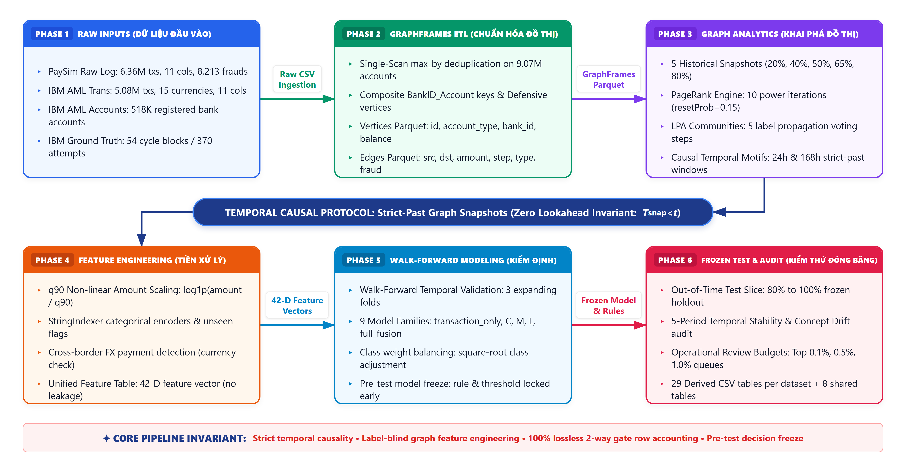
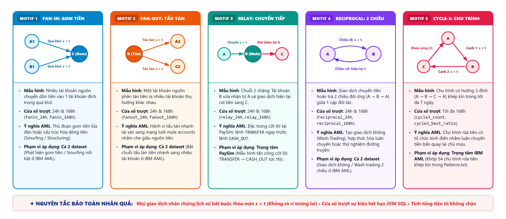

# Từ Điển Dữ Liệu Toàn Diện (Comprehensive Data Dictionary)
### GraphGuard: Hệ Thống Phát Hiện Gian Lận Tài Chính & Rửa Tiền Dựa Trên Đồ Thị (AMLS)

> [!NOTE]
> Tài liệu này được biên soạn mới hoàn toàn nhằm chuẩn hóa, nâng cấp và mở rộng từ điển dữ liệu gốc (`Report_Bundle/09_DATA_DICTIONARY.md`). Tài liệu giải trình chi tiết: (1) Cấu trúc toàn diện của dữ liệu đầu vào thô (Raw inputs) của cả hai tập dữ liệu PaySim và IBM AML (HI-Small); (2) Các biến định danh chính (Primary keys) và biến cốt lõi được bảo toàn xuyên suốt pipeline; (3) Toàn bộ các đặc trưng kỹ thuật và cấu trúc đồ thị được sinh mới (Engineered features) kèm lý do kỹ thuật và tầm quan trọng nghiệp vụ; (4) Phân tích chuyên sâu độ quan trọng đặc trưng (Feature Importance) từ các mô hình Decision Tree; (5) Bảng tra cứu chuẩn hóa 5 cột cho toàn bộ 29 bảng kết quả đầu ra theo từng tập dữ liệu, 8 bảng đối chiếu gộp và cấu trúc artifact mô hình.

---

## Mục Lục
1. [Kiến Trúc Luồng Dữ Liệu & Nguyên Tắc Bảo Toàn Tính Nhân Quả](#1-kiến-trúc-luồng-dữ-liệu--nguyên-tắc-bảo-toàn-tính-nhân-quả)
2. [Từ Điển Dữ Liệu Đầu Vào Thô (Raw Input Datasets)](#2-từ-điển-dữ-liệu-đầu-vào-thô-raw-input-datasets)
   - [2.1 Tập dữ liệu PaySim Raw](#21-tập-dữ-liệu-paysim-raw)
   - [2.2 Tập dữ liệu IBM AML HI-Small Raw](#22-tập-dữ-liệu-ibm-aml-hi-small-raw)
   - [2.3 Các biến chính (Primary Variables) & Quy tắc bảo toàn](#23-các-biến-chính-primary-variables--quy-tắc-bảo-toàn)
3. [Tầng Xử Lý ETL & Chuẩn Hóa Đồ Thị GraphFrames](#3-tầng-xử-lý-etl--chuẩn-hóa-đồ-thị-graphframes)
   - [3.1 Bảng Vertices (Đỉnh tài khoản)](#31-bảng-vertices-đỉnh-tài-khoản)
   - [3.2 Bảng Edges (Cạnh giao dịch)](#32-bảng-edges-cạnh-giao-dịch)
4. [Tầng Kỹ Thuật Đặc Trưng (Feature Engineering) & Tầm Quan Trọng Nghiệp Vụ](#4-tầng-kỹ-thuật-đặc-trưng-feature-engineering--tầm-quan-trọng-nghiệp-vụ)
   - [4.1 Lý do bổ sung biến mới trong phát hiện gian lận tài chính](#41-lý-do-bổ-sung-biến-mới-trong-phát-hiện-gian-lận-tài-chính)
   - [4.2 Nhóm đặc trưng giao dịch & Tiền xử lý (Tabular Transformations)](#42-nhóm-đặc-trưng-giao-dịch--tiền-xử-lý-tabular-transformations)
   - [4.3 Nhóm đặc trưng cấu trúc & Trung tâm đồ thị (Centrality Snapshots)](#43-nhóm-đặc-trưng-cấu-trúc--trung-tâm-đồ-thị-centrality-snapshots)
   - [4.4 Nhóm đặc trưng ngữ cảnh cộng đồng (Community LPA Snapshots)](#44-nhóm-đặc-trưng-ngữ-cảnh-cộng-đồng-community-lpa-snapshots)
   - [4.5 Nhóm đặc trưng mẫu hình chuỗi thời gian nhân quả (Causal Temporal Motifs)](#45-nhóm-đặc-trưng-mẫu-hình-chuỗi-thời-gian-nhân-quả-causal-temporal-motifs)
5. [Phân Tích Chuyên Sâu Độ Quan Trọng Của Đặc Trưng (Feature Importance Analysis)](#5-phân-tích-chuyên-sâu-độ-quan-trọng-của-đặc-trưng-feature-importance-analysis)
   - [5.1 Bảng xếp hạng Feature Importance chi tiết: PaySim vs IBM AML](#51-bảng-xếp-hạng-feature-importance-chi-tiết-paysim-vs-ibm-aml)
   - [5.2 So sánh đối chiếu & Luận giải hiện tượng thống trị đặc trưng](#52-so-sánh-đối-chiếu--luận-giải-hiện-tượng-thống-trị-đặc-trưng)
6. [Từ Điển Chi Tiết Toàn Bộ Các Bảng Kết Quả Đầu Ra (Derived CSV Tables)](#6-từ-điển-chi-tiết-toàn-bộ-các-bảng-kết-quả-đầu-ra-derived-csv-tables)
   - [6.1 Nhóm bảng Baseline & Đối soát cấu trúc (Baseline & Auditing)](#61-nhóm-bảng-baseline--đối-soát-cấu-trúc-baseline--auditing)
   - [6.2 Nhóm bảng Cấu trúc đồ thị & Phân bố cộng đồng (Topology & Community)](#62-nhóm-bảng-cấu-trúc-đồ-thị--phân-bố-cộng-đồng-topology--community)
   - [6.3 Nhóm bảng Độ bao phủ mẫu hình (Motif Coverage)](#63-nhóm-bảng-độ-bao-phủ-mẫu-hình-motif-coverage)
   - [6.4 Nhóm bảng Kiểm định Walk-Forward & Lựa chọn mô hình](#64-nhóm-bảng-kiểm-định-walk-forward--lựa-chọn-mô-hình)
   - [6.5 Nhóm bảng Đánh giá mô hình đóng băng (Frozen Test Metrics & Reliability)](#65-nhóm-bảng-đánh-giá-mô-hình-đóng-băng-frozen-test-metrics--reliability)
   - [6.6 Nhóm bảng Đường cong Precision-Recall chi tiết (8 Family PR Curves)](#66-nhóm-bảng-đường-cong-precision-recall-chi-tiết-8-family-pr-curves)
   - [6.7 Nhóm bảng Phân rã giao dịch thực tế & Bằng chứng (Case Evidence & Cold Start)](#67-nhóm-bảng-phân-rã-giao-dịch-thực-tế--bằng-chứng-case-evidence--cold-start)
   - [6.8 Nhóm 8 bảng tổng hợp dùng chung (Shared Cross-Dataset Tables)](#68-nhóm-8-bảng-tổng-hợp-dùng-chung-shared-cross-dataset-tables)
   - [6.9 Cấu trúc bảng và Metadata lưu trữ mô hình (Model Artifacts)](#69-cấu-trúc-bảng-và-metadata-lưu-trữ-mô-hình-model-artifacts)
7. [Tính Toàn Vẹn Dữ Liệu & Hướng Dẫn Truy Xuất Nguồn Gốc (Provenance)](#7-tính-toàn-vẹn-dữ-liệu--hướng-dẫn-truy-xuất-nguồn-gốc-provenance)

---

## 1. Kiến Trúc Luồng Dữ Liệu & Nguyên Tắc Bảo Toàn Tính Nhân Quả

GraphGuard được thiết kế nhằm xử lý dữ liệu giao dịch tài chính quy mô lớn thông qua Apache Spark và GraphFrames, kết hợp học máy có giám sát với khai phá cấu trúc đồ thị. Để đảm bảo mô hình phản ánh chính xác thực tế vận hành và không vi phạm tính khách quan trong đánh giá, kiến trúc tuân thủ các nguyên tắc cốt lõi:
1. **Bảo toàn tính nhân quả thời gian (Strict Temporal Causality)**: Khi tính toán đặc trưng cho một giao dịch tại thời điểm $t$, hệ thống chỉ được phép truy xuất các giao dịch có nhãn thời gian $s < t$. Tuyệt đối không cho phép dữ liệu cùng thời điểm ($s = t$) hoặc tương lai ($s > t$) tham gia vào lịch sử nhân chứng.
2. **Loại bỏ rò rỉ nhãn (Label-Blind Feature Extraction)**: Toàn bộ quá trình tính toán bậc đỉnh, PageRank, thuật toán lan truyền nhãn (LPA) và tìm kiếm motif đều chạy trên đồ thị phi nhãn (`require_unlabelled`). Nhãn gian lận (`isFraud` / `Is Laundering`) chỉ được phép kết hợp (join) tại bước huấn luyện mô hình.
3. **Ảnh chụp đồ thị lịch sử không rò rỉ (Historical Snapshots)**: Không tính PageRank và LPA trên toàn bộ đồ thị hoàn chỉnh cho các quyết định lịch sử. Thay vào đó, hệ thống chia đồ thị thành 5 khối thời gian (Time Blocks) và chỉ gắn đặc trưng từ ảnh chụp (snapshot) đã hoàn tất trước điểm biên của khối đó.



---

## 2. Từ Điển Dữ Liệu Đầu Vào Thô (Raw Input Datasets)

### 2.1 Tập dữ liệu PaySim Raw
- **Tệp nguồn**: `data/raw/PS_20174392719_1491204439457_log.csv`
- **Mô tả bối cảnh**: Tập dữ liệu mô phỏng giao dịch tiền tệ di động (Mobile Money) dựa trên nhật ký tài chính thực tế tại một quốc gia châu Phi, tạo bởi công cụ mô phỏng PaySim.
- **Quy mô vật lý**: 6,362,620 dòng; kích thước xấp xỉ 470 MiB.
- **Tỷ lệ mất cân bằng**: 8,213 giao dịch gian lận (`isFraud == 1`), chiếm tỷ lệ cực thấp **0.129%** (1:775).

| Tên cột (Column Name) | Kiểu dữ liệu (Data Type) | Đơn vị / Miền giá trị | Ý nghĩa nghiệp vụ & Thuật toán | Vai trò trong Pipeline | Ví dụ mẫu |
|---|---|---|---|---|---|
| `step` | `Integer` | $1 \le \text{step} \le 744$ (giờ) | Đơn vị thời gian mô phỏng theo giờ. Toàn bộ chu kỳ tương ứng 31 ngày ($31 \times 24\text{h} = 744\text{h}$). Đây là biến thứ tự logic, không phải mốc thời gian lịch thực. | Cốt lõi (Temporal Index) | `1`, `744` |
| `type` | `String` | 5 giá trị phân loại | Phương thức hoặc nghiệp vụ giao dịch: `CASH_IN`, `CASH_OUT`, `DEBIT`, `PAYMENT`, `TRANSFER`. Toàn bộ gian lận chỉ tập trung ở `TRANSFER` và `CASH_OUT`. | Đặc trưng phân loại & Lọc nghiệp vụ | `TRANSFER`, `PAYMENT` |
| `amount` | `Double` | $> 0$ (Đơn vị nội tệ mô phỏng) | Số tiền thực hiện chuyển hoặc thanh toán trong giao dịch. | Đặc trưng số trị chính (Amount) | `9839.64`, `181.00` |
| `nameOrig` | `String` | Bắt đầu bằng `'C'` + số định danh | Định danh tài khoản gửi tiền (Originating Customer Account). Luôn là khách hàng cá nhân. | Khóa chính nguồn cạnh (`src`), Đỉnh (`id`) | `C1231006815` |
| `oldbalanceOrg` | `Double` | $\ge 0$ | Số dư ban đầu của tài khoản nguồn trước khi phát sinh giao dịch. | Dữ liệu kiểm toán số dư | `170136.0` |
| `newbalanceOrig` | `Double` | $\ge 0$ | Số dư còn lại của tài khoản nguồn sau khi giao dịch hoàn tất. Trong nhiều vụ gian lận, số dư này bị vét cạn về 0. | Trích xuất số dư đỉnh mới nhất (`balance`) | `160296.36` |
| `nameDest` | `String` | Bắt đầu bằng `'C'` (Khách hàng) hoặc `'M'` (Thương nhân) | Định danh tài khoản thụ hưởng (Recipient Account). Nếu bắt đầu bằng `'M'`, không có số dư trong dữ liệu. | Khóa chính đích cạnh (`dst`), Đỉnh (`id`) | `M1979787155`, `C553264065` |
| `oldbalanceDest` | `Double` | $\ge 0$ | Số dư ban đầu của tài khoản thụ hưởng trước khi nhận tiền. Thường bằng 0 nếu là thương nhân (`M`). | Dữ liệu kiểm toán số dư | `0.0` |
| `newbalanceDest` | `Double` | $\ge 0$ | Số dư của tài khoản thụ hưởng sau khi nhận tiền. | Trích xuất số dư đỉnh mới nhất (`balance`) | `0.0` |
| `isFraud` | `Short / Integer` | $\{0, 1\}$ | Nhãn gian lận thực tế (Ground-truth Label). 1 là hành vi gian lận chiếm đoạt tiền; 0 là giao dịch hợp lệ. | **Nhãn mục tiêu (Target Label)** | `0`, `1` |
| `isFlaggedFraud` | `Short / Integer` | $\{0, 1\}$ | Cảnh báo heuristic thô theo quy tắc hệ thống cũ (chuyển tiền vượt 200,000 đơn vị trong một giao dịch đơn lẻ). Chỉ có 16 dòng được đánh dấu trong toàn bộ 6.36M giao dịch. | Tham chiếu đối chứng cơ sở (Loại khỏi feature set) | `0` |

---

### 2.2 Tập dữ liệu IBM AML HI-Small Raw
Tập dữ liệu rửa tiền mô phỏng do IBM Research phát hành (biến thể **HI-Small** - High Illiterate, Small Graph), mô phỏng mạng lưới ngân hàng quốc tế phức tạp.
Gồm 3 tệp tin chính:
1. `data/raw/ibm_aml/HI-Small_Trans.csv` (Nhật ký giao dịch)
2. `data/raw/ibm_aml/HI-Small_accounts.csv` (Danh bạ tài khoản & ngân hàng)
3. `data/raw/ibm_aml/HI-Small_Patterns.txt` (Kịch bản rửa tiền chuẩn)

#### A. Tệp Giao Dịch: `HI-Small_Trans.csv`
- **Quy mô vật lý**: 5,078,345 dòng; 5,177 giao dịch rửa tiền (`Is Laundering == 1`), chiếm tỷ lệ **0.102%** (1:980).

| Tên cột (Column Name) | Kiểu dữ liệu (Data Type) | Đơn vị / Miền giá trị | Ý nghĩa nghiệp vụ & Thuật toán | Vai trò trong Pipeline | Ví dụ mẫu |
|---|---|---|---|---|---|
| `Timestamp` | `String` | Định dạng `yyyy/MM/dd HH:mm` | Thời điểm ghi nhận giao dịch theo thời gian thực (từ ngày 01/09/2022). Được chuyển đổi sang Unix epoch seconds trong pipeline. | Chuyển đổi thành chỉ mục thời gian (`step`) | `2022/09/01 00:20` |
| `From Bank` | `String / Long` | Mã định danh ngân hàng | Mã số của ngân hàng chuyển tiền. Có thể chứa các chữ số 0 ở đầu (ví dụ: `021174`, `012`). | Thành phần khóa phức hợp nguồn (`from_bank_norm`) | `021174`, `10` |
| `Account` | `String` | Chuỗi ký tự số hexa/thập phân | Số tài khoản nguồn tại ngân hàng chuyển tiền. **Lưu ý**: Số tài khoản không phải là duy nhất toàn cầu, nhiều ngân hàng có thể có cùng số tài khoản. | Thành phần khóa phức hợp nguồn (`src`) | `800737690` |
| `To Bank` | `String / Long` | Mã định danh ngân hàng | Mã số của ngân hàng thụ hưởng. Có thể chứa số 0 ở đầu (ví dụ: `020`, `00220`). | Thành phần khóa phức hợp đích (`to_bank_norm`) | `020`, `3208` |
| `Account.1` (`Account_Dest`) | `String` | Chuỗi ký tự số | Số tài khoản thụ hưởng tại ngân hàng đích. Trong file CSV gốc, cột này có tên trùng là `Account` thứ hai, được đổi tên thành `Account_Dest` trong Spark để chống lỗi dotted lookup. | Thành phần khóa phức hợp đích (`dst`) | `80011F990` |
| `Amount Received` | `Double` | $> 0$ (Đơn vị ngoại tệ nhận) | Số tiền tài khoản thụ hưởng thực nhận sau khi chuyển đổi ngoại hối hoặc trừ phí. | Kiểm toán ngoại tệ | `2848.96` |
| `Receiving Currency` | `String` | 15 mã loại tiền tệ | Loại tiền tệ tài khoản thụ hưởng nhận (US Dollar, Euro, Yuan, Yen, Bitcoin, Swiss Franc, v.v.). | Kiểm toán đa tiền tệ & Xác định cờ ngoại hối (`fx_payment`) | `Euro`, `US Dollar` |
| `Amount Paid` | `Double` | $> 0$ (Đơn vị ngoại tệ gửi) | Số tiền tài khoản chuyển tiền thực tế chi trả. | **Số tiền giao dịch chính (`amount`)** | `2848.96` |
| `Payment Currency` | `String` | 15 mã loại tiền tệ | Loại tiền tệ thanh toán của tài khoản chuyển. Giữ nguyên đơn vị gốc, không quy đổi tùy tiện sang USD. | Phân nhóm co giãn (`q90 scaling`) & Indexer | `Euro`, `US Dollar` |
| `Payment Format` | `String` | 7 phương thức | Kênh giao dịch: `Cheque`, `Credit Card`, `ACH`, `Wire`, `Cash`, `Reinvestment`, `Cross-border`. | Đặc trưng phân loại chính (`type`) | `ACH`, `Wire`, `Cheque` |
| `Is Laundering` | `Short / Integer` | $\{0, 1\}$ | Nhãn rửa tiền thực tế (Ground-truth Label). 1 là giao dịch tham gia đường dây rửa tiền; 0 là giao dịch thương mại hợp pháp. | **Nhãn mục tiêu (Target Label: `isFraud`)** | `0`, `1` |

#### B. Tệp Danh Bạ Tài Khoản: `HI-Small_accounts.csv`
- **Quy mô vật lý**: 518,581 tài khoản khai báo chính thức.

| Tên cột (Column Name) | Kiểu dữ liệu | Ý nghĩa nghiệp vụ | Vai trò trong Pipeline | Ví dụ mẫu |
|---|---|---|---|---|
| `Bank Name` | `String` | Tên pháp lý của tổ chức tài chính hoặc ngân hàng đại lý. | Thuộc tính mô tả đỉnh (`bank_name`) | `Portugal Bank #4507` |
| `Bank ID` | `String / Long` | Mã định danh của ngân hàng, được chuẩn hóa qua ép kiểu `long -> string`. | Thành phần tạo khóa định danh đỉnh (`bank_id`) | `331579`, `210` |
| `Account Number` | `String` | Số hiệu tài khoản trong phạm vi ngân hàng đó. | Thành phần tạo khóa định danh đỉnh | `80062E240` |
| `Entity ID` | `String` | Mã định danh thực thể chủ tài khoản nội bộ. | Thuộc tính đối soát thực thể | `80062E240` |
| `Entity Name` | `String` | Tên và loại hình thực thể sở hữu tài khoản (Cá nhân, Doanh nghiệp tư nhân, Tập đoàn). Phần trước dấu `#` thể hiện loại hình tài khoản. | Trích xuất phân loại tài khoản (`account_type`) | `Sole Proprietorship #50438` |

#### C. Tệp Mẫu Hình Rửa Tiền Chuẩn: `HI-Small_Patterns.txt`
- **Mô tả cấu trúc**: Chứa thông tin 370 nỗ lực rửa tiền có tổ chức, trong đó có **54 chu trình khép kín (CYCLE blocks)** từ 3 đến 10 bước nhảy (hops). Mỗi khối bắt đầu bằng cú pháp `BEGIN LAUNDERING ATTEMPT - <PATTERN_NAME>` và kết thúc bằng `END LAUNDERING ATTEMPT`.
- **Vai trò**: Dùng làm tập dữ liệu đối soát độc lập (Ground-truth Pattern Audit) để thẩm định độ bao phủ của các thuật toán tìm kiếm chu trình (Cycle Motif Finding) trong Task 3 và Task 6.

---

### 2.3 Các biến chính (Primary Variables) & Quy tắc bảo toàn

Nhằm đảm bảo sự xuyên suốt giữa các giai đoạn từ ETL đến Khai phá đồ thị và Mô hình hóa, hệ thống xác lập tập các biến chính bắt buộc:

1. **Khóa phức hợp (Composite Key Resolution) cho Đỉnh và Cạnh**:
   - **PaySim**: Các định danh tài khoản `nameOrig` và `nameDest` là duy nhất toàn cầu $\to$ sử dụng trực tiếp làm khóa đỉnh `id` và cạnh `(src, dst)`.
   - **IBM AML**: `Account Number` bị trùng lặp giữa các ngân hàng. Bắt buộc phải ghép thành khóa phức hợp theo định dạng:
     $$\text{id} = \text{CastToString}(\text{CastToLong}(\text{Bank ID})) + \text{"\_"} + \text{Account Number}$$
     *Lý do kỹ thuật*: Việc ép qua `Long` rồi về `String` nhằm loại bỏ hoàn toàn hiện tượng lệch số 0 ở đầu (ví dụ: `Trans.csv` lưu `"021174"` trong khi `accounts.csv` lưu `"21174"` cho cùng một ngân hàng). Nếu không chuẩn hóa, việc liên kết bảng (join) sẽ bị trượt hoàn toàn.

2. **Chỉ số thời gian chuẩn hóa (`step`)**:
   - **PaySim**: Lưu dưới dạng số nguyên $1 \le \text{step} \le 744$ (đại diện cho số giờ mô phỏng).
   - **IBM AML**: Chuyển đổi từ `Timestamp` sang Unix epoch seconds (giây nguyên bản). Mặc dù đơn vị khác nhau, cả hai đều có tính chất thứ tự đơn điệu ($s < t$), đáp ứng hoàn hảo cho việc lọc lịch sử nhân quả.

3. **Số tiền giao dịch (`amount`)**:
   - Được bảo toàn xuyên suốt ở dạng số thực (`DoubleType`). Tuy nhiên, ở IBM AML có tới 15 loại tiền tệ khác nhau. Quy tắc bất khả xâm phạm: **Không bao giờ so sánh hoặc trừ trực tiếp số tiền danh nghĩa giữa hai loại tiền tệ khác nhau**. Thay vào đó, số tiền được chuẩn hóa theo phân vị $q\_{90}$ của từng cặp `(payment_currency, type)`.

4. **Loại giao dịch (`type`)**:
   - Ở PaySim, `type` thể hiện phương thức thanh toán (`TRANSFER`, `CASH_OUT`, v.v.).
   - Ở IBM AML, `type` được ánh xạ từ `Payment Format` (`Wire`, `Cheque`, `ACH`, v.v.).

5. **Nhãn giám sát mục tiêu (`isFraud`)**:
   - Ánh xạ từ `isFraud` (PaySim) và `Is Laundering` (IBM AML). Nhãn này tuyệt đối không được đưa vào bảng đặc trưng (`features`), mà chỉ được join vào thời điểm huấn luyện cây quyết định để tránh rò rỉ nhãn (Label Leakage).

---

## 3. Tầng Xử Lý ETL & Chuẩn Hóa Đồ Thị GraphFrames

Sau bước trích xuất từ dữ liệu thô, dữ liệu được ghi xuống định dạng tối ưu Parquet theo chuẩn cấu trúc đồ thị GraphFrames:

### 3.1 Bảng Vertices (Đỉnh tài khoản)
- **Đường dẫn**: `data/processed/paysim/vertices.parquet` và `data/processed/ibm_aml/vertices.parquet`

| Tên cột (Column Name) | Kiểu dữ liệu | Phạm vi / Giá trị | Ý nghĩa nghiệp vụ & Thuật toán | Vai trò trong Pipeline |
|---|---|---|---|---|
| `id` | `StringType` | Định danh tài khoản chuẩn | Khóa chính duy nhất đại diện cho tài khoản trong toàn mạng lưới (ở IBM là composite key `BankID_Account`). | Khóa chính Đỉnh (Primary Key) |
| `account_type` | `StringType` | PaySim: `Customer`, `Merchant`<br/>IBM: `Individual`, `Corporation`, `External/Unknown` | Loại hình tài khoản/thực thể sở hữu. Ở PaySim được suy diễn từ tiền tố `'C'` hoặc `'M'`. Ở IBM được trích xuất từ `Entity Name` hoặc gán `External/Unknown` nếu là tài khoản bổ sung phòng thủ. | Thuộc tính cấu trúc đỉnh |
| `bank_id` | `StringType` | Mã ngân hàng (IBM AML) | Mã định danh ngân hàng quản lý tài khoản. Ở PaySim cột này mang giá trị null hoặc không áp dụng. | Thuộc tính ngân hàng |
| `bank_name` | `StringType` | Tên ngân hàng (IBM AML) | Tên pháp lý của ngân hàng (nếu có trong danh bạ). | Thuộc tính kiểm toán |
| `balance` | `DoubleType` | $\ge 0$ | Số dư tài khoản gần nhất. Với PaySim, dùng hàm tổng hợp `max_by(newbalance*, step)` trong 1 lượt quét để lấy số dư sau giao dịch mới nhất; với IBM AML gán mặc định `0.0` do dữ liệu không cung cấp. | Thuộc tính tài chính |

> [!IMPORTANT]
> **Cơ chế Tạo Đỉnh Phòng Thủ (Defensive Vertex Generation ở IBM AML)**:
> Danh bạ `HI-Small_accounts.csv` chỉ chứa 518,581 tài khoản đăng ký nội bộ. Tuy nhiên, bảng giao dịch `HI-Small_Trans.csv` có chứa các tài khoản đối tác ngoài hệ thống. ETL thực hiện thao tác gom tập hợp tất cả các `src` và `dst` xuất hiện trong cạnh giao dịch, sau đó thực hiện `left_anti join` với bảng tài khoản để tự động sinh các đỉnh bổ sung với nhãn `account_type = 'External/Unknown'`. Cơ chế này đảm bảo đồ thị đạt tính toàn vẹn tham chiếu tuyệt đối: **0 cạnh treo (0 dangling edges)**.

### 3.2 Bảng Edges (Cạnh giao dịch)
- **Đường dẫn**: `data/processed/paysim/edges.parquet` và `data/processed/ibm_aml/edges.parquet`

| Tên cột (Column Name) | Kiểu dữ liệu | Đơn vị / Phạm vi | Ý nghĩa nghiệp vụ & Thuật toán | Vai trò trong Pipeline |
|---|---|---|---|---|
| `src` | `StringType` | Khớp với `vertices.id` | Khóa định danh tài khoản gửi tiền/chuyển tiền (Source Node). | Khóa ngoại nguồn (Source Key) |
| `dst` | `StringType` | Khớp với `vertices.id` | Khóa định danh tài khoản nhận tiền/thụ hưởng (Destination Node). | Khóa ngoại đích (Destination Key) |
| `amount` | `DoubleType` | $> 0$ | Giá trị số tiền giao dịch theo đồng tiền thanh toán gốc. | Đặc trưng cốt lõi (Amount) |
| `step` | `LongType / Integer` | Giờ (PaySim) hoặc Epoch seconds (IBM) | Mốc thời gian phát sinh giao dịch. Dùng để thiết lập bộ lọc cửa sổ trượt nhân quả. | Thứ tự thời gian (Temporal Order) |
| `type` | `StringType` | Tên phương thức | Loại hình giao dịch thanh toán hoặc kênh chuyển tiền. | Phân loại giao dịch |
| `payment_currency` | `StringType` | Mã tiền tệ (15 loại ở IBM, `'PaySim unit'` ở PaySim) | Đồng tiền chi trả thực tế của tài khoản nguồn. | Phân nhóm co giãn & Kiểm toán ngoại hối |
| `receiving_currency`| `StringType` | Mã tiền tệ | Đồng tiền tài khoản đích tiếp nhận. | Đối soát ngoại hối (`fx_payment`) |
| `isFraud` | `ShortType / Double` | $\{0, 1\}$ | Nhãn gian lận / rửa tiền mặt đất (Ground Truth). | **Nhãn mục tiêu (Target Label)** |

---

## 4. Tầng Kỹ Thuật Đặc Trưng (Feature Engineering) & Tầm Quan Trọng Nghiệp Vụ

### 4.1 Lý do bổ sung biến mới trong phát hiện gian lận tài chính

Trong các hệ thống phòng chống rửa tiền truyền thống dựa trên luật (Rule-based) hoặc mô hình học máy chỉ nhìn vào thuộc tính giao dịch đơn lẻ (`transaction_only`):
- **Điểm yếu của dữ liệu dạng bảng đơn thuần**: Các đối tượng rửa tiền chuyên nghiệp không thực hiện chuyển một khoản tiền khổng lồ một lần. Chúng sử dụng kỹ thuật cấu trúc hóa (Structuring / Smurfing) bằng cách chia nhỏ số tiền chuyển cho hàng chục tài khoản trung gian (mule accounts), sau đó gom lại và chuyển nhanh qua các kênh khác trong chu kỳ vài giờ hoặc vài ngày.
- **Tầm quan trọng của đặc trưng đồ thị (Graph Features)**: Giúp phát hiện các tài khoản đóng vai trò là "trạm trung chuyển" (Hubs) thông qua bậc đỉnh (Degree) và mức độ quan trọng trong mạng lưới (PageRank).
- **Tầm quan trọng của đặc trưng cộng đồng (Community Context - LPA)**: Tội phạm tài chính thường tập trung hoạt động trong các mạng lưới cấu kết chặt chẽ hoặc cố tình chuyển tiền xuyên biên giới/xuyên cộng đồng để xóa dấu vết dòng tiền (Layering). Đặc trưng cộng đồng đo lường tỷ lệ dòng tiền thoát ra khỏi cụm (`cross_fraction`).
- **Tầm quan trọng của đặc trưng Motif nhân quả (Causal Motifs)**: Giúp bắt trọn các mẫu hình hành vi theo thời gian thực:
  - Gom tiền từ nhiều nguồn (*Fan-in*): dấu hiệu của tài khoản gom tiền lừa đảo.
  - Tẩu tán tiền ra nhiều nguồn (*Fan-out*): dấu hiệu của việc phân tán tiền bẩn.
  - Chuỗi chuyển tiếp tức thì (*Relay*): tài khoản trung gian nhận tiền và đẩy đi ngay lập tức.
  - Giao dịch qua lại hai chiều (*Reciprocal*): rửa tiền qua lại tạo thanh khoản giả.
  - Chu trình khép kín 3 đỉnh (*Cycle-3*): dòng tiền đi vòng tròn $A \to B \to C \to A$ nhằm hợp thức hóa nguồn gốc tiền.

---

### 4.2 Nhóm đặc trưng giao dịch & Tiền xử lý (Tabular Transformations)

Các đặc trưng này được tiền xử lý độc lập trên từng khối thời gian huấn luyện (Training Prefix):

| Tên đặc trưng (Feature) | Kiểu dữ liệu | Công thức / Định nghĩa kỹ thuật | Lý do thiết kế & Tầm quan trọng nghiệp vụ |
|---|---|---|---|
| `scaled_amount` | `DoubleType` | $\log\left(1 + \min\left(\frac{\text{amount}}{q\_{90}}, 10^{12}\right)\right)$ | **Co giãn phi tuyến theo phân vị**: Phân vị $q\_{90}$ được tính riêng cho từng cặp `(payment_currency, type)` trên tập train. Giúp triệt tiêu sự chênh lệch mệnh giá giữa các đồng tiền (ví dụ Yen Nhật với Bitcoin) và làm mịn các giá trị ngoại lai cực lớn mà không làm mất thông tin tỷ lệ. |
| `unseen_amount_group` | `DoubleType` | $1.0$ nếu cặp `(currency, type)` chưa từng xuất hiện ở tập train; ngược lại $0.0$. | **Phát hiện hành vi dị biệt (Novelty)**: Nhận diện các kênh giao dịch mới hoặc đồng tiền lạ đột ngột xuất hiện ở giai đoạn sau, cảnh báo rủi ro gian lận tiềm ẩn. |
| `fx_payment` | `DoubleType` | $1.0$ nếu `payment_currency != receiving_currency`; ngược lại $0.0$. | **Giao dịch ngoại hối xuyên biên giới**: Rửa tiền quốc tế thường lợi dụng các giao dịch đổi ngoại tệ để làm phức tạp hóa việc truy vết của cơ quan quản lý. |
| `type_index` | `DoubleType` | `StringIndexer(type)` (thứ tự chữ cái) | Mã hóa phân loại kênh giao dịch thành số để cây quyết định phân nhánh. Ở PaySim, cây sẽ tách biệt rạch ròi giữa `TRANSFER`/`CASH_OUT` với các loại hình khác. |
| `currency_index` | `DoubleType` | `StringIndexer(payment_currency)` | Mã hóa phân loại đồng tiền thanh toán. |

---

### 4.3 Nhóm đặc trưng cấu trúc & Trung tâm đồ thị (Centrality Snapshots)

Được trích xuất từ các ảnh chụp đồ thị lịch sử (Historical Snapshots) tại 5 mốc phân vị (20%, 40%, 50%, 65%, 80% thời gian) bằng Spark GraphFrames:

| Tên đặc trưng (Feature) | Kiểu dữ liệu | Thuật toán / Cách tính | Tầm quan trọng trong phát hiện gian lận |
|---|---|---|---|
| `src_inDegree`, `dst_inDegree` | `DoubleType` | Số lượng cạnh giao dịch đi vào tài khoản trong snapshot quá khứ. | Tài khoản thụ hưởng gian lận thường có `dst_inDegree` tăng đột biến khi đóng vai trò điểm thu gom tiền từ nhiều nạn nhân. |
| `src_outDegree`, `dst_outDegree` | `DoubleType` | Số lượng cạnh giao dịch đi ra khỏi tài khoản trong snapshot quá khứ. | Tài khoản tẩu tán tiền thường có `src_outDegree` cao bất thường trong thời gian ngắn. |
| `src_degree`, `dst_degree` | `DoubleType` | $\text{inDegree} + \text{outDegree}$ | Tổng bậc kết nối, phản ánh mức độ hoạt động giao dịch tích cực của tài khoản trong mạng lưới. |
| `src_pagerank`, `dst_pagerank` | `DoubleType` | PageRank tính qua 10 vòng lặp lũy thừa (`iterations=10`, `resetProb=0.15`). | **Độ tập trung quyền lực/dòng tiền**: Giúp xác định các tài khoản trung tâm chi phối hoặc các nút "ngân hàng ngầm" mà dòng tiền liên tục chảy dồn về. |
| `src_seen`, `dst_seen` | `DoubleType` | $1.0$ nếu tài khoản đã từng có giao dịch trong snapshot quá khứ; $0.0$ nếu là tài khoản mới toanh. | **Kiểm soát bài toán Cold-start**: Tài khoản mới tạo lần đầu tham gia mạng lưới thường tiềm ẩn rủi ro cao (tài khoản rác dùng một lần để nhận tiền lừa đảo). |

---

### 4.4 Nhóm đặc trưng ngữ cảnh cộng đồng (Community LPA Snapshots)

Trích xuất thông qua thuật toán Lan truyền Nhãn (Label Propagation Algorithm - LPA, 5 vòng lặp) trên snapshot đồ thị lịch sử:

| Tên đặc trưng (Feature) | Kiểu dữ liệu | Thuật toán / Cách tính | Tầm quan trọng trong phát hiện gian lận |
|---|---|---|---|
| `src_community_size`, `dst_community_size` | `DoubleType` | Số lượng thành viên (tài khoản) thuộc về cộng đồng LPA chứa tài khoản nguồn/đích. | Phân biệt tài khoản thuộc các cộng đồng thương mại khổng lồ (bình thường) với các cụm tài khoản cô lập quy mô nhỏ chuyên dùng để rửa tiền. |
| `src_community_cross_fraction`, `dst_community_cross_fraction` | `DoubleType` | Tỷ lệ số giao dịch đi ra khỏi cộng đồng trên tổng số giao dịch của cộng đồng đó: $\frac{\text{Giao dịch liên cộng đồng}}{\text{Tổng giao dịch xuất phát}}$. | **Đặc trưng cầu nối (Bridge Fraction)**: Nhóm tài khoản rửa tiền thường có tỷ lệ chuyển tiền xuyên cộng đồng rất cao để tẩu tán tài sản sang mạng lưới khác. |
| `src_community_out_transactions`, `dst_community_out_transactions` | `DoubleType` | Tổng khối lượng giao dịch phát sinh từ cộng đồng đó. | Đánh giá quy mô hoạt động kinh tế của cụm tài khoản. |
| `same_community` | `DoubleType` | $1.0$ nếu cả `src` và `dst` cùng thuộc một cộng đồng LPA và cả hai đều đã được thấy (`seen == 1`); ngược lại $0.0$. | Giao dịch nội bộ cộng đồng (khép kín) vs Giao dịch vươn ra ngoài cộng đồng. |
| `community_endpoints_seen` | `DoubleType` | $1.0$ nếu cả hai đầu mút `src` và `dst` đều đã có nhãn cộng đồng xác định; ngược lại $0.0$. | Kiểm soát độ tin cậy của thông tin cộng đồng. |

---

### 4.5 Nhóm đặc trưng mẫu hình chuỗi thời gian nhân quả (Causal Temporal Motifs)

Toàn bộ các đặc trưng motif được tính toán chính xác bằng cơ chế **Sự kiện hết hạn và Tổng tiền tố không chặn (Expiry Events & Unbounded Prefix Sums)** trên JVM SQL, hoàn toàn không dùng Python UDFs. Thuật toán kích hoạt tại $s+1$ và hết hạn tại $s+H+1$, tính trên hai cửa sổ trượt quá khứ: **$H = 24\text{h}$** (1 ngày) và **$H = 168\text{h}$** (7 ngày).



| Tên đặc trưng (Feature) | Kiểu dữ liệu | Cửa sổ thời gian | Định nghĩa kỹ thuật & Ý nghĩa nghiệp vụ phòng chống gian lận |
|---|---|---|---|
| `sender_in_24h`, `sender_in_168h` | `DoubleType` | $24\text{h}, 168\text{h}$ | Số lượng giao dịch tài khoản chuyển tiền (`src`) đã **nhận vào** nghiêm ngặt trong quá khứ $H$ giờ. Phản ánh lịch sử tiếp nhận tiền trước khi chuyển đi. |
| `sender_out_24h`, `sender_out_168h` | `DoubleType` | $24\text{h}, 168\text{h}$ | Số lượng giao dịch tài khoản chuyển tiền (`src`) đã **chuyển đi** trong quá khứ $H$ giờ. Đo lường tần suất hoạt động của tài khoản gửi. |
| `receiver_in_24h`, `receiver_in_168h` | `DoubleType` | $24\text{h}, 168\text{h}$ | Số lượng giao dịch tài khoản thụ hưởng (`dst`) đã **nhận vào** trong quá khứ $H$ giờ. **Đây là đặc trưng quan trọng nhất tại PaySim!** Giúp phát hiện tài khoản rút tiền mặt (`CASH_OUT`) nhận dồn dập các lệnh chuyển tiền bất thường. |
| `receiver_out_24h`, `receiver_out_168h` | `DoubleType` | $24\text{h}, 168\text{h}$ | Số lượng giao dịch tài khoản thụ hưởng (`dst`) đã **chuyển đi** trong quá khứ $H$ giờ. |
| `fanin_24h`, `fanin_168h` | `DoubleType` | $24\text{h}, 168\text{h}$ | Số lượng đối tác chuyển tiền duy nhất khác nhau ($A \to C \leftarrow B$) đã chuyển dồn vào tài khoản đích $C$ trong quá khứ. Đặc trưng cốt lõi của thủ đoạn thu gom tiền lừa đảo (Smurfing / Structuring). |
| `fanout_24h`, `fanout_168h` | `DoubleType` | $24\text{h}, 168\text{h}$ | Số lượng đối tác nhận tiền duy nhất khác nhau ($A \leftarrow B \to C$) mà tài khoản nguồn $B$ đã phân tán tiền tới trong quá khứ. Bắt trọn hành vi tẩu tán tài sản nhanh chóng sau khi chiếm đoạt. |
| `relay_24h`, `relay_168h` | `DoubleType` | $24\text{h}, 168\text{h}$ | Số lượng chuỗi chuyển tiếp 2 chặng ($A \to B \to C$) trong đó tài khoản nguồn $B$ vừa nhận tiền từ $A$ và giao dịch hiện tại là chặng đẩy tiền tiếp sang $C$. Ở PaySim, điều kiện nghiêm ngặt là chặng trước là `TRANSFER` và chặng hiện tại là `CASH_OUT`. |
| `reciprocal_24h`, `reciprocal_168h` | `DoubleType` | $24\text{h}, 168\text{h}$ | Số lượng giao dịch hoàn trả 2 chiều ($A \to B \to A$) giữa cùng một cặp tài khoản trong quá khứ. Thường thấy trong các đường dây tạo giao dịch khống để hợp thức hóa hóa đơn thương mại. |
| `cycle3_count` | `DoubleType` | Tối đa $168\text{h}$ | Số lượng chu trình có hướng 3 đỉnh ($A \to B \to C \to A$) mà giao dịch hiện tại là mắt xích cuối cùng khép kín chu trình. |
| `cycle3_best_ratio` | `DoubleType` | Tối đa $168\text{h}$ | Tỷ số bảo toàn số tiền tốt nhất trong chu trình: $\min(\text{amount}) / \max(\text{amount})$. Tỷ số càng gần $1.0$ chứng tỏ tiền đi một vòng rồi quay về gần như nguyên vẹn (dấu hiệu rửa tiền chu kỳ kinh điển). |
| `cycle3_min_gap_seconds`| `DoubleType` | Tối đa $168\text{h}$ | Khoảng cách thời gian ngắn nhất (tính bằng giây) giữa các giao dịch cấu thành chu trình. Chu trình diễn ra càng nhanh thì độ rủi ro càng cao. |

---

## 5. Phân Tích Chuyên Sâu Độ Quan Trọng Của Đặc Trưng (Feature Importance Analysis)

Theo yêu cầu kiểm toán và đánh giá của giảng viên, mục này trình bày chi tiết độ quan trọng đặc trưng (Impurity-based Feature Importance trích xuất từ các cây quyết định độ sâu 5 có trọng số lớp) của cả hai tập dữ liệu PaySim và IBM AML trên tất cả 9 họ mô hình thực nghiệm.

### 5.1 Bảng xếp hạng Feature Importance chi tiết: PaySim vs IBM AML

Bảng dưới đây thống kê toàn bộ các đặc trưng có độ quan trọng lớn hơn 0 (`importance > 0`) được các cây quyết định thực sự sử dụng để phân nhánh:

#### A. Tập Dữ Liệu PaySim

| Họ mô hình (Model Family) | Tên đặc trưng (Feature Name) | Nhóm đặc trưng | Độ quan trọng (Importance) | Tỷ lệ tích lũy |
|---|---|---|:---:|:---:|
| **`full_fusion`** *(T+C+M+L)* | `receiver_in_168h` | Causal Motif | **0.464440** (46.44%) | 46.44% |
| | `scaled_amount` | Tabular/Preprocessed | **0.273489** (27.35%) | 73.79% |
| | `type_index` | Tabular/Preprocessed | **0.261727** (26.17%) | 99.96% |
| | `dst_inDegree` | Centrality | **0.000345** (0.03%) | 100.00% |
| **`motif_assisted`** *(T+M)* | `receiver_in_168h` | Causal Motif | **0.464983** (46.50%) | 46.50% |
| | `scaled_amount` | Tabular/Preprocessed | **0.272495** (27.25%) | 73.75% |
| | `type_index` | Tabular/Preprocessed | **0.262522** (26.25%) | 100.00% |
| **`without_centrality`** *(T+M+L)*<br/>*(Họ mô hình chiến thắng validation)* | `receiver_in_168h` | Causal Motif | **0.464983** (46.50%) | 46.50% |
| | `scaled_amount` | Tabular/Preprocessed | **0.272495** (27.25%) | 73.75% |
| | `type_index` | Tabular/Preprocessed | **0.262522** (26.25%) | 100.00% |
| **`without_community`** *(T+C+M)* | `receiver_in_168h` | Causal Motif | **0.464440** (46.44%) | 46.44% |
| | `scaled_amount` | Tabular/Preprocessed | **0.273489** (27.35%) | 73.79% |
| | `type_index` | Tabular/Preprocessed | **0.261727** (26.17%) | 99.96% |
| | `dst_inDegree` | Centrality | **0.000345** (0.03%) | 100.00% |
| **`transaction_centrality`** *(T+C)* | `scaled_amount` | Tabular/Preprocessed | **0.564702** (56.47%) | 56.47% |
| | `type_index` | Tabular/Preprocessed | **0.342016** (34.20%) | 90.67% |
| | `dst_inDegree` | Centrality | **0.092099** (9.21%) | 99.88% |
| | `dst_pagerank` | Centrality | **0.001182** (0.12%) | 100.00% |
| **`without_motifs`** *(T+C+L)* | `scaled_amount` | Tabular/Preprocessed | **0.564702** (56.47%) | 56.47% |
| | `type_index` | Tabular/Preprocessed | **0.342016** (34.20%) | 90.67% |
| | `dst_inDegree` | Centrality | **0.092099** (9.21%) | 99.88% |
| | `dst_pagerank` | Centrality | **0.001182** (0.12%) | 100.00% |
| **`transaction_community`** *(T+L)* | `scaled_amount` | Tabular/Preprocessed | **0.564514** (56.45%) | 56.45% |
| | `type_index` | Tabular/Preprocessed | **0.344336** (34.43%) | 90.89% |
| | `dst_community_size` | Community LPA | **0.091151** (9.12%) | 100.00% |
| **`transaction_novelty`** *(T+Novelty)*| `scaled_amount` | Tabular/Preprocessed | **0.564514** (56.45%) | 56.45% |
| | `type_index` | Tabular/Preprocessed | **0.344336** (34.43%) | 90.89% |
| | `dst_seen` | Novelty flag | **0.091151** (9.12%) | 100.00% |
| **`transaction_only`** *(Baseline T)* | `scaled_amount` | Tabular/Preprocessed | **0.653169** (65.32%) | 65.32% |
| | `type_index` | Tabular/Preprocessed | **0.346831** (34.68%) | 100.00% |

---

#### B. Tập Dữ Liệu IBM AML (HI-Small)

| Họ mô hình (Model Family) | Tên đặc trưng (Feature Name) | Nhóm đặc trưng | Độ quan trọng (Importance) | Tỷ lệ tích lũy |
|---|---|---|:---:|:---:|
| **`full_fusion`** *(T+C+M+L)*<br/>*(Họ mô hình chiến thắng validation)* | `scaled_amount` | Tabular/Preprocessed | **0.439122** (43.91%) | 43.91% |
| | `type_index` | Tabular/Preprocessed | **0.403075** (40.31%) | 84.22% |
| | `fanin_168h` | Causal Motif | **0.087332** (8.73%) | 92.95% |
| | `src_pagerank` | Centrality | **0.031767** (3.18%) | 96.13% |
| | `fanout_24h` | Causal Motif | **0.020571** (2.06%) | 98.19% |
| | `reciprocal_168h` | Causal Motif | **0.011785** (1.18%) | 99.36% |
| | `dst_community_cross_fraction`| Community LPA | **0.003652** (0.37%) | 99.73% |
| | `fanin_24h` | Causal Motif | **0.001832** (0.18%) | 99.91% |
| | `sender_out_24h` | Causal Motif | **0.000862** (0.09%) | 100.00% |
| **`motif_assisted`** *(T+M)* | `scaled_amount` | Tabular/Preprocessed | **0.447310** (44.73%) | 44.73% |
| | `type_index` | Tabular/Preprocessed | **0.418379** (41.84%) | 86.57% |
| | `fanin_168h` | Causal Motif | **0.090648** (9.06%) | 95.63% |
| | `fanout_24h` | Causal Motif | **0.021352** (2.14%) | 97.77% |
| | `reciprocal_168h` | Causal Motif | **0.018300** (1.83%) | 99.60% |
| | `sender_out_24h` | Causal Motif | **0.002108** (0.21%) | 99.81% |
| | `fanin_24h` | Causal Motif | **0.001902** (0.19%) | 100.00% |
| **`without_centrality`** *(T+M+L)* | `scaled_amount` | Tabular/Preprocessed | **0.447310** (44.73%) | 44.73% |
| | `type_index` | Tabular/Preprocessed | **0.418379** (41.84%) | 86.57% |
| | `fanin_168h` | Causal Motif | **0.090648** (9.06%) | 95.63% |
| | `fanout_24h` | Causal Motif | **0.021352** (2.14%) | 97.77% |
| | `reciprocal_168h` | Causal Motif | **0.018300** (1.83%) | 99.60% |
| | `sender_out_24h` | Causal Motif | **0.002108** (0.21%) | 99.81% |
| | `fanin_24h` | Causal Motif | **0.001902** (0.19%) | 100.00% |
| **`without_community`** *(T+C+M)* | `scaled_amount` | Tabular/Preprocessed | **0.438214** (43.82%) | 43.82% |
| | `type_index` | Tabular/Preprocessed | **0.406374** (40.64%) | 84.46% |
| | `fanin_168h` | Causal Motif | **0.088046** (8.80%) | 93.26% |
| | `src_pagerank` | Centrality | **0.032027** (3.20%) | 96.47% |
| | `fanout_24h` | Causal Motif | **0.020740** (2.07%) | 98.54% |
| | `reciprocal_168h` | Causal Motif | **0.011882** (1.19%) | 99.73% |
| | `fanin_24h` | Causal Motif | **0.001847** (0.18%) | 99.91% |
| | `sender_out_24h` | Causal Motif | **0.000870** (0.09%) | 100.00% |
| **`transaction_centrality`** *(T+C)* | `scaled_amount` | Tabular/Preprocessed | **0.469212** (46.92%) | 46.92% |
| | `type_index` | Tabular/Preprocessed | **0.434817** (43.48%) | 90.40% |
| | `fx_payment` | Tabular/Preprocessed | **0.063897** (6.39%) | 96.80% |
| | `src_degree` | Centrality | **0.016425** (1.64%) | 98.44% |
| | `src_pagerank` | Centrality | **0.014752** (1.48%) | 99.91% |
| | `dst_degree` | Centrality | **0.000896** (0.09%) | 100.00% |
| **`without_motifs`** *(T+C+L)* | `scaled_amount` | Tabular/Preprocessed | **0.468723** (46.87%) | 46.87% |
| | `type_index` | Tabular/Preprocessed | **0.430246** (43.02%) | 89.90% |
| | `fx_payment` | Tabular/Preprocessed | **0.063225** (6.32%) | 96.22% |
| | `src_pagerank` | Centrality | **0.033909** (3.39%) | 99.61% |
| | `dst_community_cross_fraction`| Community LPA | **0.003898** (0.39%) | 100.00% |
| **`transaction_community`** *(T+L)* | `scaled_amount` | Tabular/Preprocessed | **0.481812** (48.18%) | 48.18% |
| | `type_index` | Tabular/Preprocessed | **0.451797** (45.18%) | 93.36% |
| | `fx_payment` | Tabular/Preprocessed | **0.066392** (6.64%) | 100.00% |
| **`transaction_novelty`** *(T+Novelty)*| `scaled_amount` | Tabular/Preprocessed | **0.481812** (48.18%) | 48.18% |
| | `type_index` | Tabular/Preprocessed | **0.451797** (45.18%) | 93.36% |
| | `fx_payment` | Tabular/Preprocessed | **0.066392** (6.64%) | 100.00% |
| **`transaction_only`** *(Baseline T)* | `scaled_amount` | Tabular/Preprocessed | **0.481812** (48.18%) | 48.18% |
| | `type_index` | Tabular/Preprocessed | **0.451797** (45.18%) | 93.36% |
| | `fx_payment` | Tabular/Preprocessed | **0.066392** (6.64%) | 100.00% |

---

### 5.2 So sánh đối chiếu & Luận giải hiện tượng thống trị đặc trưng

Từ số liệu thực nghiệm trên hai tập dữ liệu, có thể rút ra những hiểu biết sâu sắc (insights) về bản chất tội phạm tài chính:

1. **Hiện tượng Thống trị Của `receiver_in_168h` ở PaySim (46.44%)**:
   - Ở PaySim, đặc trưng motif `receiver_in_168h` chiếm tỷ trọng áp đảo gần 50%, thậm chí vượt qua cả số tiền (`scaled_amount`: 27.35%) và loại giao dịch (`type_index`: 26.17%).
   - *Luận giải nghiệp vụ*: Trong kịch bản gian lận tài chính di động của PaySim, kẻ lừa đảo chiếm quyền kiểm soát tài khoản nạn nhân và thực hiện lệnh `TRANSFER` sang một tài khoản thụ hưởng trung gian (thường là tài khoản dùng một lần), sau đó ngay lập tức thực hiện `CASH_OUT` để tẩu tán tiền mặt. Số lượng giao dịch tiền vào tài khoản thụ hưởng trong vòng 7 ngày (`receiver_in_168h`) bộc lộ rõ sự bất thường: tài khoản thụ hưởng gian lận thường chỉ vừa xuất hiện và nhận dồn dập các giao dịch chuyển tiền lớn trước khi bị phong tỏa.
   - Khi không có motif (`without_motifs` hoặc `transaction_centrality`), cây quyết định buộc phải dựa vào `dst_inDegree` (9.21%) để bù đắp, nhưng `dst_inDegree` chỉ là ảnh chụp tĩnh nên hiệu năng kém xa `receiver_in_168h`.

2. **Cơ Chế Phối Hợp Đa Tầng Của IBM AML (HI-Small)**:
   - Khác với PaySim, rửa tiền chuyên nghiệp trong IBM AML là một mạng lưới phức hợp tinh vi. Không có một đặc trưng đơn lẻ nào thống trị hoàn toàn, mà là sự hiệp đồng của nhiều chiều thông tin:
     - **Tầng giao dịch**: `scaled_amount` (43.91%) và `type_index` (40.31%) đóng vai trò là bộ lọc phân loại nền tảng.
     - **Tầng Motif chuỗi thời gian**: `fanin_168h` (8.73%) phát hiện thủ đoạn gom tiền (Smurfing); `fanout_24h` (2.06%) bắt kịp tốc độ tẩu tán tiền nhanh trong vòng 1 ngày; `reciprocal_168h` (1.18%) nhận diện các giao dịch khống qua lại hai chiều.
     - **Tầng Cấu trúc mạng lưới**: `src_pagerank` (3.18%) xác định các tài khoản có vị trí trung tâm trong mạng lưới dòng tiền; `dst_community_cross_fraction` (0.37%) định vị các giao dịch mang tính chất "cầu nối" vượt ra ngoài cộng đồng gốc.
   - Nhờ sự bổ trợ hoàn hảo này, mô hình `full_fusion` trên IBM AML đạt hiệu năng vượt trội so với baseline thuần giao dịch (`transaction_only`), minh chứng cho giá trị thực tiễn không thể thay thế của kỹ thuật đồ thị kết hợp chuỗi thời gian.

---

## 6. Từ Điển Chi Tiết Toàn Bộ Các Bảng Kết Quả Đầu Ra (Derived CSV Tables)

Dưới đây là từ điển chuẩn hóa 5 cột cho toàn bộ **29 tệp CSV** của mỗi tập dữ liệu (tổng cộng 58 bảng thành phần), **8 tệp CSV** dùng chung, và các artifacts cấu trúc mô hình.

### 6.1 Nhóm bảng Baseline & Đối soát cấu trúc (Baseline & Auditing)

#### 1. `baseline_summary.csv`
- **Mô tả**: Tóm tắt kết quả truy vấn đối soát mẫu hình đồ thị cơ sở (Rule-based Baseline) trên toàn bộ đồ thị hoàn chỉnh. Đây là kiểm toán nhãn đối chứng, không phải mô hình dự báo.
- **Số dòng**: 1 dòng mỗi dataset.

| Tên cột (Column Name) | Kiểu dữ liệu | Đơn vị / Phạm vi | Mô tả nghiệp vụ & Thuật toán | Vai trò trong Pipeline |
|---|---|---|---|---|
| `dataset` | `StringType` | `paysim` hoặc `ibm_aml` | Tên tập dữ liệu thực thi. | Khóa định danh tập dữ liệu |
| `raw_cycles` / `label_audit_raw_cycles` | `LongType` | Số đếm nguyên | Số chu trình đồ thị thô tìm thấy theo phương pháp đối chứng. | Kiểm toán chu trình thô |
| `relay_pairs` / `directed_account_cycles` | `LongType` | Số đếm nguyên | PaySim: Số cặp chuyển tiếp 2 chặng (`TRANSFER -> CASH_OUT`). IBM: Số chu trình tài khoản có hướng. | Đếm mẫu hình đối chứng |
| `same_hour` / `transaction_combinations` | `LongType` | Số đếm nguyên | PaySim: Số cặp relay diễn ra trong cùng một giờ. IBM: Số tổ hợp giao dịch thỏa mãn chu trình. | Đối soát độ trễ thời gian |
| `fraud_transfer_edges` / `fraud_edges` | `LongType` | Số đếm nguyên | Số cạnh gian lận thực tế nằm trong các mẫu hình tìm thấy. | Kiểm toán nhãn trùng khớp |
| `fraud_cashout_edges` / `USD_above_10000_cycles` | `LongType` | Số đếm nguyên | PaySim: Số cạnh cashout gian lận. IBM: Số chu trình có tổng giá trị quy đổi trên 10,000 USD. | Kiểm toán ngưỡng giá trị |

#### 2. `baseline_examples.csv`
- **Mô tả**: Danh sách các ví dụ nhân chứng cụ thể được trích xuất từ kết quả truy vấn đồ thị cơ sở để minh họa trực quan.
- **Số dòng**: PaySim: 30 dòng; IBM AML: 54 dòng.

| Tên cột (Column Name) | Kiểu dữ liệu | Mô tả nghiệp vụ & Thuật toán | Vai trò trong Pipeline |
|---|---|---|---|
| `source_account` / `a` | `StringType` | Định danh tài khoản đầu tiên trong chuỗi/chu trình nhân chứng. | Nhân chứng đỉnh khởi đầu |
| `middle_account` / `b` | `StringType` | Định danh tài khoản trung gian (trung chuyển) trong chuỗi. | Nhân chứng đỉnh trung gian |
| `cashout_account` / `c` | `StringType` | Định danh tài khoản nhận tiền cuối cùng trong chuỗi. | Nhân chứng đỉnh kết thúc |
| `transfer_step` / `step_a` | `LongType` | Mốc thời gian xảy ra giao dịch chuyển tiền chặng đầu. | Trật tự thời gian chặng 1 |
| `cashout_step` / `step_b` | `LongType` | Mốc thời gian xảy ra giao dịch rút tiền chặng sau. | Trật tự thời gian chặng 2 |
| `transfer_amount` / `amount_a` | `DoubleType` | Số tiền thực hiện ở giao dịch chặng đầu. | Giá trị giao dịch chặng 1 |
| `cashout_amount` / `amount_b` | `DoubleType` | Số tiền thực hiện ở giao dịch chặng sau. | Giá trị giao dịch chặng 2 |
| `transfer_isFraud` / `isFraud_a` | `ShortType` | Nhãn gian lận thực tế của giao dịch chặng đầu. | Kiểm toán nhãn chặng 1 |
| `cashout_isFraud` / `isFraud_b` | `ShortType` | Nhãn gian lận thực tế của giao dịch chặng sau. | Kiểm toán nhãn chặng 2 |

#### 3. `baseline_currencies.csv`
- **Mô tả**: Thống kê số lượng chu trình gian lận phân bổ theo từng loại tiền tệ trong baseline của IBM AML. Với PaySim, tệp này chỉ chứa header (0 dòng) do PaySim là đơn tiền tệ.
- **Số dòng**: IBM AML: 15 dòng; PaySim: 0 dòng.

| Tên cột (Column Name) | Kiểu dữ liệu | Đơn vị | Mô tả nghiệp vụ & Thuật toán | Vai trò trong Pipeline |
|---|---|---|---|---|
| `payment_currency` | `StringType` | Tên đồng tiền | Loại tiền tệ phát sinh trong chu trình gian lận của IBM AML. | Khóa phân loại tiền tệ |
| `count` | `LongType` | Số đếm nguyên | Số lượng chu trình gian lận được phát hiện sử dụng loại tiền tệ này. | Đại lượng thống kê |

---

### 6.2 Nhóm bảng Cấu trúc đồ thị & Phân bố cộng đồng (Topology & Community)

#### 4. `degree_distribution.csv`
- **Mô tả**: Phân bố tổng bậc kết nối (Degree Distribution) của toàn bộ các tài khoản trong đồ thị, tính cả các đỉnh bậc 0. Tổng `account_count = V`, tổng `degree * count = 2E`.
- **Số dòng**: PaySim: 101 dòng; IBM AML: 303 dòng.

| Tên cột (Column Name) | Kiểu dữ liệu | Đơn vị / Phạm vi | Mô tả nghiệp vụ & Thuật toán | Vai trò trong Pipeline |
|---|---|---|---|---|
| `degree` | `LongType` | $\ge 0$ | Giá trị bậc kết nối (tổng số giao dịch vào và ra của tài khoản). | Trục hoành phân bố ($k$) |
| `account_count` | `LongType` | Số lượng tài khoản | Số lượng tài khoản trong mạng lưới có đúng giá trị bậc kết nối tương ứng. | Trục tung phân bố ($N\_k$) |

#### 5. `top10_pagerank.csv`
- **Mô tả**: Danh sách 10 tài khoản có điểm PageRank cao nhất trích xuất từ phân tích mô tả toàn bộ đồ thị.
- **Số dòng**: 10 dòng mỗi dataset.

| Tên cột (Column Name) | Kiểu dữ liệu | Mô tả nghiệp vụ & Thuật toán | Vai trò trong Pipeline |
|---|---|---|---|
| `id` | `StringType` | Định danh tài khoản có điểm PageRank cao nhất. | Khóa tài khoản trung tâm |
| `pagerank` | `DoubleType` | Điểm số PageRank tính toán qua 10 vòng lặp lũy thừa. Thể hiện mức độ tập trung dòng tiền. | Điểm số trung tâm |
| `inDegree` | `LongType` | Số lượng giao dịch tiền chuyển vào tài khoản này trong toàn đồ thị. | Bậc vào toàn cục |
| `outDegree` | `LongType` | Số lượng giao dịch tiền chuyển đi từ tài khoản này trong toàn đồ thị. | Bậc ra toàn cục |
| `degree` | `LongType` | Tổng bậc kết nối ($\text{inDegree} + \text{outDegree}$). | Tổng bậc toàn cục |

#### 6. `community_size_distribution.csv`
- **Mô tả**: Phân bố quy mô các cộng đồng được phát hiện bởi thuật toán LPA (5 vòng lặp).
- **Số dòng**: PaySim: 99 dòng; IBM AML: 69 dòng.

| Tên cột (Column Name) | Kiểu dữ liệu | Đơn vị | Mô tả nghiệp vụ & Thuật toán | Vai trò trong Pipeline |
|---|---|---|---|---|
| `member_count` | `LongType` | Số thành viên | Quy mô kích thước của một cộng đồng (số lượng tài khoản thuộc về cộng đồng đó). | Kích thước cộng đồng |
| `count` | `LongType` | Số lượng cộng đồng | Số lượng các cộng đồng trong mạng lưới có cùng kích thước `member_count`. | Tần suất xuất hiện |

#### 7. `community_top50.csv`
- **Mô tả**: Chi tiết 50 cộng đồng có quy mô thành viên lớn nhất trong toàn mạng lưới.
- **Số dòng**: 50 dòng mỗi dataset.

| Tên cột (Column Name) | Kiểu dữ liệu | Mô tả nghiệp vụ & Thuật toán | Vai trò trong Pipeline |
|---|---|---|---|
| `label` | `StringType` | Mã định danh đại diện của cộng đồng LPA (giữ nguyên định dạng chuỗi 64-bit). | Khóa nhận diện cộng đồng |
| `member_count` | `LongType` | Tổng số lượng tài khoản thành viên trong cộng đồng. | Quy mô cộng đồng |
| `customer_count` / `unique_banks_count` | `LongType` | PaySim: Số lượng khách hàng. IBM AML: Số lượng ngân hàng khác nhau có tài khoản trong cộng đồng. | Đa dạng hóa thực thể |
| `merchant_count` | `LongType` | Số lượng thương nhân trong cộng đồng (chỉ có ở PaySim). | Thuộc tính thương mại PaySim |
| `total_tx_count` | `LongType` | Tổng số lượng giao dịch phát sinh nội bộ và kết nối với cộng đồng này. | Tổng khối lượng giao dịch |
| `positive_tx_count` | `LongType` | Số lượng giao dịch gian lận/rửa tiền xuất hiện trong cộng đồng (chỉ dùng để kiểm toán nhãn). | Đối soát nhãn gian lận |
| `internal_tx_count` | `LongType` | Số lượng giao dịch chuyển tiền nội bộ giữa các thành viên cùng thuộc cộng đồng này. | Mức độ cô lập nội bộ |
| `cross_tx_count` | `LongType` | Số lượng giao dịch chuyển tiền kết nối giữa thành viên cộng đồng này với cộng đồng khác. | Mức độ giao tiếp bên ngoài |

---

### 6.3 Nhóm bảng Độ bao phủ mẫu hình (Motif Coverage)

#### 8. `motif_coverage.csv`
- **Mô tả**: Tỷ lệ bao phủ và mật độ gian lận của 9 nhóm mẫu hình motif trên toàn bộ tập dữ liệu (`full`) và trên tập kiểm thử độc lập (`test`).
- **Số dòng**: 18 dòng mỗi dataset (9 nhóm motif $\times$ 2 phạm vi).

| Tên cột (Column Name) | Kiểu dữ liệu | Đơn vị / Phạm vi | Mô tả nghiệp vụ & Thuật toán | Vai trò trong Pipeline |
|---|---|---|---|---|
| `scope` | `StringType` | `full` hoặc `test` | Phạm vi dữ liệu đánh giá: `full` (100% dữ liệu) hoặc `test` (20% dữ liệu cuối sau mốc 80%). | Phân đoạn dữ liệu |
| `motif` | `StringType` | Tên mẫu hình | Nhóm motif được đánh giá: `fanin`, `fanout`, `relay`, `reciprocal`, `cycle3`, v.v. | Định danh loại mẫu hình |
| `transactions` | `LongType` | Số đếm nguyên | Tổng số giao dịch trong phạm vi đánh giá tương ứng. | Mẫu số tổng thể |
| `positives` | `LongType` | Số đếm nguyên | Tổng số giao dịch gian lận thực tế trong phạm vi đánh giá. | Nhãn dương thực tế |
| `covered_transactions` | `LongType` | Số đếm nguyên | Số lượng giao dịch có sự xuất hiện của mẫu hình motif này. | Giao dịch kích hoạt motif |
| `covered_positives` | `LongType` | Số đếm nguyên | Số lượng giao dịch gian lận có chứa mẫu hình motif này (giao điểm giữa motif và nhãn). | Gian lận được motif bao phủ |
| `positive_coverage` | `DoubleType` | Tỷ lệ $0.0 - 1.0$ | Tỷ lệ bao phủ gian lận: $\frac{\text{covered\\_positives}}{\text{positives}}$. Đo lường khả năng bắt trúng gian lận của motif. | Recall tiềm năng của motif |
| `positive_fraction_when_present` | `DoubleType` | Tỷ lệ $0.0 - 1.0$ | Mật độ gian lận khi có mặt motif: $\frac{\text{covered\\_positives}}{\text{covered\\_transactions}}$. Thể hiện độ chuẩn xác thô của motif. | Precision tiềm năng của motif |
| `population_prevalence` | `DoubleType` | Tỷ lệ $0.0 - 1.0$ | Tỷ lệ gian lận tự nhiên trong toàn bộ tập dữ liệu: $\frac{\text{positives}}{\text{transactions}}$. | Đường cơ sở ngẫu nhiên |
| `interpretation` | `StringType` | Chuỗi diễn giải | Ý nghĩa định tính của mẫu hình trong bối cảnh phòng chống tội phạm tài chính. | Diễn giải nghiệp vụ |

---

### 6.4 Nhóm bảng Kiểm định Walk-Forward & Lựa chọn mô hình

#### 9. `walk_forward.csv`
- **Mô tả**: Kết quả chi tiết của quy trình kiểm định tiến triển theo thời gian (Walk-Forward Validation) qua 3 nếp gấp (folds) $\times$ 9 họ mô hình $\times$ 12 ngưỡng phân loại.
- **Số dòng**: 324 dòng mỗi dataset ($3 \times 9 \times 12$).

| Tên cột (Column Name) | Kiểu dữ liệu | Đơn vị / Phạm vi | Mô tả nghiệp vụ & Thuật toán | Vai trò trong Pipeline |
|---|---|---|---|---|
| `fold` | `Integer` | $1, 2, 3$ | Nếp gấp kiểm định: Fold 1 (train $\le 40\%$, val $(40,50]\%$); Fold 2 (train $\le 50\%$, val $(50,65]\%$); Fold 3 (train $\le 65\%$, val $(65,80]\%$). | Chỉ số phân vùng thời gian |
| `family` | `StringType` | 9 mã họ mô hình | Họ mô hình tham gia thử nghiệm (tra cứu bảng `model_families.csv`). | Định danh kiến trúc mô hình |
| `threshold` | `DoubleType` | $0.001 \dots 0.99$ | Ngưỡng xác suất rủi ro để quyết định cảnh báo (12 giá trị cố định). | Ngưỡng quyết định |
| `transactions` | `LongType` | Số đếm nguyên | Tổng số giao dịch trong tập validation của fold tương ứng. | Số mẫu đánh giá |
| `fraud` | `LongType` | Số đếm nguyên | Số lượng giao dịch gian lận thực tế trong tập validation. | Nhãn dương thực tế |
| `alerts` | `LongType` | Số đếm nguyên | Số lượng giao dịch mà mô hình gắn nhãn cảnh báo tại ngưỡng đang xét ($\text{TP} + \text{FP}$). | Số lượng cảnh báo |
| `TP` | `LongType` | Số đếm nguyên | True Positives: Số giao dịch gian lận được mô hình phát hiện chính xác. | Dương tính thật |
| `FP` | `LongType` | Số đếm nguyên | False Positives: Số giao dịch hợp pháp bị mô hình báo nhầm là gian lận. | Dương tính giả |
| `FN` | `LongType` | Số đếm nguyên | False Negatives: Số giao dịch gian lận bị mô hình bỏ sót. | Âm tính giả |
| `TN` | `LongType` | Số đếm nguyên | True Negatives: Số giao dịch hợp pháp được phân loại đúng. | Âm tính thật |
| `precision` | `DoubleType` | $0.0 - 1.0$ | Độ chính xác: $\frac{\text{TP}}{\text{TP} + \text{FP}}$. Tỷ lệ cảnh báo đúng trong tổng số cảnh báo. | Độ chuẩn xác |
| `recall` | `DoubleType` | $0.0 - 1.0$ | Độ bao phủ: $\frac{\text{TP}}{\text{TP} + \text{FN}}$. Tỷ lệ gian lận phát hiện được trên tổng số gian lận. | Độ nhạy |
| `F1` | `DoubleType` | $0.0 - 1.0$ | Trung bình điều hòa giữa Precision và Recall: $2 \times \frac{P \times R}{P + R}$. | Điểm cân bằng F1 |
| `prevalence` | `DoubleType` | $0.0 - 1.0$ | Tỷ lệ gian lận tự nhiên trong tập validation: $\frac{\text{fraud}}{\text{transactions}}$. | Tỷ lệ cơ sở |
| `alert_rate` | `DoubleType` | $0.0 - 1.0$ | Tỷ lệ cảnh báo của hệ thống: $\frac{\text{alerts}}{\text{transactions}}$. | Tỷ lệ tải cảnh báo |

#### 10. `validation_leaderboard.csv`
- **Mô tả**: Bảng xếp hạng trung bình 3 nếp gấp validation cho 9 họ mô hình $\times$ 12 ngưỡng. Đây là bảng căn cứ duy nhất để chọn ra họ mô hình chiến thắng và đóng băng ngưỡng tối ưu.
- **Số dòng**: 108 dòng mỗi dataset ($9 \times 12$).

| Tên cột (Column Name) | Kiểu dữ liệu | Đơn vị | Mô tả nghiệp vụ & Thuật toán | Vai trò trong Pipeline |
|---|---|---|---|---|
| `family` | `StringType` | 9 mã họ mô hình | Họ mô hình đánh giá. | Định danh họ mô hình |
| `threshold` | `DoubleType` | $0.001 \dots 0.99$ | Ngưỡng rủi ro tương ứng. | Ngưỡng kiểm định |
| `mean_F1` | `DoubleType` | $0.0 - 1.0$ | Điểm F1 trung bình trên cả 3 nếp gấp validation. **Tiêu chí tối thượng để lựa chọn mô hình**. | Tiêu chí xếp hạng chính |
| `worst_F1` | `DoubleType` | $0.0 - 1.0$ | Điểm F1 thấp nhất trong 3 folds. Đánh giá tính ổn định trong kịch bản xấu nhất. | Tiêu chí ổn định |
| `std_F1` | `DoubleType` | $\ge 0$ | Độ lệch chuẩn F1 giữa 3 folds. | Độ biến động F1 |
| `mean_precision` | `DoubleType` | $0.0 - 1.0$ | Độ chính xác trung bình trên 3 folds. | Độ chuẩn xác trung bình |
| `TP`, `FP`, `FN` | `LongType` | Số đếm | Tổng số lượng TP, FP, FN tích lũy trên cả 3 folds. | Thống kê số lượng tích lũy |
| `transactions` | `LongType` | Số đếm | Tổng số giao dịch validation được đánh giá ($n\_{\text{val1}} + n\_{\text{val2}} + n\_{\text{val3}}$). | Quy mô kiểm tra |
| `folds` | `Integer` | Thường là 3 | Số lượng folds tham gia tính toán. | Số nếp gấp kiểm định |

#### 11. `validation_average_precision.csv`
- **Mô tả**: Chỉ số Average Precision (AP / PR-AUC) của từng họ mô hình theo từng fold validation, dùng để đánh giá năng lực sắp xếp thứ tự rủi ro (Ranking quality) không phụ thuộc ngưỡng.
- **Số dòng**: 27 dòng mỗi dataset ($3 \text{ folds} \times 9 \text{ families}$).

| Tên cột (Column Name) | Kiểu dữ liệu | Mô tả nghiệp vụ & Thuật toán | Vai trò trong Pipeline |
|---|---|---|---|
| `fold` | `Integer` | Nếp gấp validation ($1, 2, 3$). | Chỉ số phân vùng |
| `family` | `StringType` | Họ mô hình đánh giá. | Định danh họ mô hình |
| `average_precision` | `DoubleType` | Điểm AP tính toán từ diện tích dưới đường cong Precision-Recall không vị sai. | Năng lực xếp hạng rủi ro |
| `transactions` | `LongType` | Tổng số giao dịch trong fold validation đó. | Quy mô mẫu |

---

### 6.5 Nhóm bảng Đánh giá mô hình đóng băng (Frozen Test Metrics & Reliability)

#### 12. `test_metrics.csv`
- **Mô tả**: Bảng tổng kết kết quả đánh giá cuối cùng của toàn bộ 9 họ mô hình trên tập kiểm thử độc lập (Test Set: 20% dữ liệu cuối sau mốc 80%). Mỗi mô hình sử dụng đúng ngưỡng rủi ro đã được đóng băng từ pha validation.
- **Số dòng**: 9 dòng mỗi dataset.

| Tên cột (Column Name) | Kiểu dữ liệu | Đơn vị / Phạm vi | Mô tả nghiệp vụ & Thuật toán | Vai trò trong Pipeline |
|---|---|---|---|---|
| `model` | `StringType` | 9 mã họ mô hình | Tên họ mô hình được đánh giá trên tập test độc lập. | Định danh mô hình |
| `threshold` | `DoubleType` | Ngưỡng đóng băng | Ngưỡng rủi ro tối ưu được chọn từ `validation_leaderboard` (ví dụ: PaySim = 0.7; IBM AML = 0.5). | Ngưỡng vận hành đóng băng |
| `transactions` | `LongType` | Số lượng mẫu | Tổng số giao dịch trong tập test (PaySim: 1,248,736; IBM AML: 1,017,821). | Quy mô tập test |
| `fraud` | `LongType` | Số lượng mẫu | Tổng số giao dịch gian lận thực tế trong tập test (PaySim: 4,250; IBM AML: 1,799). | Số dương thực tế |
| `alerts` | `LongType` | Số lượng mẫu | Số lượng giao dịch mà mô hình phát cảnh báo tại ngưỡng đóng băng. | Tải cảnh báo thực tế |
| `TP`, `FP`, `FN`, `TN` | `LongType` | Số đếm nguyên | Ma trận nhầm lẫn (Confusion Matrix) chi tiết trên tập kiểm thử độc lập. | Kết quả phân loại chi tiết |
| `precision` | `DoubleType` | $0.0 - 1.0$ | Tỷ lệ cảnh báo chính xác trên tập test. | Độ chuẩn xác kiểm thử |
| `recall` | `DoubleType` | $0.0 - 1.0$ | Tỷ lệ gian lận phát hiện được trên tập test. | Độ bao phủ kiểm thử |
| `F1` | `DoubleType` | $0.0 - 1.0$ | Điểm F1 kiểm thử chính thức. | Hiệu năng tổng hợp |
| `prevalence` | `DoubleType` | $0.0 - 1.0$ | Tỷ lệ gian lận tự nhiên trong tập test: $\frac{\text{fraud}}{\text{transactions}}$. | Tỷ lệ cơ sở test |
| `alert_rate` | `DoubleType` | $0.0 - 1.0$ | Tỷ lệ giao dịch bị cảnh báo: $\frac{\text{alerts}}{\text{transactions}}$. | Tỷ lệ tải cảnh báo test |
| `average_precision` | `DoubleType` | $0.0 - 1.0$ | Điểm AP trên toàn bộ đường cong PR của tập test. | Năng lực xếp hạng test |
| `selected_on_validation`| `Boolean` | `True` / `False` | Đánh dấu `True` cho duy nhất họ mô hình được lựa chọn chính thức từ validation. | Cờ mô hình chiến thắng |
| `precision_low95`, `precision_high95` | `DoubleType` | $0.0 - 1.0$ | Khoảng tin cậy 95% Wilson Score Interval cho Precision. | Độ bất định Precision |
| `recall_low95`, `recall_high95` | `DoubleType` | $0.0 - 1.0$ | Khoảng tin cậy 95% Wilson Score Interval cho Recall. | Độ bất định Recall |

#### 13. `test_temporal_stability.csv`
- **Mô tả**: Phân rã hiệu năng tập kiểm thử của 9 mô hình thành 5 khoảng thời gian liên tiếp (mỗi khoảng xấp xỉ 4% dữ liệu) để đo lường độ ổn định theo thời gian và hiện tượng suy giảm hiệu năng (Concept Drift).
- **Số dòng**: 45 dòng mỗi dataset ($9 \text{ families} \times 5 \text{ periods}$).

| Tên cột (Column Name) | Kiểu dữ liệu | Mô tả nghiệp vụ & Thuật toán | Vai trò trong Pipeline |
|---|---|---|---|
| `model` | `StringType` | Tên họ mô hình. | Định danh mô hình |
| `test_period` | `Integer` | Khoảng thời gian kiểm thử con ($1 \dots 5$). | Phân đoạn chuỗi thời gian |
| `threshold` | `DoubleType` | Ngưỡng rủi ro đóng băng của mô hình. | Ngưỡng kiểm thử |
| `transactions`, `fraud`, `alerts` | `LongType` | Số giao dịch, số gian lận và số cảnh báo trong phân đoạn thời gian đó. | Thống kê quy mô phân đoạn |
| `TP`, `FP`, `FN`, `TN` | `LongType` | Ma trận nhầm lẫn chi tiết trong phân đoạn thời gian. | Phân loại phân đoạn |
| `precision`, `recall`, `F1` | `DoubleType` | Các chỉ số chất lượng trong phân đoạn thời gian. | Đo lường độ trôi hiệu năng |
| `precision_low95`, `precision_high95` | `DoubleType` | Khoảng tin cậy 95% Wilson cho Precision phân đoạn. | Độ bất định phân đoạn |
| `recall_low95`, `recall_high95` | `DoubleType` | Khoảng tin cậy 95% Wilson cho Recall phân đoạn. | Độ bất định phân đoạn |
| `average_precision` | `DoubleType` | Điểm AP trong phân đoạn thời gian tương ứng. | Điểm AP phân đoạn |

#### 14. `reliability_summary.csv`
- **Mô tả**: Bảng tóm tắt chỉ số độ tin cậy và biến động: so sánh giữa điểm F1 kỳ vọng ở pha validation và khoảng biến thiên F1 (min, max, std) qua 5 phân đoạn thời gian tập test.
- **Số dòng**: 9 dòng mỗi dataset.

| Tên cột (Column Name) | Kiểu dữ liệu | Mô tả nghiệp vụ & Thuật toán | Vai trò trong Pipeline |
|---|---|---|---|
| `model` | `StringType` | Mã họ mô hình. | Định danh mô hình |
| `threshold` | `DoubleType` | Ngưỡng rủi ro đã đóng băng. | Ngưỡng vận hành |
| `mean_F1` | `DoubleType` | Điểm F1 trung bình ở pha validation. | Kỳ vọng kiểm định |
| `worst_F1` | `DoubleType` | Điểm F1 tệ nhất ở pha validation. | Rủi ro kiểm định |
| `std_F1` | `DoubleType` | Độ lệch chuẩn F1 ở pha validation. | Biến động kiểm định |
| `test_period_min_F1` | `DoubleType` | Điểm F1 thấp nhất ghi nhận được trong 5 phân đoạn test. | Đáy hiệu năng thực tế |
| `test_period_max_F1` | `DoubleType` | Điểm F1 cao nhất ghi nhận được trong 5 phân đoạn test. | Đỉnh hiệu năng thực tế |
| `test_period_std_F1` | `DoubleType` | Độ lệch chuẩn F1 giữa 5 phân đoạn test. Đo lường mức độ suy giảm do drift. | Biến động thực tế |
| `positive_periods` | `Integer` | Số lượng phân đoạn test có chứa ít nhất 1 giao dịch gian lận (luôn là 5/5). | Tính hợp lệ phân đoạn |

#### 15. `graph_contributions.csv`
- **Mô tả**: Nghiên cứu loại bỏ thành phần (Ablation Study) đo lường mức độ đóng góp quan sát được của từng nhóm đặc trưng đồ thị đối chứng với mô hình nền tảng.
- **Số dòng**: 7 dòng mỗi dataset.

| Tên cột (Column Name) | Kiểu dữ liệu | Đơn vị | Mô tả nghiệp vụ & Thuật toán | Vai trò trong Pipeline |
|---|---|---|---|---|
| `contrast` | `StringType` | Chuỗi mô tả cặp đối chiếu | Cặp mô hình so sánh đối chứng (ví dụ: `full_fusion vs transaction_only`). | Định danh kịch bản ablation |
| `enhanced` | `StringType` | Mã họ mô hình nâng cao | Mô hình được bổ sung thêm nhóm đặc trưng đồ thị. | Mô hình thử nghiệm |
| `reference` | `StringType` | Mã họ mô hình cơ sở | Mô hình đối chứng cơ sở bị cắt giảm đặc trưng. | Mô hình đối chứng |
| `delta_precision` | `DoubleType` | Chênh lệch tỷ lệ ($-1.0 \dots +1.0$) | Mức tăng/giảm Precision: $\text{Precision}\_{\text{enhanced}} - \text{Precision}\_{\text{ref}}$. | Mức đóng góp Precision |
| `delta_recall` | `DoubleType` | Chênh lệch tỷ lệ ($-1.0 \dots +1.0$) | Mức tăng/giảm Recall: $\text{Recall}\_{\text{enhanced}} - \text{Recall}\_{\text{ref}}$. | Mức đóng góp Recall |
| `delta_F1` | `DoubleType` | Chênh lệch tỷ lệ ($-1.0 \dots +1.0$) | Mức tăng/giảm điểm F1 tổng thể ($\times 100$ để ra điểm phần trăm). | Mức đóng góp F1 |
| `delta_average_precision` | `DoubleType` | Chênh lệch tỷ lệ ($-1.0 \dots +1.0$) | Mức tăng/giảm Average Precision trên toàn đường cong. | Mức đóng góp Ranking AP |

#### 16. `review_budgets.csv`
- **Mô tả**: Đánh giá hiệu quả vận hành thực tế dưới các giới hạn ngân sách điều tra cố định (Review Budgets: Top 0.1%, 0.5%, 1.0% giao dịch có điểm rủi ro cao nhất).
- **Số dòng**: 27 dòng mỗi dataset ($9 \text{ families} \times 3 \text{ budgets}$).

| Tên cột (Column Name) | Kiểu dữ liệu | Đơn vị | Mô tả nghiệp vụ & Thuật toán | Vai trò trong Pipeline |
|---|---|---|---|---|
| `model` | `StringType` | Mã họ mô hình | Tên họ mô hình được xếp hạng rủi ro. | Định danh mô hình |
| `review_fraction` | `DoubleType` | $0.001, 0.005, 0.01$ | Tỷ lệ ngân sách kiểm tra trên toàn bộ tập test ($0.1\%, 0.5\%, 1.0\%$). | Tỷ lệ phân bổ ngân sách |
| `K` | `LongType` | Số lượng giao dịch | Ngưỡng số lượng giao dịch tối đa điều tra viên có thể rà soát: $K = \text{round}(N\_{\text{test}} \times \text{fraction})$. | Dung lượng hồ sơ tối đa |
| `transactions` | `LongType` | Số lượng mẫu | Tổng số giao dịch trong tập kiểm thử. | Tổng thể test |
| `fraud` | `LongType` | Số lượng mẫu | Tổng số giao dịch gian lận trong tập kiểm thử. | Tổng gian lận test |
| `TP_at_K` | `LongType` | Số lượng mẫu | Số lượng giao dịch gian lận thực sự bắt trúng trong Top-$K$ hồ sơ có rủi ro cao nhất. | Gian lận phát hiện tại K |
| `precision_at_K` | `DoubleType` | $0.0 - 1.0$ | Tỷ lệ phát hiện chính xác trong Top-$K$: $\frac{\text{TP}\_K}{K}$. | Hiệu suất điều tra tại K |
| `recall_at_K` | `DoubleType` | $0.0 - 1.0$ | Tỷ lệ gian lận tóm được trên tổng số gian lận: $\frac{\text{TP}\_K}{\text{fraud}}$. | Năng lực thu hồi vốn tại K |
| `tie_policy` | `StringType` | `deterministic` | Quy tắc xử lý hòa điểm số: Sử dụng thứ tự ổn định định sẵn, không tối ưu sau kiểm thử. | Chính sách chống vị sai |

---

### 6.6 Nhóm bảng Đường cong Precision-Recall chi tiết (8 Family PR Curves)
Gồm 8 tệp CSV độc lập tương ứng với các họ mô hình:
- `pr_curve_full_fusion.csv`
- `pr_curve_motif_assisted.csv`
- `pr_curve_transaction_centrality.csv`
- `pr_curve_transaction_community.csv`
- `pr_curve_transaction_novelty.csv`
- `pr_curve_transaction_only.csv`
- `pr_curve_without_centrality.csv`
- `pr_curve_without_community.csv`
- `pr_curve_without_motifs.csv`
*(Lưu ý: Các thùng điểm được tính toán chính xác trên toàn bộ tập kiểm thử thông qua score histogram, không phải đường cong lấy mẫu xấp xỉ).*

| Tên cột (Column Name) | Kiểu dữ liệu | Đơn vị / Phạm vi | Mô tả nghiệp vụ & Thuật toán | Vai trò trong Pipeline |
|---|---|---|---|---|
| `risk_score` | `DoubleType` | $0.0 - 1.0$ | Ngưỡng điểm số rủi ro do cây quyết định tính toán (tỷ lệ trọng số dương tại nút lá). | Ngưỡng phân định ranh giới |
| `positives` | `LongType` | Số đếm nguyên | Số lượng giao dịch gian lận thực tế có điểm số rủi ro $\ge \text{risk\\_score}$. | Dương tính thực tế tích lũy |
| `transactions` | `LongType` | Số đếm nguyên | Tổng số giao dịch có điểm số rủi ro $\ge \text{risk\\_score}$. | Tổng số cảnh báo kích hoạt |
| `precision` | `DoubleType` | $0.0 - 1.0$ | Độ chính xác tại ngưỡng tương ứng: $\frac{\text{positives}}{\text{transactions}}$. | Tọa độ trục tung PR curve |
| `recall` | `DoubleType` | $0.0 - 1.0$ | Độ bao phủ tại ngưỡng tương ứng: $\frac{\text{positives}}{\text{Total Fraud}}$. | Tọa độ trục hoành PR curve |

---

### 6.7 Nhóm bảng Phân rã giao dịch thực tế & Bằng chứng (Case Evidence & Cold Start)

#### 17. `selected_cold_start.csv`
- **Mô tả**: Đánh giá hiệu năng của mô hình chiến thắng phân rã theo trạng thái lịch sử của tài khoản: Cả hai tài khoản đã biết (`both_seen`), chỉ một tài khoản đã biết (`one_seen`), hoặc cả hai đều là tài khoản mới toanh (`neither_seen`).
- **Số dòng**: 3 dòng mỗi dataset.

| Tên cột (Column Name) | Kiểu dữ liệu | Mô tả nghiệp vụ & Thuật toán | Vai trò trong Pipeline |
|---|---|---|---|
| `history_group` | `StringType` | Nhóm lịch sử tài khoản: `both_seen`, `one_seen`, `neither_seen`. | Phân loại trạng thái cold-start |
| `transactions`, `fraud`, `alerts` | `LongType` | Số giao dịch, số gian lận và số cảnh báo phát sinh trong nhóm lịch sử đó. | Thống kê quy mô phân nhóm |
| `TP`, `FP`, `FN`, `TN` | `LongType` | Ma trận nhầm lẫn chi tiết của mô hình trên phân nhóm lịch sử. | Kết quả phân loại chi tiết |
| `precision`, `recall`, `F1` | `DoubleType` | Các chỉ số chất lượng đánh giá riêng cho phân nhóm lịch sử. | Năng lực xử lý tài khoản mới |
| `prevalence`, `alert_rate` | `DoubleType` | Tỷ lệ gian lận cơ sở và tỷ lệ phát cảnh báo trong phân nhóm. | Mật độ rủi ro phân nhóm |

#### 18. `selected_case_evidence.csv`
- **Mô tả**: Bằng chứng giao dịch thực tế và các giao dịch nhân chứng lịch sử (witnesses) giải trình cho một cảnh báo True Positive cụ thể của mô hình chiến thắng.
- **Số dòng**: PaySim: 1 dòng; IBM AML: 3 dòng.

| Tên cột (Column Name) | Kiểu dữ liệu | Mô tả nghiệp vụ & Thuật toán | Vai trò trong Pipeline |
|---|---|---|---|
| `event_id` | `LongType` | Khóa định danh sự kiện giao dịch duy nhất trong pipeline. | Định danh sự kiện |
| `src` | `StringType` | Tài khoản chuyển tiền trong giao dịch nhân chứng. | Đỉnh nguồn |
| `dst` | `StringType` | Tài khoản thụ hưởng trong giao dịch nhân chứng. | Đỉnh đích |
| `step` | `LongType` | Mốc thời gian phát sinh (giờ đối với PaySim, epoch seconds đối với IBM AML). | Trật tự thời gian sự kiện |
| `type` | `StringType` | Loại hình/kênh giao dịch. | Phương thức giao dịch |
| `amount` | `DoubleType` | Số tiền giao dịch theo đồng tiền thanh toán gốc. | Giá trị giao dịch |
| `payment_currency` | `StringType` | Đơn vị tiền tệ thanh toán. | Đơn vị tiền |
| `isFraud` | `ShortType` | Nhãn gian lận thực tế của giao dịch nhân chứng. | Nhãn thực tế |
| `example_model` | `StringType` | Tên mô hình phát hiện ra trường hợp điển hình này. | Mô hình phát hiện |
| `evidence_kind` | `StringType` | Bản chất của dòng dữ liệu: `target_transaction` (giao dịch bị cảnh báo) hoặc `historical_witness` (giao dịch nhân chứng quá khứ tạo nên motif). | Vai trò chứng cứ |

#### 19. `selected_amounts_by_currency.csv`
- **Mô tả**: Tổng giá trị giao dịch và số lượng mẫu được phân rã theo từng loại tiền tệ và theo từng góc phần tư của ma trận nhầm lẫn (TP, FP, FN, TN) cho mô hình chiến thắng.
- **Số dòng**: PaySim: 4 dòng (1 loại tiền tệ $\times$ 4 ca); IBM AML: 59 dòng (15 loại tiền tệ $\times$ 4 ca).

| Tên cột (Column Name) | Kiểu dữ liệu | Mô tả nghiệp vụ & Thuật toán | Vai trò trong Pipeline |
|---|---|---|---|
| `payment_currency` | `StringType` | Đồng tiền thanh toán (tuyệt đối không cộng gộp các đồng tiền thành một tổng USD). | Khóa phân loại tiền tệ |
| `case` | `StringType` | Phân loại ma trận nhầm lẫn: `TP`, `FP`, `FN`, `TN`. | Phân loại kết quả mô hình |
| `transactions` | `LongType` | Số lượng giao dịch rơi vào trường hợp này đối với đồng tiền đó. | Số lượng giao dịch |
| `payment_amount` | `DoubleType` | Tổng số tiền thanh toán tích lũy theo đúng đơn vị `payment_currency`. | Tổng giá trị tài chính |

---

### 6.8 Nhóm 8 bảng tổng hợp dùng chung (Shared Cross-Dataset Tables)
Nằm tại thư mục `Report_Bundle/tables/`:

#### 1. `dataset_overview.csv`
- **Mô tả**: Tổng quan toàn diện về quy mô dữ liệu, cấu trúc đồ thị và mô hình chiến thắng được lựa chọn cho mỗi tập dữ liệu (mỗi dataset 1 dòng).
- **Các cột chính**: `dataset`, `source_run_id`, `transactions`, `accounts`, `positives`, `prevalence`, `self_loops`, `mean_total_degree`, `communities`, `internal_edges`, `cross_edges`, `selected_family`, `threshold`, `test_transactions`, `test_positives`, `selected_precision`, `selected_recall`, `selected_F1`, `selected_AP`.

#### 2. `all_18_test_models.csv`
- **Mô tả**: Ghép toàn bộ kết quả kiểm thử của 18 mô hình (9 họ $\times$ 2 datasets) trên tập test với cột phân loại `dataset`. Tuyệt đối không tính trung bình gộp các chỉ số giữa hai dataset khác nhau.

#### 3. `baseline_vs_validation_selected.csv`
- **Mô tả**: Đối chiếu trực diện hiệu năng giữa phương pháp luật cơ sở (Heuristic Baseline) và mô hình học máy đồ thị được tối ưu hóa từ validation (mỗi dataset 2 dòng).

#### 4. `evaluation_splits.csv`
- **Mô tả**: Định nghĩa phân vùng thời gian chi tiết cho 3 nếp gấp Walk-Forward validation và tập kiểm thử độc lập cuối cùng:
  - `dataset`, `fold`, `role` (`train`, `validation`, `test`), `blocks`, `transactions`, `positives`, `first_step`, `last_step`.

#### 5. `exact_feature_allowlists.csv`
- **Mô tả**: Danh sách thứ tự chính xác từng đặc trưng (Feature Index từ 0 đến $M-1$) được nạp vào VectorAssembler của từng cây quyết định trong từng họ mô hình. Dùng để ánh xạ giải mã cây nhị phân (`tree_nodes.csv`).
  - `dataset`, `family`, `feature_index`, `feature`.

#### 6. `existing_phase_measurements.csv`
- **Mô tả**: Ghi nhận thời gian thực thi (Wall-clock seconds), mức tiêu thụ CPU trung bình (%) và đỉnh dung lượng bộ nhớ JVM/RAM tiêu hao qua từng giai đoạn xử lý (ETL, Graph Analytics, Historical Snapshots, Modeling).

#### 7. `full_time_blocks.csv`
- **Mô tả**: Thông tin số lượng giao dịch, số gian lận và mốc thời gian biên giới hạn của 5 khối thời gian (Time Blocks $0 \dots 4$) và khối kiểm thử ($5$).

#### 8. `model_families.csv`
- **Mô tả**: Bảng ma trận định nghĩa cấu hình của 9 họ mô hình thực nghiệm, thể hiện sự có mặt của các nhóm đặc trưng:
  - `family`, `T` (Tabular), `C` (Centrality), `M` (Motifs), `L` (LPA Community), `novelty_only`, `meaning`.

---

### 6.9 Cấu trúc bảng và Metadata lưu trữ mô hình (Model Artifacts)
Nằm tại thư mục `Report_Bundle/datasets/<dataset>/model_details/<family>/`:
- `training.json`: Lưu trữ siêu dữ liệu huấn luyện gồm số lượng mẫu ($N$), số mẫu dương ($P$), trọng số cân bằng lớp (`positive_class_weight`), danh sách tên đặc trưng và trạng thái hội tụ.
- `amount_scales.csv`: Bảng phân vị $q\_{90}$ của số tiền giao dịch theo từng cặp `(payment_currency, type)` được học từ tập huấn luyện.
- `saved_model_parameters.json`: Lưu cấu trúc tham số gốc của Pipeline Spark ML (StringIndexer labels, cây quyết định độ sâu 5, số nút).
- `tree_nodes.csv`: Bảng phẳng hóa cấu trúc cây quyết định nhị phân:
  - `node_id`, `left_child`, `right_child`, `split_feature_index`, `split_threshold`, `split_categories`, `is_leaf`, `prediction_raw_count`, `impurity_stats`.
- `leaf_rules.csv`: Diễn giải toàn bộ đường đi từ gốc đến từng nút lá (Leaf Rules) dưới dạng biểu thức logic IF-THEN rõ ràng, kèm `risk_score`, nhãn cảnh báo tại ngưỡng đóng băng `alert_at_frozen_threshold` và số lượng mẫu huấn luyện rơi vào lá `training_raw_count`.

---

## 7. Tính Toàn Vẹn Dữ Liệu & Hướng Dẫn Truy Xuất Nguồn Gốc (Provenance)

Hệ thống GraphGuard đảm bảo tính tái lập (Reproducibility) và toàn vẹn dữ liệu thông qua các cơ chế kiểm toán tự động:
1. **Kiểm tra tính toàn vẹn tham chiếu (Zero Dangling Edges)**:
   - Tất cả các cạnh giao dịch trong `edges.parquet` đều có đỉnh nguồn (`src`) và đỉnh đích (`dst`) tồn tại hợp lệ trong `vertices.parquet`. Điều này được xác nhận thông qua bộ kiểm thử `tests/test_task2_3_edges.py` và `tests/test_project_audit.py`.
2. **Khóa băm nguồn thực thi (Source Fingerprinting)**:
   - Toàn bộ các kết quả số liệu trong báo cáo và bảng CSV đều gắn liền với mã định danh thực thi (`run_id`) duy nhất, ví dụ:
     - IBM AML: `run_20261024T081350344149Z`
     - PaySim: `run_20261024T084918669391Z`
   - Tuyệt đối không thay đổi mã băm nguồn hoặc gán nhãn lại kết quả cũ khi không chạy lại mã tính toán.
3. **Lệnh đối soát và xác thực độc lập trên Windows PowerShell**:
   Để kiểm tra tính nhất quán của dữ liệu thô và các bảng kết quả mà không cần kích hoạt lại các tác vụ tính toán nặng:
   ```powershell
   # 1. Xác thực tính đầy đủ của các tệp dữ liệu thô (Raw Checksum & Row Counts)
   powershell.exe -NoProfile -ExecutionPolicy Bypass -File .\scripts\download_datasets.ps1 -VerifyOnly

   # 2. Chạy cổng kiểm toán toàn diện độc lập (Comprehensive Project Audit Gate)
   .\.venv\Scripts\python.exe -m pytest tests\test_project_audit.py -v
   ```
4. **Cam kết chất lượng tài liệu**: Toàn bộ các định nghĩa trong tài liệu này hoàn toàn khớp với mã nguồn triển khai thực tế tại các tệp [`src/motif/config.py`](../src/motif/config.py), [`src/motif/features.py`](../src/motif/features.py), [`src/motif/modeling.py`](../src/motif/modeling.py), [`src/paysim/etl_mapping.py`](../src/paysim/etl_mapping.py) và [`src/ibm_aml/etl.py`](../src/ibm_aml/etl.py).
